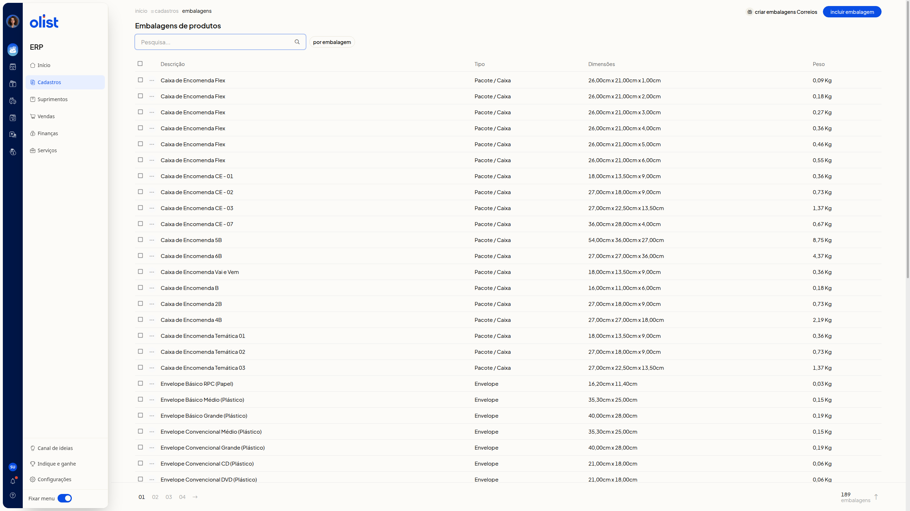
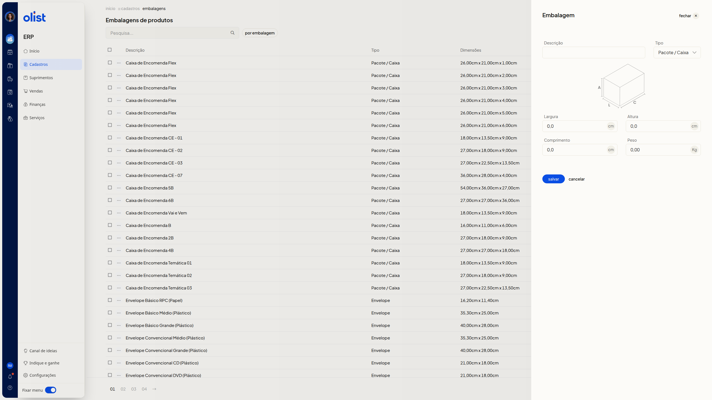
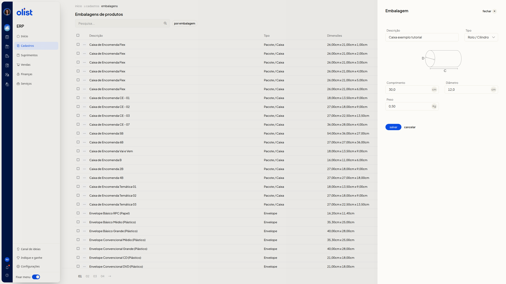

# Embalagens

## Descrição

A página **Embalagens de produtos** do ERP da Olist lista as embalagens já cadastradas e permite incluir uma nova. Em **Tipo**, você escolhe **Envelope**, **Pacote / Caixa** ou **Rolo / Cilindro**. As medidas exibidas mudam conforme a opção.

Acesse **Cadastros** no menu lateral do ERP. O caminho é **início > cadastros > embalagens**.

## Pré-requisitos

Você precisa de permissão para **Embalagens de produtos** para acessar a tela.

## Instruções

### Como consultar a lista de embalagens

1. Acesse **Cadastros** no menu lateral do ERP e abra a página **Embalagens de produtos**.
2. Consulte a lista nas colunas **Descrição**, **Tipo**, **Dimensões** e **Peso**. Busque no campo **Pesquisa...**, use o **filtro por embalagem** e percorra as páginas.

   

3. Confira as dimensões em cm e o peso em Kg. A lista de embalagens cadastradas fica visível, com busca, filtro e paginação.

### Como cadastrar uma embalagem

Nenhum campo é obrigatório.

1. Na página **Embalagens de produtos**, clique em **Incluir embalagem**.
2. Preencha **Descrição** com texto livre. Exemplo: Caixa exemplo tutorial.
3. Escolha **Envelope**, **Pacote / Caixa** ou **Rolo / Cilindro** em **Tipo**. Ao abrir, **Envelope** já vem selecionado.
 - **Envelope**: informe **Largura**, **Comprimento** e **Peso**.
 - **Pacote / Caixa**: informe **Largura**, **Altura**, **Comprimento** e **Peso**.
 - **Rolo / Cilindro**: informe **Comprimento**, **Diâmetro** e **Peso**. **Diâmetro** é a marca D e **Comprimento** é a marca C.
 Ao mudar de **Pacote / Caixa** para **Rolo / Cilindro**, **Descrição**, **Comprimento** e **Peso** já preenchidos permanecem.

   

4. Informe as medidas em cm e o **Peso** em Kg, com vírgula decimal. Em **Pacote / Caixa**, exemplos: largura 20,0, altura 15,0, comprimento 30,0 e peso 0,50. Em **Rolo / Cilindro**, exemplos: comprimento 30,0, diâmetro 12,0 e peso 0,50.

   

   

5. Clique em **salvar** para confirmar o cadastro.

## Links relacionados

Se precisar de ajuda, fale com o suporte.
