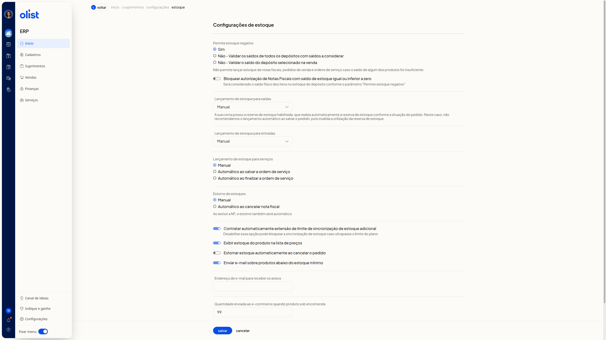
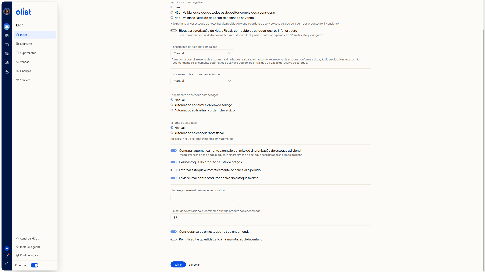

# Como configurar o estoque

No ERP da Olist, as configurações de estoque definem se o saldo pode ficar negativo, quando o lançamento acontece nas saídas, entradas e serviços, e como o estorno é feito. Na mesma tela você também define o aviso de estoque mínimo, a exibição do saldo na lista de preços e a quantidade enviada ao ecommerce para produtos sob encomenda.

## Passo a passo

1. Acesse Configurações de estoque pelo caminho Início, Suprimentos e Configurações. A tela mostra os títulos Estoque e Configurações de estoque.

2. Ajuste as opções da parte superior. Leia o texto de cada grupo antes de escolher.

   **Permite estoque negativo.** Selecione uma opção:
   - Sim
   - Não - Validar os saldos de todos os depósitos com saldos a considerar
   - Não - Validar o saldo do depósito selecionado na venda

   Se o estoque negativo não for permitido, o ERP não lança estoque de notas fiscais, pedidos de venda e ordens de serviço quando o saldo de algum produto é insuficiente. Em vendas e notas fiscais, o depósito considerado é o selecionado. Em ordens de serviço, é o depósito padrão.

   **Bloquear autorização de Notas Fiscais com saldo de estoque igual ou inferior a zero.** Ligue ou desligue. O saldo usado é o saldo físico dos itens no depósito, conforme Permite estoque negativo.

   **Lançamento de estoque para saídas.** Selecione uma opção:
   - Manual
   - Automático ao autorizar a nota fiscal
   - Automático ao salvar a nota fiscal
   - Automático ao salvar o pedido
   - Automático ao marcar pedido como enviado

   Se a reserva de estoque estiver habilitada, a tela informa que a reserva é feita automaticamente conforme a situação do pedido. Evite Automático ao salvar o pedido: essa opção invalida a reserva de estoque.

   **Lançamento de estoque para entradas.** Selecione uma opção:
   - Manual
   - Automático ao autorizar a nota fiscal
   - Automático ao salvar a nota fiscal
   - Automático ao salvar a ordem de compra
   - Automático ao finalizar conferência de compra

   **Lançamento de estoque para serviços.** Selecione uma opção:
   - Manual
   - Automático ao salvar a ordem de serviço
   - Automático ao finalizar a ordem de serviço

   **Estorno de estoques.** Selecione Manual ou Automático ao cancelar nota fiscal. Na opção automática, o estorno também acontece ao excluir a nota fiscal.

   

3. Role até o fim do formulário e ajuste as opções restantes.
   - **Contratar automaticamente extensão de limite de sincronização de estoque adicional.** Ligue ou desligue. Se desligar, a sincronização de estoque pode ser bloqueada quando o limite do plano for ultrapassado.
   - **Exibir estoque do produto na lista de preços.** Ligue ou desligue.
   - **Estornar estoque automaticamente ao cancelar o pedido.** Ligue ou desligue.
   - **Enviar e-mail sobre produtos abaixo do estoque mínimo.** Ligue ou desligue.
   - **Endereço de e-mail para receber os avisos.** Informe o email.
   - **Quantidade enviada ao e-commerce quando produto sob encomenda.** Informe a quantidade.
   - **Considerar saldo em estoque no sob encomenda.** Ligue ou desligue.
   - **Permitir editar quantidade lida na importação de inventário.** Ligue ou desligue.

   Clique em Salvar para guardar as configurações.

   

A tela reúne os parâmetros atuais e os textos que explicam várias opções. Depois de salvar, acompanhe o estoque em Suprimentos.

## Perguntas frequentes

### O que a tela explica quando o estoque negativo não é permitido?

O ERP não lança estoque de notas fiscais, pedidos de venda e ordens de serviço se o saldo de algum produto for insuficiente. Em vendas e notas fiscais, vale o depósito selecionado. Em ordens de serviço, vale o depósito padrão. Nas opções Não, você escolhe entre validar os saldos de todos os depósitos com saldos a considerar ou validar só o saldo do depósito selecionado na venda.

### Por que evitar o lançamento automático ao salvar o pedido?

Se a reserva de estoque estiver habilitada, a reserva é feita automaticamente conforme a situação do pedido. O lançamento automático ao salvar o pedido invalida essa reserva. Use outra opção de Lançamento de estoque para saídas.

### Qual saldo o bloqueio de autorização da nota fiscal considera?

O saldo físico dos itens no depósito, de acordo com o parâmetro Permite estoque negativo.

### O que pode acontecer se eu desligar a extensão automática do limite de sincronização?

A sincronização de estoque pode ser bloqueada se o limite do plano for ultrapassado.

### O estorno automático também vale ao excluir a nota fiscal?

Sim. Em Automático ao cancelar nota fiscal, o estorno também é automático ao excluir a nota fiscal.

---

### Observações internas (não publicar)

- Não foi observado o que acontece ao clicar em Salvar ou em Cancelar. Nenhum dos dois foi acionado.
- Não foi testado se o email ou a quantidade ficam obrigatórios em algum estado dos interruptores. Com o aviso de estoque mínimo ligado e o email vazio, nenhum campo tinha marcação de obrigatório.
- O efeito de cada opção no estoque em uso não foi verificado. Só rótulos e textos desta tela foram vistos.
- O caminho de cliques a partir do menu inicial não foi percorrido. A tela já estava aberta. Confirmar o menu antes de publicar. Só o breadcrumb (Início, Suprimentos, Configurações) e os títulos Estoque e Configurações de estoque foram vistos.
- O texto longo sobre estoque negativo (depósito selecionado e depósito padrão) estava no conteúdo da página. No screenshot, só a frase curta foi confirmada como visível.
- Textos de ajuda que aparecem só depois de trocar uma opção de lista ou rádio não foram vistos, porque nenhuma opção foi alterada.
- Os valores vistos (Sim, Manual, quantidade 99, interruptores ligados ou desligados, email vazio) são o estado da conta observada, não um padrão confirmado.
- O aviso de reserva de estoque foi visto numa conta com reserva habilitada. Não está confirmado se ele aparece para todas as contas.

---

## Branding Checklist (para revisão)

✓ Título descreve uma tarefa
✓ Sem 'seller' ou 'usuário'
✓ Sentence case no título
✓ Closure dialógico (próximo passo/artigo relacionado)
✓ Sem hífen em ebook
✓ Passos com verbos no imperativo
✓ Sem promessas sensacionalistas
✓ Nomes de produto corretos
✓ Sem 'você' genérico
✗ Sem hífen em ecommerce
✗ Sem hífen em email

**Score:** 9/11
