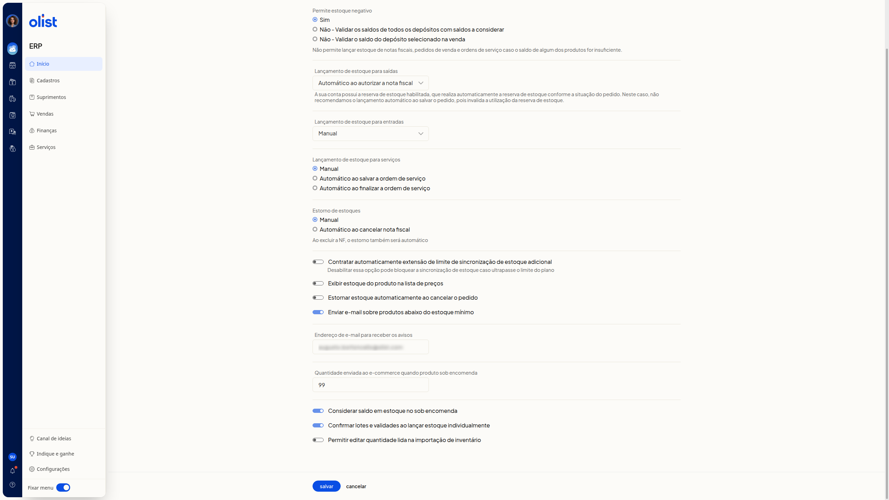

# Como configurar o estoque

## Descrição

No ERP da Olist, a tela **Configurações de estoque** reúne os parâmetros de estoque negativo, lançamento de saídas, entradas e serviços, estorno, sincronização, avisos, sob encomenda, lotes e importação de inventário. Você ajusta esses parâmetros para definir como o estoque se comporta em cada um desses pontos.

Acesse **Início > Suprimentos > Configurações > Estoque**.

## Pré-requisitos

- Você precisa estar autenticado no ERP e conseguir abrir **Configurações de estoque**.
- Se a reserva de estoque estiver habilitada, o lançamento automático ao salvar o pedido não é recomendado, porque invalida o uso da reserva.

## Instruções

### Como acessar

1. Acesse **Início > Suprimentos > Configurações > Estoque**. A tela **Configurações de estoque** abre com as opções atuais.

   

2. Ajuste as opções abaixo.
3. Clique em **Salvar**, no fim da tela, para gravar a configuração.

### O que cada opção faz

Nenhuma opção é obrigatória.

#### Estoque negativo

Em **Permite estoque negativo**, selecione uma das opções:

- **Sim**
- **Não - Validar os saldos de todos os depósitos com saldos a considerar**
- **Não - Validar o saldo do depósito selecionado na venda**

Quando o estoque negativo não é permitido, não é possível lançar estoque de notas fiscais, pedidos de venda e ordens de serviço se o saldo de algum produto for insuficiente.

#### Lançamento de estoque

Em **Lançamento de estoque para saídas**, selecione uma das opções:

- **Manual**
- **Automático ao autorizar a nota fiscal**
- **Automático ao salvar a nota fiscal**
- **Automático ao salvar o pedido**
- **Automático ao marcar pedido como enviado**

Se a reserva de estoque estiver habilitada, a reserva ocorre conforme a situação do pedido. **Automático ao salvar o pedido** não é recomendado, porque invalida o uso da reserva.

Em **Lançamento de estoque para entradas**, selecione uma das opções:

- **Manual**
- **Automático ao autorizar a nota fiscal**
- **Automático ao salvar a nota fiscal**
- **Automático ao salvar a ordem de compra**
- **Automático ao finalizar conferência de compra**

Em **Lançamento de estoque para serviços**, selecione uma das opções:

- **Manual**
- **Automático ao salvar a ordem de serviço**
- **Automático ao finalizar a ordem de serviço**

#### Estorno

Em **Estorno de estoques**, selecione **Manual** ou **Automático ao cancelar nota fiscal**. A tela informa que, ao excluir a nota fiscal, o estorno também será automático.

**Estornar estoque automaticamente ao cancelar o pedido**

#### Sincronização

Desabilitar **Contratar automaticamente extensão de limite de sincronização de estoque adicional** pode bloquear a sincronização de estoque caso ultrapasse o limite do plano.

#### Lista de preços

**Exibir estoque do produto na lista de preços**

#### Aviso de estoque mínimo

**Enviar e-mail sobre produtos abaixo do estoque mínimo** envia email sobre produtos abaixo do estoque mínimo. Em **Endereço de e-mail para receber os avisos**, informe o endereço de email.

#### Sob encomenda

Em **Quantidade enviada ao e-commerce quando produto sob encomenda**, informe a quantidade numérica.

**Considerar saldo em estoque no sob encomenda**

#### Lotes e importação de inventário

- **Confirmar lotes e validades ao lançar estoque individualmente**
- **Permitir editar quantidade lida na importação de inventário**

Ao terminar, clique em **Salvar**.

## Links relacionados

Se precisar de ajuda com estas configurações, fale com o suporte.
