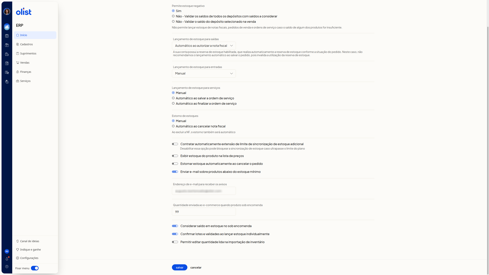

# Como configurar o estoque

## Descrição

No ERP da Olist, a tela **Configurações de estoque** reúne como o estoque é lançado, estornado, validado e avisado. Você define estoque negativo, lançamentos, estorno, sincronização, lista de preços, aviso por email, sob encomenda, lotes e validades e importação de inventário.

O caminho é **Início > Suprimentos > Configurações > Estoque**.

## Pré-requisitos

Você precisa estar autenticado no ERP.

## Instruções

Nenhuma opção é obrigatória.

### Como acessar

1. Acesse **Início > Suprimentos > Configurações > Estoque**.

   

2. Localize **Salvar** e **Cancelar** no final da tela. **Salvar** grava a configuração. Não clique em **Salvar** apenas para consultar.

### O que cada opção faz

#### Estoque negativo

**Permite estoque negativo** define se o estoque negativo é permitido. Escolha uma opção:

- **Sim**
- **Não - Validar os saldos de todos os depósitos com saldos a considerar**
- **Não - Validar o saldo do depósito selecionado na venda**

O grupo informa que não é permitido lançar estoque de notas fiscais, pedidos de venda e ordens de serviço se o saldo de algum produto for insuficiente.

#### Lançamento de saídas

**Lançamento de estoque para saídas** define quando o estoque de saídas é lançado. Escolha uma opção:

- **Manual**
- **Automático ao autorizar a nota fiscal**
- **Automático ao salvar a nota fiscal**
- **Automático ao salvar o pedido**
- **Automático ao marcar pedido como enviado**

Com a reserva de estoque habilitada, que reserva o estoque conforme a situação do pedido, não se recomenda **Automático ao salvar o pedido**. Essa escolha invalida a utilização da reserva de estoque.

#### Lançamento de entradas

**Lançamento de estoque para entradas** define quando o estoque de entradas é lançado. Escolha uma opção:

- **Manual**
- **Automático ao autorizar a nota fiscal**
- **Automático ao salvar a nota fiscal**
- **Automático ao salvar a ordem de compra**
- **Automático ao finalizar conferência de compra**

#### Lançamento de serviços

**Lançamento de estoque para serviços** define o lançamento de estoque para serviços. Escolha uma opção:

- **Manual**
- **Automático ao salvar a ordem de serviço**
- **Automático ao finalizar a ordem de serviço**

#### Estorno

**Estorno de estoques** define o estorno de estoques. Escolha **Manual** ou **Automático ao cancelar nota fiscal**.

Em **Automático ao cancelar nota fiscal**, a tela informa que, ao excluir a nota fiscal, o estorno também será automático.

Ligue ou desligue **Estornar estoque automaticamente ao cancelar o pedido**.

#### Sincronização de estoque

Ligue ou desligue **Contratar automaticamente extensão de limite de sincronização de estoque adicional**.

Desabilitar essa opção pode bloquear a sincronização de estoque caso ultrapasse o limite do plano.

#### Lista de preços

Ligue ou desligue **Exibir estoque do produto na lista de preços**.

#### Aviso de estoque mínimo

Ligue ou desligue **Enviar e-mail sobre produtos abaixo do estoque mínimo**.

Com o aviso em uso, preencha **Endereço de e-mail para receber os avisos** com um endereço de email.

#### Sob encomenda

Informe a quantidade numérica em **Quantidade enviada ao e-commerce quando produto sob encomenda**.

Ligue ou desligue **Considerar saldo em estoque no sob encomenda**.

#### Lotes e validades

Ligue ou desligue **Confirmar lotes e validades ao lançar estoque individualmente**.

#### Importação de inventário

Ligue ou desligue **Permitir editar quantidade lida na importação de inventário**.

Ao concluir os ajustes, clique em **Salvar** para gravar a configuração.

## Links relacionados

Se precisar de ajuda com estas configurações, fale com o suporte.
