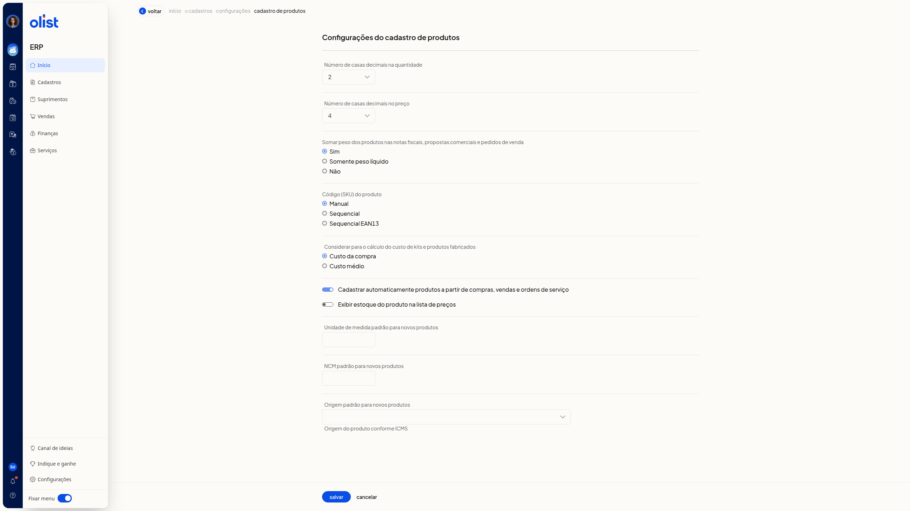

# Configurações do cadastro de produtos

No ERP da Olist, a tela **Configurações do cadastro de produtos** reúne os parâmetros do cadastro de produtos. Você define casas decimais, a soma de peso em notas fiscais, propostas comerciais e pedidos de venda, o código (SKU), o custo de kits e produtos fabricados, o cadastro automático, a exibição de estoque na lista de preços e os padrões de unidade, NCM e origem para novos produtos.

## Importante

O campo **Considerar para o cálculo do custo de kits e produtos fabricados** só aparece se você possui os módulos de preço de custo de produtos e de DRE.

## Como acessar

Acesse **início > cadastros > configurações > cadastro de produtos**.

## Pré-requisitos

- Autenticação no ERP: você precisa estar autenticado para abrir a tela de configurações do cadastro de produtos.
- Permissão para configurar cadastros de produtos: só com essa permissão você acessa estas configurações.

## Configurações do cadastro de produtos

Nenhum parâmetro é obrigatório.

**Número de casas decimais na quantidade**: selecione **0**, **1**, **2**, **3** ou **4**.

**Número de casas decimais no preço**: selecione de **0** a **10**.

**Somar peso dos produtos nas notas fiscais, propostas comerciais e pedidos de venda**: selecione **Sim**, **Somente peso líquido** ou **Não**.

**Código (SKU) do produto**: selecione **Manual**, **Sequencial** ou **Sequencial EAN13**.

**Considerar para o cálculo do custo de kits e produtos fabricados**: selecione **Custo da compra** ou **Custo médio**.

Estas duas opções ficam na mesma seção.

**Cadastrar automaticamente produtos a partir de compras, vendas e ordens de serviço**: ligue ou desligue.

**Exibir estoque do produto na lista de preços**: ligue ou desligue.

**Unidade de medida padrão para novos produtos**: informe a unidade de medida.

**NCM padrão para novos produtos**: informe o NCM.

**Origem padrão para novos produtos**: selecione uma origem. O texto de ajuda é **Origem do produto conforme ICMS**.

- **0 - Nacional, exceto as indicadas nos códigos 3 a 5**
- **1 - Estrangeira - Importação direta, exceto a indicada no código 6**
- **2 - Estrangeira - Adquirida no mercado interno, exceto a indicada no código 7**
- **3 - Nacional, mercadoria ou bem com Conteúdo de Importação superior a 40% e inferior ou igual a 70**
- **4 - Nacional, cuja produção tenha sido feita em conformidade com os processos produtivos básicos de que tratam as legislações citadas nos Ajustes**
- **5 - Nacional, mercadoria ou bem com Conteúdo de Importação inferior ou igual a 40**
- **6 - Estrangeira - Importação direta, sem similar nacional, constante em lista da CAMEX**
- **7 - Estrangeira - Adquirida no mercado interno, sem similar nacional, constante em lista da CAMEX**
- **8 - Nacional, mercadoria ou bem com Conteúdo de Importação superior a 70**

No rodapé, acione **salvar** ou **cancelar**.

## Links relacionados

Se precisar de ajuda com estas configurações, fale com o suporte.
