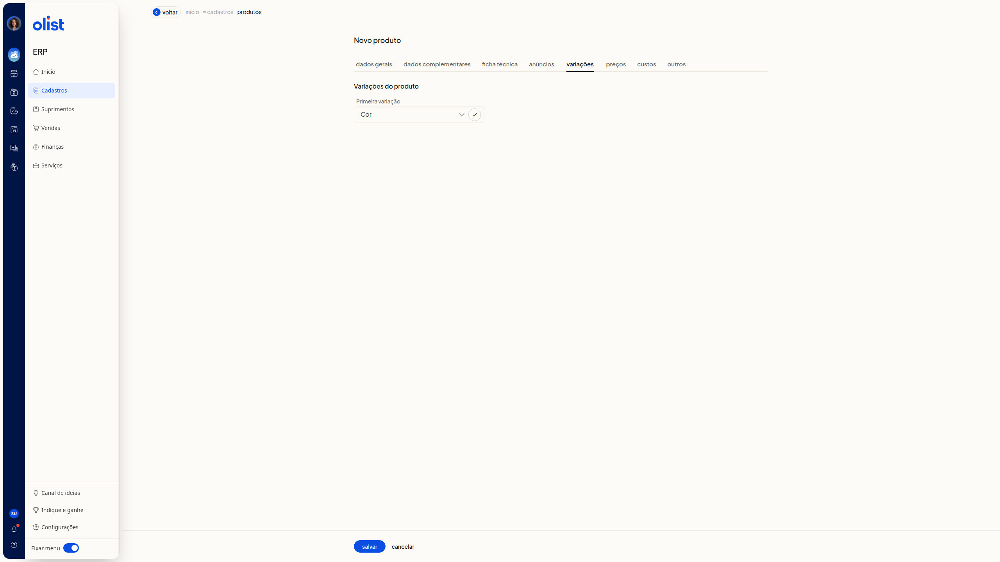

# Visão geral: Conheça os campos da tela de produtos

A ficha **Novo produto** reúne os campos do cadastro de produto no ERP da Olist. Você consulta e preenche os dados nas abas **Dados Gerais**, **Dados Complementares**, **Ficha técnica**, **Anúncios**, **Preços**, **Custos** e **Outros**, quando elas estão disponíveis para a sua empresa.

O **Tipo do Produto** tem as opções **Simples**, **Kit**, **Com variações**, **Fabricado** e **Matéria-prima**. Com **Kit**, a ficha mostra a aba **Kits**. Com **Com variações**, mostra a aba **Variações**.

## Importante

Só quem tem permissão de produtos acessa o cadastro de novo produto. As abas **Kits** e **Variações** não aparecem juntas: a aba exibida depende do **Tipo do Produto**. Tipos e abas também variam conforme o módulo da empresa e a permissão de acesso.

Confira os pré-requisitos antes de procurar uma aba que não está na ficha.

## Como acessar

No ERP, acesse **Cadastros > Produtos** e clique em **Incluir produto**.

## Pré-requisitos

- Acesso à lista de produtos pelo menu **Cadastros**, no ERP.
- Permissão de produtos: só quem tem essa permissão acessa o cadastro de novo produto.
- Módulo de variações: o tipo **Com variações** só fica disponível se a empresa tiver esse módulo.
- Módulo de produção ou de ordem de produção: o tipo **Fabricado** só fica disponível se a empresa tiver um desses módulos.
- Integração de ecommerce ou os módulos de API ou de lista de atualizações: a aba **Anúncios** só aparece se a empresa tiver uma dessas condições.
- Módulo de lista de preços: a aba **Preços** só aparece se a empresa tiver esse módulo.
- Módulo DRE: a aba **Custos** só aparece se a empresa tiver esse módulo.
- Permissão de preço de custo: só quem tem essa permissão acessa a aba **Custos**.
- Aba **Kits**: o **Tipo do Produto** precisa estar em **Kit**.
- Aba **Variações**: o **Tipo do Produto** precisa estar em **Com variações**.

Com os requisitos atendidos, localize cada campo nos grupos abaixo.

## Grupos de configuração

### Dados Gerais

Estes campos não são obrigatórios.

- **Tipo do Produto**: opções **Simples**, **Kit**, **Com variações**, **Fabricado** e **Matéria-prima**.
- **Código (SKU)**: apresentado como opcional.
- **Código de barras (GTIN)**.

**Salvar** e **Cancelar** ficam no rodapé da ficha.

### Dados Complementares

Estes campos não são obrigatórios.

- **Slug**
- **Keywords**
- **Título para SEO**
- **Descrição para SEO**

### Ficha técnica

A aba **Ficha técnica** faz parte da ficha **Novo produto**.

### Anúncios

A aba **Anúncios** só aparece se a empresa tiver integração de ecommerce ou os módulos de API ou de lista de atualizações.

### Preços

A aba **Preços** só aparece se a empresa tiver o módulo de lista de preços.

### Custos

A aba **Custos** só aparece se a empresa tiver o módulo DRE. Só quem tem permissão de preço de custo acessa essa aba.

### Outros

O campo **GTIN/EAN tributável** não é obrigatório.

### Kits

A aba **Kits** aparece quando você seleciona **Kit** em **Tipo do Produto**. A tabela de composição tem estas colunas:

- **Produto / Código (SKU)**
- **Quantidade / Unidade**
- **Preço Un. / Custo**
- **Preço Promocional**
- **Preço Total**
- **Ações**

As ações da aba são:

- **adicionar produto no kit**
- **atualizar preço do produto**
- **atualizar peso do produto**
- **alterar regras**

### Variações

A aba **Variações** aparece quando você seleciona **Com variações** em **Tipo do Produto**. Essa seleção remove a aba **Kits** e exibe a aba **Variações**.

No bloco **Variações do produto**, o campo **Primeira variação** não é obrigatório. A lista mostra tipos de variação já cadastrados, como **Cor**, **Tamanho**, **Gênero**, **Voltagem** e **Sabor**.

Se uma aba não aparecer na ficha, veja as perguntas frequentes.

## Perguntas frequentes

### O campo Código (SKU) é obrigatório?

Não. Em **Dados Gerais**, **Código (SKU)** é apresentado como opcional.

### Onde informo o código de barras?

Em **Dados Gerais**, no campo **Código de barras (GTIN)**. Em **Outros**, no campo **GTIN/EAN tributável**. Nenhum dos dois é obrigatório.

### A aba Kits não está na ficha. O que fazer?

Selecione **Kit** em **Tipo do Produto**. A aba **Kits** só aparece com esse tipo e não aparece junto com **Variações**.

### A aba Variações não está na ficha. O que fazer?

Selecione **Com variações** em **Tipo do Produto**. Esse tipo só fica disponível se a empresa tiver o módulo de variações.

### A aba Anúncios, Preços ou Custos não aparece. O que fazer?

Confira o pré-requisito de cada aba. **Anúncios** depende de integração de ecommerce ou dos módulos de API ou de lista de atualizações. **Preços** depende do módulo de lista de preços. **Custos** depende do módulo DRE e da permissão de preço de custo.

## Links relacionados

Se precisar de ajuda para localizar um campo da ficha de produtos, fale com o suporte.
