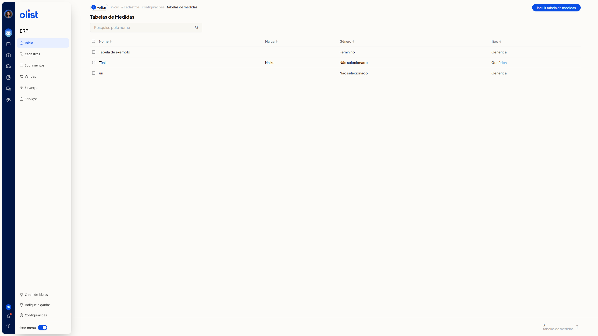
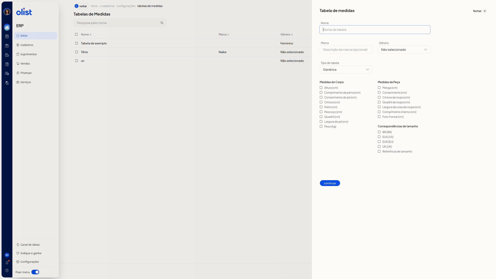
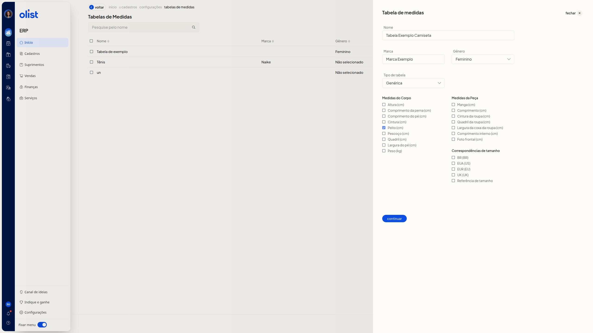
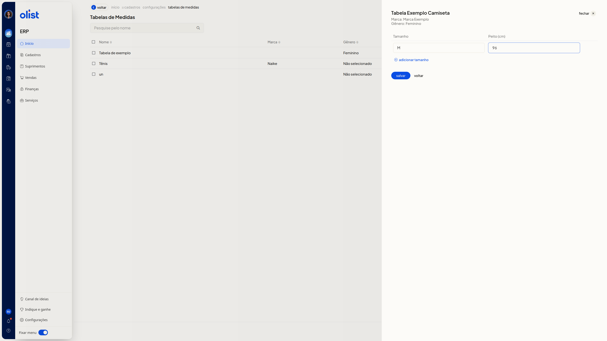

# Tabelas de medidas - Vestuário: Roupas e calçados

## Descrição

A página **Tabelas de Medidas** do ERP da Olist lista tabelas de vestuário e calçados. Você consulta as tabelas cadastradas e inclui uma nova tabela: primeiro nome, marca, gênero, tipo e medidas, depois tamanhos e valores. A gravação fica no botão **Salvar**.

Para abrir a página, acesse **início > cadastros > configurações > tabelas de medidas**.

## Pré-requisitos

Antes de começar, você precisa:

- estar autenticado no ERP e conseguir abrir a página **Tabelas de Medidas** por **início > cadastros > configurações > tabelas de medidas**
- ter a permissão de variações
- ter a permissão para configurar tabelas de medidas

## Instruções

### Como abrir a página Tabelas de Medidas

1. No ERP, acesse **início > cadastros > configurações > tabelas de medidas**. A página **Tabelas de Medidas** mostra **Pesquise pelo nome**, a listagem com as colunas **Nome**, **Marca** e **Gênero** e o botão **Incluir Tabela de Medidas**.

   

### Como criar uma tabela de medidas

1. Na página **Tabelas de Medidas**, clique em **Incluir Tabela de Medidas**.

   

2. Preencha **Nome**. Preencha **Marca**, se quiser. Selecione **Gênero**. Selecione **Tipo de tabela**. Nenhum desses campos é obrigatório. **Marca** é opcional.
 - Em **Gênero**, selecione **Não selecionado**, **Masculino**, **Feminino**, **Meninos** ou **Meninas**.
 - Em **Tipo de tabela**, selecione **Genérica**, **Moda - Medidas da peça**, **Moda - Medidas do corpo** ou **Moda - Medidas combinadas**.

3. Marque as medidas que a tabela deve usar. As caixas ficam nos grupos **Medidas do Corpo**, **Medidas da Peça** e **Correspondências de tamanho**.
 - **Altura (cm)**
 - **Comprimento da perna (cm)**
 - **Comprimento do pé (cm)**
 - **Cintura (cm)**
 - **Peito (cm)**
 - **Pescoço (cm)**
 - **Quadril (cm)**
 - **Largura do pé (cm)**
 - **Peso (kg)**
 - **Manga (cm)**
 - **Comprimento (cm)**
 - **Cintura da roupa (cm)**
 - **Quadril da roupa (cm)**
 - **Largura da coxa da roupa (cm)**
 - **Comprimento interno (cm)**
 - **Foto frontal (cm)**
 - Em **Correspondências de tamanho**, marque **BR (BR)**, **EUA (US)**, **EUR (EU)**, **UK (UK)** ou **Referência de tamanho**.

   

4. Clique em **Continuar**.

5. Confira o nome, a marca e o gênero. Informe **Tamanho** e o valor de cada coluna de medida exibida. Informe ao menos uma linha de tamanho e o valor da medida marcada. O painel mostra a tabela em preenchimento, com a linha de tamanho e a medida marcada pronta para confirmação. Na tela também estão **Adicionar tamanho**, **Voltar** e **fechar**. Clique em **Salvar** para gravar. Se não quiser gravar, pare antes de **Salvar**.

   

## Links relacionados

Se precisar de ajuda com tabelas de medidas, fale com o suporte.
