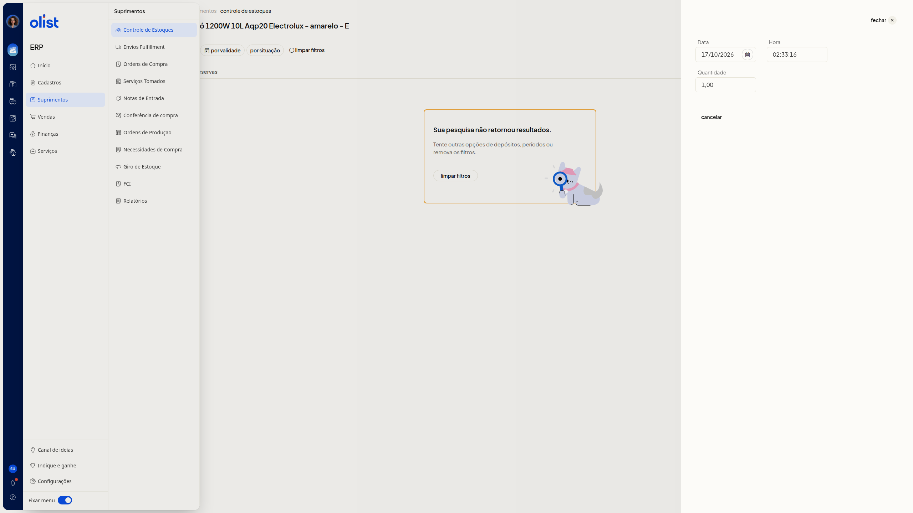

# Controle de lotes e validades de produtos

## Descrição

No ERP da Olist, você consulta o lote e a validade do produto na aba **Lotes e validades**, no detalhe de estoque. Acesse **Início > Suprimentos > Controle de Estoques** e abra o produto.

O lote e a validade não são informados no painel **Lançamento de estoque**, aberto por **Incluir lançamento**. Nesse painel, os campos são **Tipo**, **Data**, **Hora**, **Quantidade**, **Preço unitário** e **Observações**. Não há item de lotes no menu **Suprimentos** nem colunas de lote ou de validade na lista.

## Pré-requisitos

- Permissão de estoque para acessar o **Controle de Estoques**.
- A aba **Lotes e validades** é desbloqueada com upgrade do plano quando o recurso não está ativo na empresa.
- A aba **Lotes e validades** é liberada ao contratar a extensão quando o recurso não está ativo na empresa.

## Instruções

1. Acesse **Início > Suprimentos > Controle de Estoques**.
2. Abra o detalhe de estoque do produto.
3. Acesse a aba **Lotes e validades**.
4. Filtre **por validade** ou **por situação**. Os dois filtros não são obrigatórios. **por validade** filtra um período da **Data de validade** e tem a opção **sem filtro**. **por situação** oferece **Sem filtro**, **Disponível**, **Reservado** e **Lançado**. Para remover os filtros, acione **limpar filtros**. Se a pesquisa não retornar resultados, a tela exibe **Sua pesquisa não retornou resultados** e sugere outras opções de depósitos, de períodos ou remover os filtros.

   

## Perguntas frequentes

### Como liberar a aba Lotes e validades?

A aba **Lotes e validades** é desbloqueada com upgrade do plano quando o recurso não está ativo na empresa. Ela é liberada ao contratar a extensão quando o recurso não está ativo na empresa.

### O que fazer se a pesquisa não retornar resultados?

A tela exibe **Sua pesquisa não retornou resultados** e sugere outras opções de depósitos, de períodos ou remover os filtros.

## Links relacionados

Se a aba não aparecer depois de conferir o plano e a extensão, fale com o suporte.
