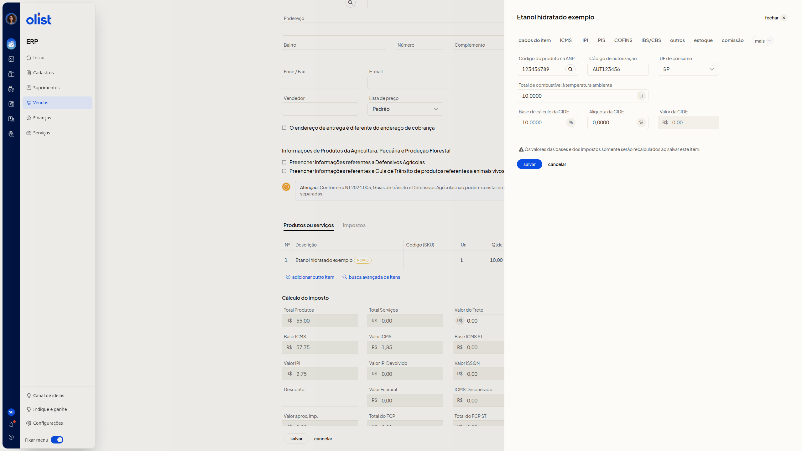

# Como configurar produtos da tabela ANP (Combustíveis) na Nota Fiscal

## Descrição

Na nota fiscal nova, ainda não emitida, a aba **Combustível** permite informar o código do produto na ANP e os demais dados de combustível e CIDE do item.

Essa aba fica no editor do item, não no formulário principal da nota. O caminho começa em **Vendas > Notas Fiscais > Incluir nota fiscal**. Inclua um item e abra **Combustível**. Se a aba não aparecer na barra de abas, clique em **mais** e depois em **Combustível**.

## Pré-requisitos

- Você precisa da permissão de Notas Fiscais para acessar a tela de notas fiscais.
- Você precisa da permissão para editar notas fiscais para editar a nota.
- Uma nota fiscal nova, aberta em **Vendas > Notas Fiscais > Incluir nota fiscal**, ainda não emitida.
- Ao menos um item incluído em **Produtos ou serviços**.

## Importante

Os valores das bases e dos impostos somente serão recalculados ao salvar o item.

## Instruções

1. Acesse **Vendas > Notas Fiscais**.
2. Clique em **Incluir nota fiscal**.
3. Na seção **Produtos ou serviços**, inclua um item.
4. Abra a edição desse item.
5. Na barra de abas, clique em **mais** e depois em **Combustível**.
6. Preencha os campos da aba. Nenhum campo é obrigatório.
 - **Código do produto na ANP**: informe o código. Há um botão de busca ao lado do campo.
 - **Código de autorização**: informe o código.
 - **UF de consumo**: selecione a UF. A lista inclui as UFs e EX.
 - **Total de combustível à temperatura ambiente**: informe um número com vírgula decimal. A unidade Lt aparece ao lado do campo.
 - **Base de cálculo da CIDE**: informe um número com vírgula decimal. % aparece ao lado do campo.
 - **Alíquota da CIDE**: informe um número com vírgula decimal. % aparece ao lado do campo.
 - **Valor da CIDE**: informe o valor em reais. R$ aparece ao lado do campo.

   

7. Clique em **Salvar**. Os valores das bases e dos impostos somente serão recalculados ao salvar este item.

## Perguntas frequentes

### Onde fica a aba Combustível?

No editor do item, não no formulário principal da nota. Se ela não aparecer na barra de abas, clique em **mais** e depois em **Combustível**.

### Os campos da aba Combustível são obrigatórios?

Não. Nenhum campo da aba é obrigatório.

## Links relacionados

Se precisar de ajuda para configurar a aba **Combustível**, fale com o suporte.
