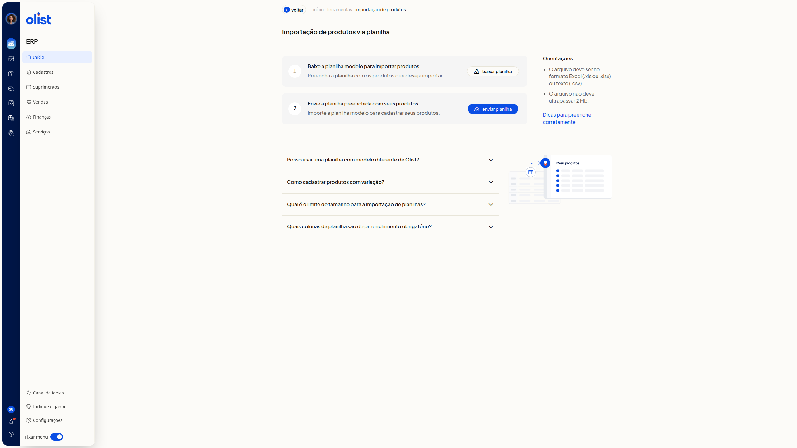

# Validações na importação de produtos

## Descrição

Na página **Importação de produtos via planilha**, do ERP da Olist, a tela reúne as regras do arquivo: formato, tamanho, layout padrão, variações e colunas obrigatórias. Seguir essas regras deixa a planilha no padrão exigido para a importação.

Acesse **início > ferramentas > importação de produtos**.

## Pré-requisitos

Você precisa destas permissões:

- permissão de produtos
- permissão de importação de registros
- permissão para incluir e editar produtos

A planilha precisa conter ao menos uma linha de dados para a importação ser concluída.

## Instruções

1. Leia o bloco **Orientações**. O arquivo deve ser Excel (.xls ou.xlsx) ou texto (.csv) e não deve ultrapassar 2 Mb.

   

2. Expanda **Posso usar uma planilha com modelo diferente de Olist?**. Baixe a planilha com o layout padrão em **baixar planilha**. Um modelo diferente não serve. Os formatos desse download são **Excel (.xls)** e **Texto (.csv)**.

3. Expanda **Como cadastrar produtos com variação?**. No pai, preencha os dados e informe V em **Tipo de Produto**. No filho, informe S em **Tipo de Produto**, o código do pai em **Código do Pai** e as características em **Variações**, no modelo Tamanho:GG||Cor:Branco.

4. Expanda **Qual é o limite de tamanho para a importação de planilhas?**. O arquivo deve ter até 500 registros e não deve ultrapassar 2 Mb.

5. Expanda **Quais colunas da planilha são de preenchimento obrigatório?**. Preencha **Descrição**, **Sob Encomenda** e **Situação**.

6. Clique em **Dicas para preencher corretamente**. O artigo **Importar planilha de produtos** abre em outra aba, com as seções **Baixar planilha modelo**, **Instruções de preenchimento**, **Recomendações de importação** e **Realizar o upload e finalizar a importação**. Ele indica estas regras:
 - não altere o nome das colunas nem a ordem do cabeçalho
 - não exclua colunas; deixe a célula em branco
 - use termos padronizados
 - **Situação** deve ser Ativo ou Inativo
 - **Sob Encomenda** deve ser Sim ou Não
 - para NF-e, informe **Unidade**, **NCM** de 8 dígitos e **Origem** com o número ou a descrição oficial (códigos 0 a 8)
 - deixe **ID** em branco para produto novo e informe o ID já existente para atualizar
 - use até 10 URLs diretas, com extensão.jpg,.png,.webp ou.jpeg; links de nuvem não são aceitos
 - as colunas **Imagem 1** a **Imagem 6** armazenam a foto; **Imagem Externa 7** a **Imagem Externa 10** apenas guardam o link

 Na conferência depois do envio, itens com ícone vermelho bloqueiam a importação. Corrija a planilha e envie de novo. Só arquivos 100% corretos são processados.

## Links relacionados

Para preencher a planilha e finalizar a importação, consulte o artigo **Importar planilha de produtos**.
