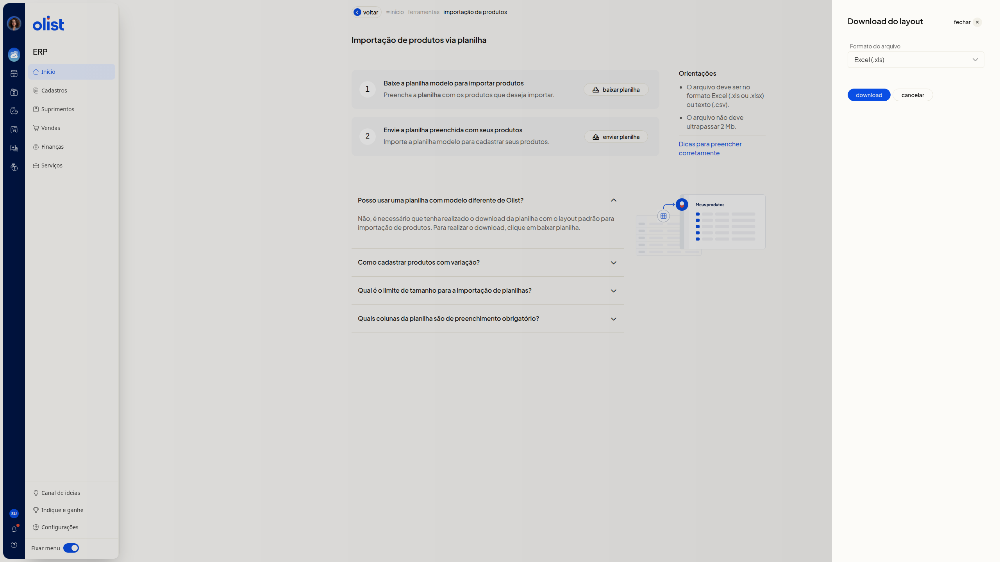

# Importar planilha de produtos

## Descrição

A importação de produtos via planilha cadastra produtos no ERP da Olist a partir do layout padrão. Na página **Importação de produtos via planilha**, você baixa a planilha, preenche os produtos e envia o arquivo.

Acesse **início > ferramentas > importação de produtos**.

## Pré-requisitos

- Você precisa da permissão de produtos para acessar a importação de produtos via planilha.
- Se você não é de suporte, também precisa da permissão de importação de registros e da permissão para incluir e editar produtos.
- Use a planilha de layout padrão baixada em **baixar planilha**. Um modelo diferente não serve.
- O arquivo deve ser Excel (.xls ou.xlsx) ou texto (.csv), ter até 500 registros, conter ao menos uma linha de dados e não ultrapassar 2 Mb.
- Preencha as colunas **Descrição**, **Sob Encomenda** e **Situação**.

Com isso, baixe a planilha modelo e preencha os produtos.

## Instruções

**Importante:** não altere o nome das colunas nem a ordem do cabeçalho. Não exclua colunas: deixe a célula em branco. Use termos padronizados.

### Conferir as orientações

1. Leia o bloco **Orientações**. O arquivo deve ser Excel (.xls ou.xlsx) ou texto (.csv) e não deve ultrapassar 2 Mb.

   

### Baixar a planilha modelo

1. No passo **Baixe a planilha modelo para importar produtos**, clique em **baixar planilha**.
2. No painel **Download do layout**, no campo **Formato do arquivo**, escolha **Excel (.xls)** ou **Texto (.csv)**. O campo não é obrigatório e **Excel (.xls)** já vem selecionado.

   

3. Clique em **download** para obter o arquivo. Para fechar o painel sem baixar, clique em **cancelar** ou em **fechar**, no cabeçalho.

### Preencher a planilha

Preencha a planilha com os produtos que deseja importar.

- Em **Situação**, informe Ativo ou Inativo.
- Em **Sob Encomenda**, informe Sim ou Não.
- Deixe **ID** em branco para produto novo. Para atualizar um produto, informe o ID já existente.
- Para NF-e, preencha **Unidade**, **NCM** com 8 dígitos e **Origem** com o número ou a descrição oficial (códigos 0 a 8).
- Em imagens, informe até 10 URLs diretas, com extensão.jpg,.png,.webp ou.jpeg. Links de nuvem não são aceitos.
- As colunas de **Imagem 1 a 6** armazenam a foto. **Imagem Externa 7 a 10** apenas guardam o link.
- Para produto com variação, siga a pergunta frequente **Como cadastrar produtos com variação**.

### Enviar a planilha preenchida

1. No passo **Envie a planilha preenchida com seus produtos**, clique em **enviar planilha** e escolha o arquivo no computador. Se houver itens que bloqueiam a importação, corrija a planilha e envie de novo. Só arquivos 100% corretos são processados.

## Perguntas frequentes

### Posso usar uma planilha com modelo diferente de Olist?

Use a planilha com o layout padrão, baixada em **baixar planilha**. Um modelo diferente não serve.

### Como cadastrar produtos com variação?

No pai, preencha os dados e informe V em **Tipo de Produto**. No filho, informe S em **Tipo de Produto**, o código do pai em **Código do Pai** e as características em **Variações**, no modelo Tamanho:GG||Cor:Branco.

### Qual é o limite de tamanho para a importação de planilhas?

O arquivo deve ter até 500 registros e não deve ultrapassar 2 Mb.

### Quais colunas da planilha são de preenchimento obrigatório?

**Descrição**, **Sob Encomenda** e **Situação**.

## Links relacionados

Se precisar de ajuda para concluir a importação, fale com o suporte.
