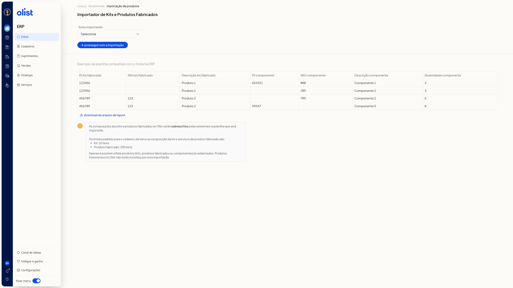
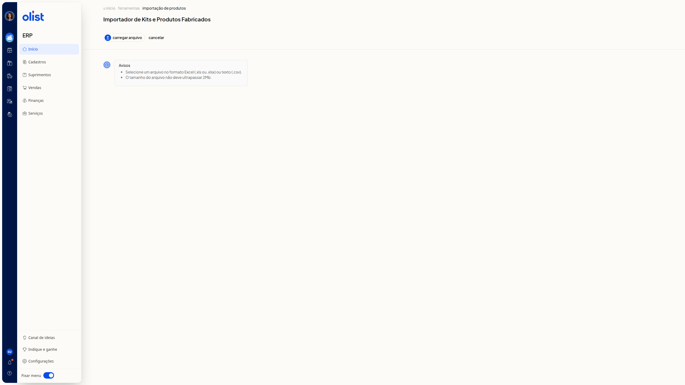

# Importar planilha de composições de kits e estrutura dos produtos fabricados

## Descrição

A página **Importador de Kits e Produtos Fabricados** do ERP da Olist permite escolher se a importação é de kits ou de produtos fabricados, consultar um exemplo de planilha compatível, baixar o arquivo de layout e avançar para a etapa de carregar o arquivo.

A planilha modelo e as regras exibidas são as mesmas para as duas opções. Acesse **início > ferramentas > importação de produtos**.

## Importante

Leia estes avisos antes de carregar a planilha.

- As composições dos kits e produtos fabricados no Olist serão sobrescritas pelas existentes na planilha que será importada.
- Os limites padrões para o cadastro de itens na composição de kit e estrutura de produto fabricado são 20 itens para kit e 200 itens para produto fabricado.

Confira os pré-requisitos a seguir.

## Pré-requisitos

- Você precisa ter permissão de importação de registros e permissão para incluir e editar produtos. O suporte também acessa o **Importador de Kits e Produtos Fabricados**.
- Os kits, produtos fabricados e componentes usados na planilha precisam já estar cadastrados. Produtos inexistentes no Olist não serão incluídos por esta importação.
- A planilha deve seguir o exemplo exibido na página.
- Na etapa de carregamento, o arquivo deve ser Excel (.xls ou.xlsx) ou texto (.csv), com tamanho de até 2Mb.

Em seguida, consulte a planilha modelo e avance para carregar o arquivo.

## Instruções

### Consultar a planilha modelo e as regras

1. Acesse **início > ferramentas > importação de produtos**.
2. Escolha **Kits** ou **Produtos Fabricados** no campo **Estou importando:**. As opções são **Selecione**, **Kits** e **Produtos Fabricados**. O campo não é obrigatório. O exemplo de planilha e as regras permanecem os mesmos.

   

3. Consulte a tabela **Exemplo de planilha compatível com o Sistema ERP**. Nenhuma coluna é obrigatória:
 - **ID kit/fabricado**
 - **SKU kit/fabricado**
 - **Descrição kit/fabricado**
 - **ID componente**
 - **SKU componente**
 - **Descrição componente**
 - **Quantidade componente**
4. Clique em **download do arquivo de layout** se quiser o arquivo.
5. Leia o aviso de que as composições serão sobrescritas, os limites de itens e a regra de usar apenas produtos já cadastrados. Você vê o layout da planilha, um exemplo com quatro linhas e as regras da importação.

### Avançar até a tela de carregar arquivo

1. Selecione **Kits** ou **Produtos Fabricados** em **Estou importando:**.
2. Clique em **prosseguir com a importação**.
3. Leia a seção **Avisos**. Clique em **Carregar arquivo** quando for escolher a planilha em Excel (.xls ou.xlsx) ou texto (.csv), com até 2Mb. **Cancelar** volta à tela anterior, com o exemplo de planilha e o campo **Estou importando:**. A tela mostra **Carregar arquivo**, **Cancelar** e os avisos de formato e tamanho.

   

## Links relacionados

Se precisar de ajuda, fale com o suporte.
