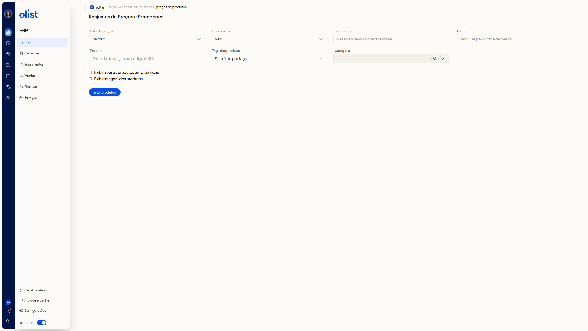
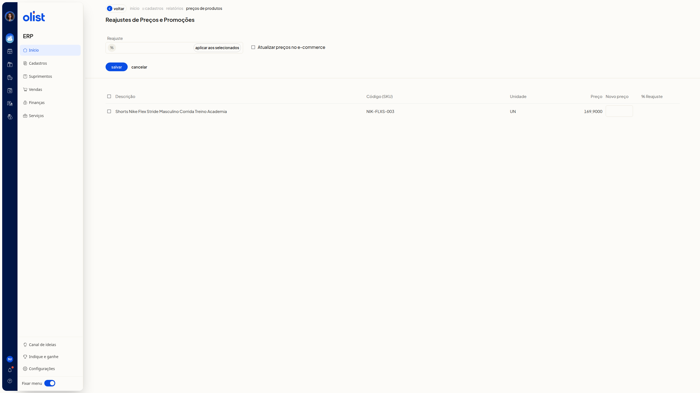
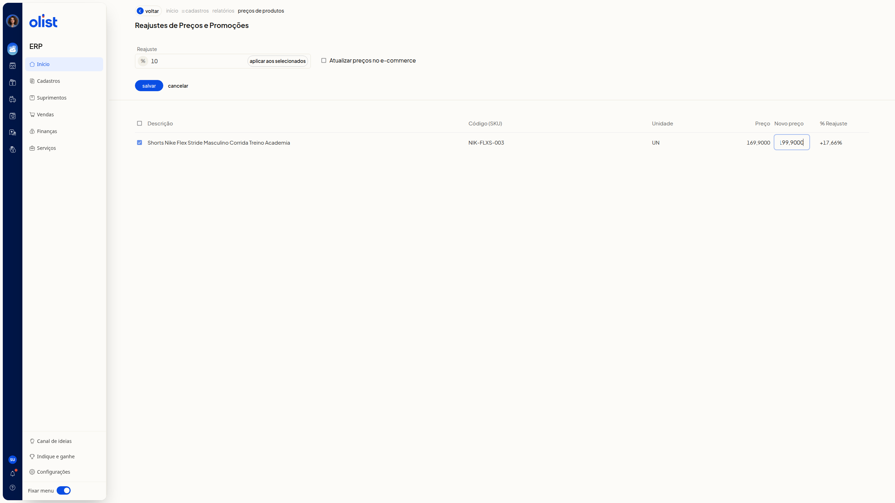

# Reajuste de preços em massa de produtos

## Descrição

A tela **Reajustes de Preços e Promoções**, no ERP da Olist, filtra produtos e permite informar um reajuste em massa por percentual ou por novo preço em cada linha. Você pode marcar a atualização desses preços no ecommerce.

Acesse **Início > Cadastros > Relatórios > Preços de produtos** para abrir a tela.

## Pré-requisitos

- Você precisa estar autenticado no ERP da Olist e conseguir abrir a tela **Reajustes de Preços e Promoções**.
- Você precisa de permissão para o relatório de preços de produtos.
- Você precisa de permissão para editar produtos para informar o reajuste e salvar os preços.
- Você precisa ter produtos cadastrados para a lista exibir linhas.
- As listas de preços e as tags dos filtros são as já cadastradas na conta.
- O filtro **Lista de preços** só aparece se você tiver permissão de lista de preços.
- O campo **Exibir custo** só aparece se você tiver permissão para ver o custo dos produtos.
- O filtro **Categoria** só aparece se a empresa tiver o módulo de categorias de produtos.
- A opção **Exibir apenas produtos em promoção** só fica disponível se a empresa tiver o módulo de promoções.
- A opção **Atualizar preços no e-commerce** só aparece quando há uma plataforma de ecommerce liberada que atualiza preços.
- Para atualizar os preços no ecommerce, você precisa estar autenticado na plataforma de ecommerce.
- Os filtros e os campos do painel de reajuste não são obrigatórios.

## Instruções

**Importante:** preencher **Reajuste** ou **Novo preço** não grava o reajuste. A confirmação é o botão **Salvar**.

### Como filtrar e listar produtos

1. Acesse **Início > Cadastros > Relatórios > Preços de produtos**.

   

2. Selecione a lista em **Lista de preços**. A opção já selecionada é **Padrão**. As demais opções são as listas de preços da conta.
3. Em **Exibir custo**, selecione **Não**, **Custo da compra** ou **Custo médio**. A opção já selecionada é **Não**.
4. Preencha **Fornecedor**, **Marca**, **Produto** e **Categoria** somente se quiser restringir a lista.
5. Em **Tags dos produtos**, abra **Sem filtro por tags** e marque uma tag já cadastrada, se quiser filtrar por tag.
6. Marque **Exibir apenas produtos em promoção** para restringir a lista a produtos em promoção, se quiser.
7. Marque **Exibir imagem dos produtos** para exibir a imagem dos produtos, se quiser.
8. Clique em **Listar produtos**. Com uma tag selecionada, a tela mostra a tabela de produtos e as ações **exibir filtros**, **download**, **Informar reajuste** e **informar promoções**.

### Como informar o reajuste de preços

1. Na lista de produtos, clique em **Informar reajuste**.

   

2. Digite o percentual numérico no campo **Reajuste**, ao lado do símbolo %. Digitar o percentual sozinho não altera o preço da linha.
3. Confira as colunas **Descrição**, **Código (SKU)**, **Unidade**, **Preço**, **Novo preço** e **% Reajuste**.
4. Edite **Novo preço** na linha desejada. Use valor com vírgula decimal, no mesmo padrão da coluna **Preço**. A coluna **% Reajuste** dessa linha é recalculada na hora e a coluna **Preço** continua com o valor atual.

   

5. Marque **Atualizar preços no e-commerce** se o reajuste também deve valer no ecommerce.
6. Clique em **Salvar** para confirmar o reajuste. Até a confirmação, o novo preço permanece na coluna **Novo preço**, com o percentual recalculado em **% Reajuste**, sem gravar o reajuste.

## Links relacionados

Se precisar de ajuda para concluir o reajuste, fale com o suporte.
