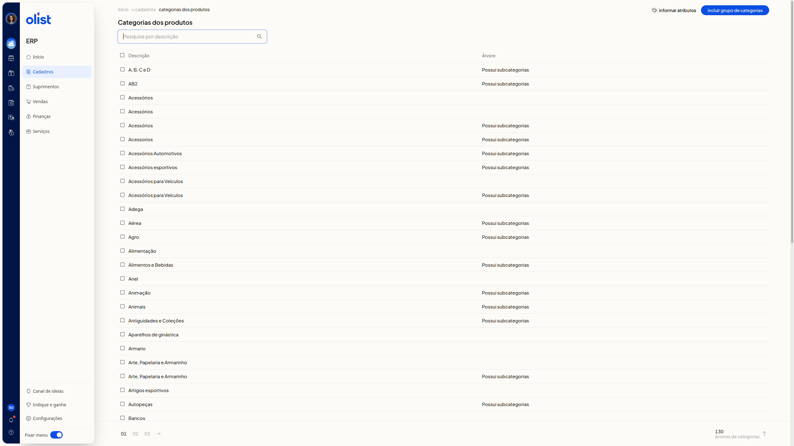
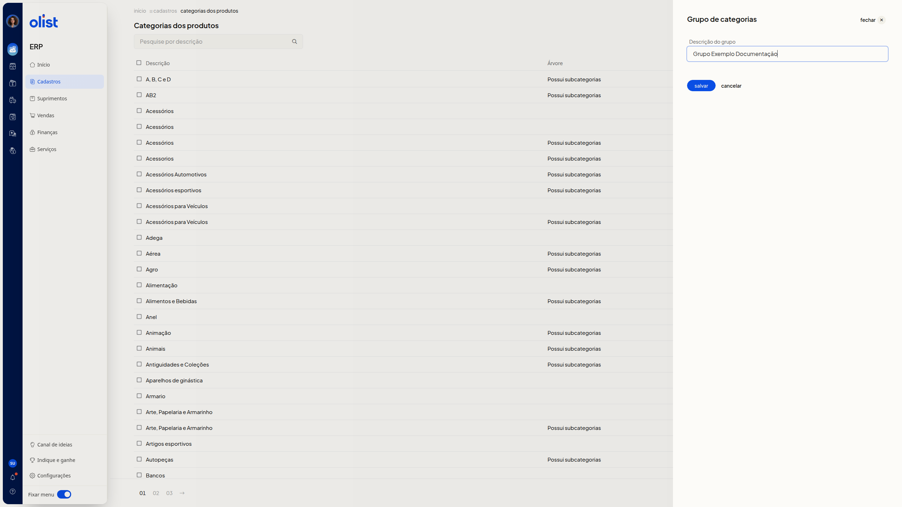
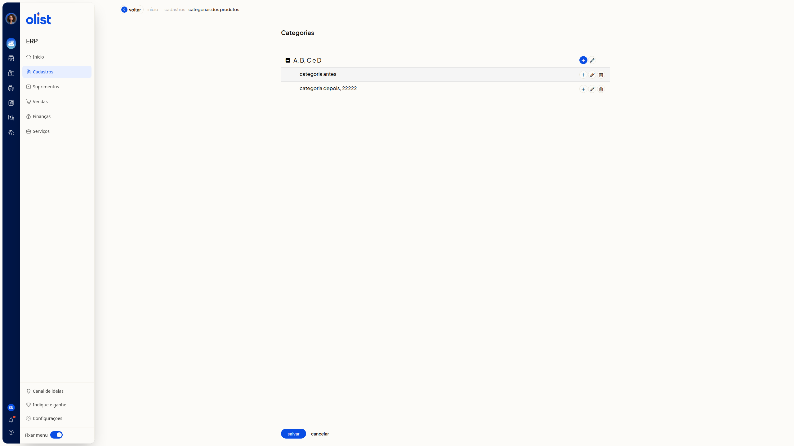
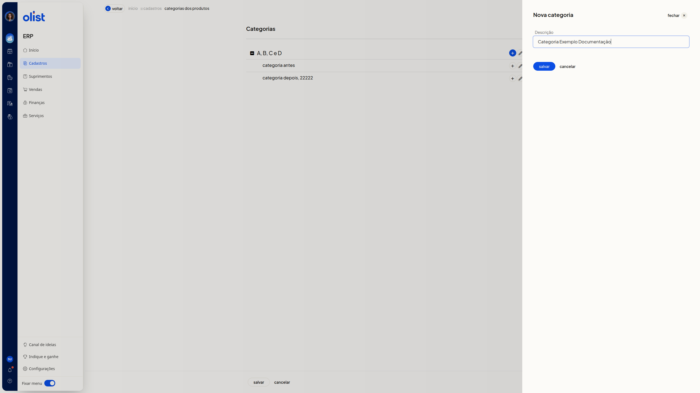

# Categorias dos produtos

## Descrição

No ERP da Olist, a página **Categorias dos produtos** lista os grupos de categorias. Você inclui um grupo, abre a árvore para incluir ou editar categorias e informa atributos de uma categoria já existente.

Acesse **Cadastros > Categorias dos produtos**.

## Pré-requisitos

Para começar, confira:
- estar autenticado no ERP e na área de Cadastros
- ter a permissão de Categorias dos produtos
- para organizar a árvore, abrir um grupo que já apareça na listagem
- para informar atributos, escolher uma categoria existente

## Instruções

### Como consultar os grupos de categorias

1. Acesse **Cadastros > Categorias dos produtos**.

 

2. Preencha **Pesquise por descrição** para buscar um grupo pela descrição.
3. Consulte as colunas **Descrição** e **Árvore**. Na coluna **Árvore**, o grupo pode exibir **Possui subcategorias**.
4. Use a paginação quando houver mais grupos. A listagem mostra os grupos de categorias e os atalhos **Incluir grupo de categorias** e **Informar atributos**.

### Como incluir um grupo de categorias

1. Na listagem, clique em **Incluir grupo de categorias**.
2. No painel **Grupo de categorias**, preencha **Descrição do grupo**. A descrição é necessária para salvar o grupo.

 

3. Clique em **salvar**. Se não quiser gravar, clique em **cancelar** para fechar o painel e voltar à listagem.

### Como incluir uma categoria

1. Na listagem, clique na descrição de um grupo.
2. Na árvore, cada linha tem **Incluir categoria**, **Editar categoria** e **Excluir categoria**.

 

3. Clique em **Incluir categoria** e, no painel **Nova categoria**, preencha **Descrição**. A descrição é necessária para incluir a categoria.

 

4. Clique em **salvar**. Se não quiser gravar, clique em **cancelar** para fechar o painel e voltar à árvore.

### Como editar a descrição de uma categoria

1. Na listagem, clique na descrição de um grupo.
2. Clique em **Editar categoria**.
3. Altere **Descrição**. O campo mostra o nome atual. A descrição é necessária para editar a categoria.
4. Clique em **salvar**. Se não quiser gravar, clique em **cancelar** para fechar o painel e voltar à árvore.

### Como sair da árvore sem salvar

1. Clique em **Voltar**. Você retorna à listagem de **Categorias dos produtos** sem salvar.

### Como informar atributos de uma categoria

1. Na listagem, clique em **Informar atributos**.
2. No painel **Informar atributos para categoria**, busque a **Categoria**, escolha uma categoria na árvore e clique em **selecionar categoria**. O campo **Categoria** mostra a categoria escolhida.
3. Se quiser, marque **Estender atributos para categorias filhas**.
4. Na linha de **Atributo** e **Valor**, pesquise o atributo pelo nome e preencha **Valor**. A linha fica preenchida, mas a alteração ainda não é aplicada.

 

5. Se quiser informar outro atributo, clique em **adicionar atributo** e preencha a nova linha.
6. Clique em **Aplicar**.

## Perguntas frequentes

### A descrição do grupo é necessária para salvar?

Sim. Para salvar o grupo de categorias, informe a descrição do grupo.

### A descrição é necessária para incluir ou editar uma categoria?

Sim. Para incluir ou editar uma categoria, informe a descrição.

## Links relacionados

Se precisar de ajuda com Categorias dos produtos, fale com o suporte.
