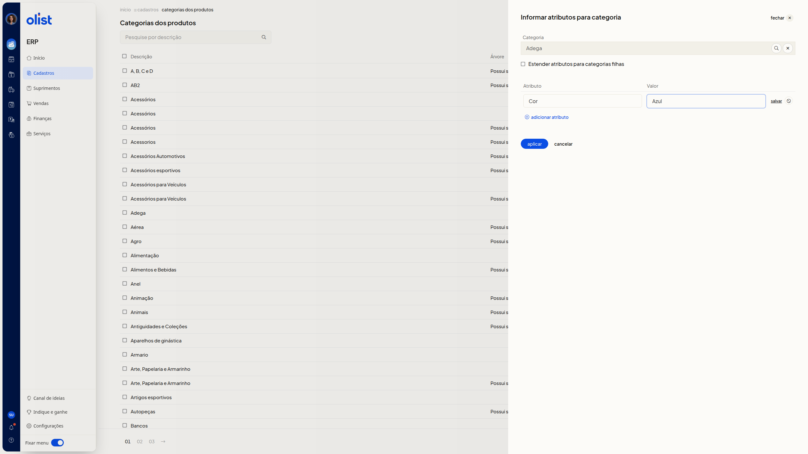

# Como informar atributos de uma categoria

## Descrição

No ERP da Olist, a página **Categorias dos produtos** permite informar atributos de uma categoria que já existe. Nesse preenchimento, você pode usar a opção **Estender atributos para categorias filhas**.

Acesse **Cadastros > Categorias dos produtos**.

## Pré-requisitos

- Esteja autenticado no ERP e na área de Cadastros.
- Tenha permissão de **Categorias dos produtos** para acessar a tela.
- Escolha uma categoria existente em **Categoria**.

## Instruções

Os campos **Categoria**, **Atributo** e **Valor** não são obrigatórios. A opção **Estender atributos para categorias filhas** também não é obrigatória.

1. Acesse **Cadastros > Categorias dos produtos**.
2. Clique em **Informar atributos**.
3. Abra a busca de **Categoria**.
4. Pesquise e escolha uma categoria na árvore.
5. Clique em **selecionar categoria**. O campo **Categoria** mostra a categoria escolhida.
6. Marque **Estender atributos para categorias filhas** se quiser usar essa opção.
7. Pesquise o atributo pelo nome em **Atributo**.
8. Preencha **Valor**.

   

9. Clique em **adicionar atributo** se quiser incluir outra linha.
10. Clique em **Aplicar** para gravar. Na linha, **salvar** também grava. Clique em **cancelar** se não quiser gravar.

## Links relacionados

Se precisar de ajuda, fale com o suporte.
