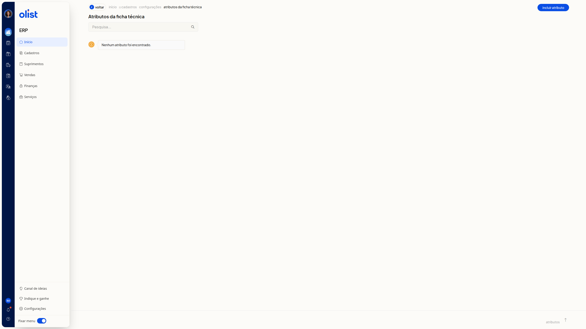
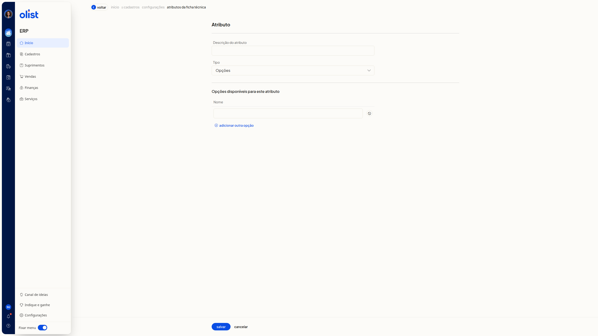

# Atributos dos Produtos - Configurações

No ERP da Olist, a tela **Atributos da ficha técnica** lista os atributos da ficha técnica. Você pesquisa na lista e abre a inclusão de um atributo para informar a descrição e o tipo.

## Como acessar

Acesse **início > cadastros > configurações > atributos da ficha técnica**.

## Pré-requisitos

- Autenticação no ERP: você precisa estar autenticado no ERP.
- Página **Atributos da ficha técnica**: a consulta e a inclusão são feitas nesta página.

## Grupos de configuração

### Atributos da ficha técnica

A lista reúne os atributos da ficha técnica.

- Quando não há atributos, a lista exibe **Nenhum atributo foi encontrado.**
- **Pesquisa...** não é obrigatório e busca na lista. Exemplo: embalagem.
- **Incluir atributo** abre o formulário **Atributo**.
- **voltar** retorna.

### Atributo

O formulário **Atributo** reúne a descrição, o tipo, **salvar** e **cancelar**.

- **Descrição do atributo** não é obrigatório. Exemplo: Cor da embalagem.
- **Tipo** não é obrigatório. As opções são **Texto**, **Valor**, **Opções** e **Checkbox (Sim/Não)**.

Em **Texto**, **Valor** e **Checkbox (Sim/Não)**, permanecem apenas **Descrição do atributo** e **Tipo**. Em **Opções**, aparece a seção **Opções disponíveis para este atributo**. A descrição já digitada permanece ao trocar o **Tipo**.

### Opções disponíveis para este atributo

A seção aparece quando o **Tipo** é **Opções**. Nela, você informa o nome das opções disponíveis.

- **Nome** não é obrigatório. Exemplo: Azul.
- A seção também traz **Remover** e **adicionar outra opção**.

## Links relacionados

Se precisar de ajuda com esta configuração, fale com o suporte.
