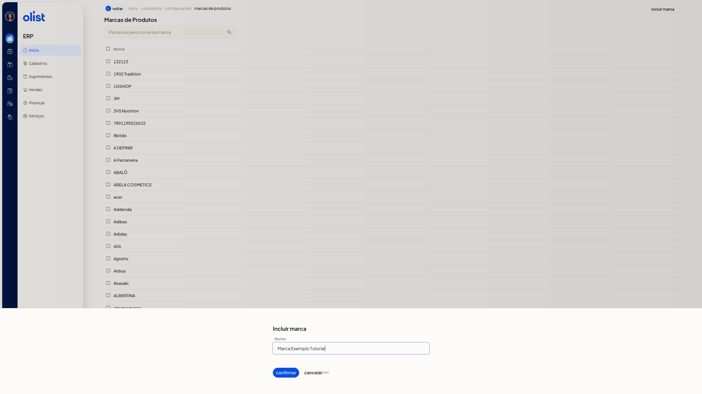
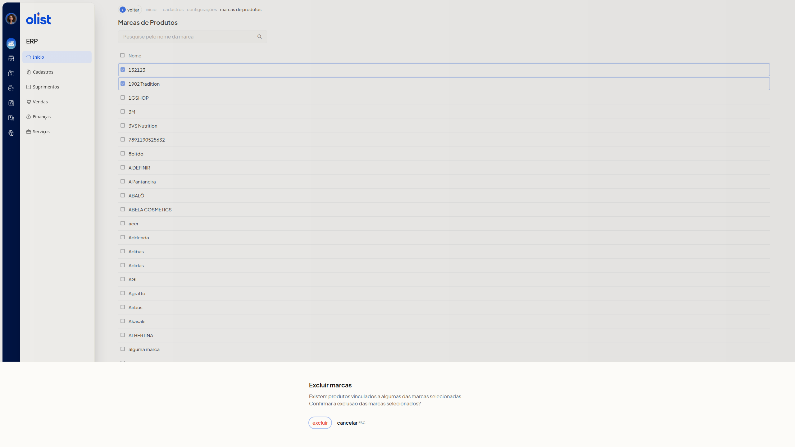

# Marcas dos Produtos - Configurações

A tela **Marcas de Produtos** lista as marcas cadastradas dos produtos. Nela você inclui uma marca, altera o nome, unifica duas ou mais marcas e exclui as selecionadas. Na unificação, alguns dados dos produtos são atualizados com a nova marca unificada.

## Importante

- Não é possível incluir ou alterar uma marca com o nome de outra marca já cadastrada.
- Não é possível unificar as marcas se a descrição informada já existir em uma marca que não foi selecionada.
- Incluir, alterar e unificar só seguem em **Confirmar**. A exclusão só segue em **Excluir**. **Cancelar ESC** fecha sem concluir a ação.

## Como acessar

Acesse **Início > Cadastros > Configurações > marcas de produtos**.

## Grupos de configuração

### Marcas de Produtos

A lista reúne as marcas na coluna **Nome**, com uma caixa de seleção por linha. O campo **Pesquise pelo nome da marca** não é obrigatório. Use-o para localizar uma marca pelo nome. **Incluir marca** fica no topo da lista. A lista tem paginação e o rodapé mostra o total de marcas.

Ao marcar caixas de seleção, a lista mostra a contagem da seleção, o botão **Unificar marcas** e **Mais ações**. Em **Mais ações** estão **Unificar marcas** e **Excluir marcas**.

### Incluir marca

**Incluir marca** reúne o campo **Nome**. O campo não é obrigatório.

1. Clique em **Incluir marca**.
2. Preencha **Nome**.

   

3. Clique em **Confirmar** para incluir a marca. Para sair sem incluir, clique em **Cancelar ESC**.

### Alterar marca

**Alterar marca** reúne o campo **Nome**, já preenchido com o nome atual. O campo não é obrigatório.

1. Na coluna **Nome**, clique no nome da marca.
2. Confira **Nome**.

   

3. Ajuste **Nome**, se precisar, e clique em **Confirmar** para alterar a marca. **Cancelar ESC** fecha sem alterar a marca.

### Unificar marcas

**Unificar marcas** reúne o aviso de atualização dos produtos e o campo **Descrição**. O campo não é obrigatório e já vem preenchido.

1. Marque a caixa de seleção das marcas. A lista mostra a contagem da seleção, **Unificar marcas** e **Mais ações**.
2. Se só uma marca estiver marcada, clique em **Unificar marcas**. A tela exibe **Selecione pelo menos duas marcas para unificar** e não abre o formulário. Clique em **Fechar ESC** para fechar o aviso.
3. Com duas ou mais marcas, clique em **Unificar marcas** no botão da seleção ou em **Mais ações**.
4. Leia o aviso e ajuste **Descrição**, se precisar. O aviso informa que alguns dados serão atualizados com a nova marca unificada (produtos).

   

5. Clique em **Confirmar** para unificar as marcas. **Cancelar ESC** fecha o diálogo e mantém as marcas selecionadas.

### Excluir marcas

**Excluir marcas** pede confirmação antes de excluir as marcas selecionadas.

1. Marque uma ou mais marcas na lista.
2. Clique em **Mais ações** e escolha **Excluir marcas**.
3. Leia o aviso. O diálogo informa que existem produtos vinculados a algumas das marcas selecionadas e pede a confirmação da exclusão.

   

4. Clique em **Excluir** para excluir as marcas selecionadas. **Cancelar ESC** fecha o diálogo sem excluir.

## Perguntas frequentes

### Posso incluir ou alterar uma marca com um nome já cadastrado?

Não. Não é possível incluir ou alterar uma marca com o nome de outra marca já cadastrada. Informe outro nome.

### Posso unificar com uma descrição que já existe?

Não, se a descrição já existir em uma marca que não foi selecionada. Ajuste **Descrição** para um texto que não pertença a uma marca de fora da seleção.

### O que a unificação atualiza nos produtos?

Alguns dados são atualizados com a nova marca unificada (produtos).

### Quantas marcas preciso marcar para unificar?

Pelo menos duas. Com uma marca, a tela exibe **Selecione pelo menos duas marcas para unificar** e não abre o formulário.

## Links relacionados

Se precisar de ajuda com as marcas dos produtos, fale com o suporte.
