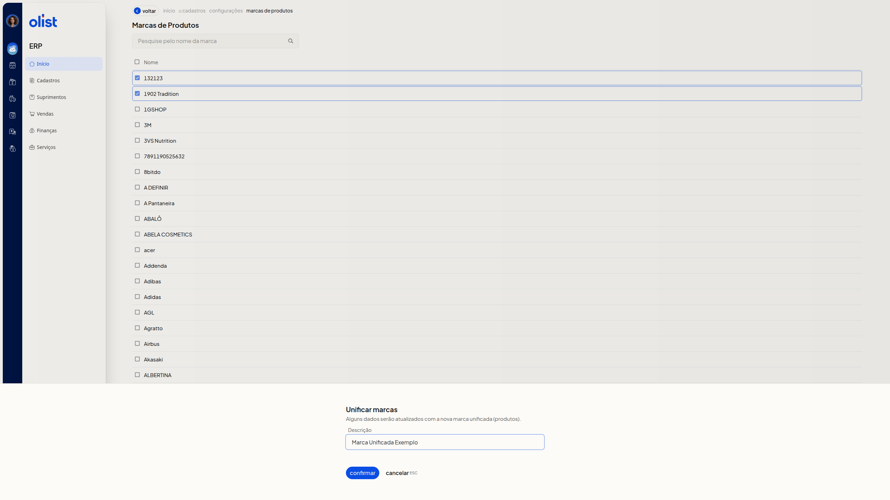

# Como unificar marcas de produtos

## Descrição

A tela **Marcas de Produtos**, no ERP da Olist, permite unificar duas ou mais marcas cadastradas. Ao unificar, alguns dados serão atualizados com a nova marca unificada (produtos).

Você encontra a lista em **Início > Cadastros > Configurações > marcas de produtos**.

## Pré-requisitos

- Pelo menos duas marcas cadastradas na lista.
- A descrição não pode já existir em uma marca que não foi selecionada.

Com esses pontos atendidos, siga para as instruções.

## Importante

O diálogo informa que alguns dados serão atualizados com a nova marca unificada (produtos). A unificação só segue pelo botão **Confirmar**. **Cancelar ESC** fecha o diálogo e mantém as marcas selecionadas.

## Instruções

1. Acesse **Início > Cadastros > Configurações > marcas de produtos**.
2. Marque a caixa de seleção de pelo menos duas marcas na coluna **Nome**.
3. Clique em **Unificar marcas** ou em **Mais ações > Unificar marcas**. Se aparecer o aviso **Selecione pelo menos duas marcas para unificar**, clique em **Fechar ESC**, marque outra marca e clique em **Unificar marcas** outra vez.
4. Ajuste o campo **Descrição**, se necessário. O campo já vem preenchido e não é obrigatório.

 

5. Clique em **Confirmar** para seguir com a unificação. Alguns dados serão atualizados com a nova marca unificada (produtos).

## Links relacionados

Se você precisar de ajuda para unificar marcas, fale com o suporte.
