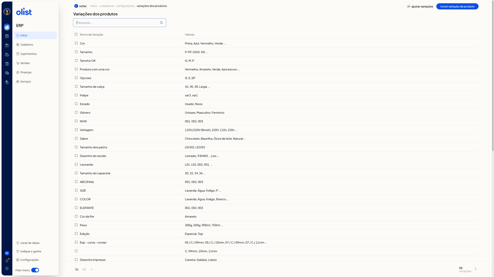
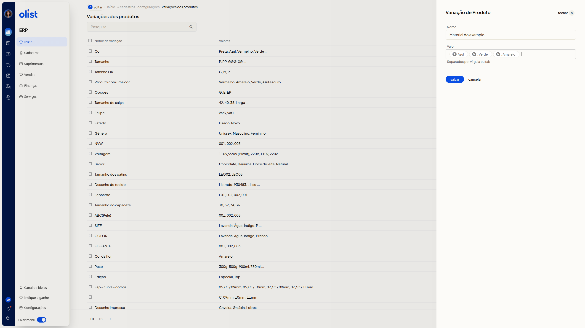
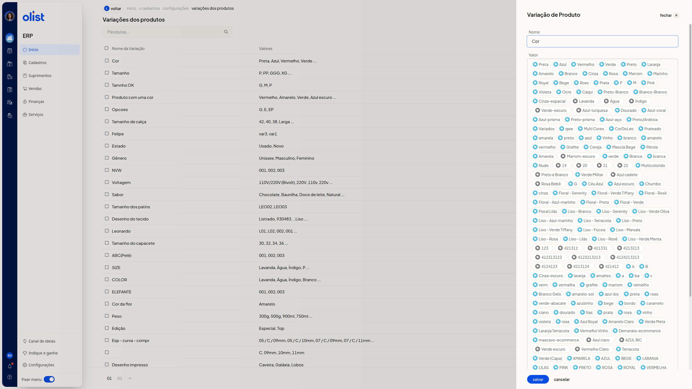

# Variações de Produtos - Configurações

A tela **Variações dos produtos** reúne, no ERP da Olist, as variações já cadastradas. Nela você consulta a lista, inclui uma variação, edita uma existente e move valores de uma variação para outra.

## Importante

Valores vinculados a algum produto não podem ser alterados.

## Como acessar

Acesse **Início > Cadastros > Configurações > Variações dos produtos**.

## Pré-requisitos

- Estar autenticado no ERP: a página **Variações dos produtos** abre a lista de variações cadastradas.

## Grupos de configuração

### Variações dos produtos

A lista reúne as variações cadastradas, a pesquisa e as ações **Incluir variação de produto** e **Ajustar variações**.

- **Pesquisa...**: localiza uma variação na lista. O preenchimento não é obrigatório.
- **Nome da Variação**: mostra o nome de cada variação. Clique no nome para abrir a edição.
- **Valores**: mostra os valores da variação. Valores longos aparecem resumidos, seguidos de reticências.

O rodapé informa o total de variações e a paginação.

Clique em **Voltar** para sair da tela.

### Variação de Produto

O painel **Variação de Produto** serve para incluir uma variação ou editar uma já cadastrada. Os campos **Nome** e **Valor** não são obrigatórios.

#### Incluir uma variação

Clique em **Incluir variação de produto**.

- **Nome**: informe o nome da variação.
- **Valor**: digite os valores separados por vírgula ou tab, conforme o texto **Separados por vírgula ou tab**. Os valores passam a aparecer separados na tela.

O painel oferece **Salvar**, **Cancelar** e **fechar**. Clique em **Salvar** para salvar a variação preenchida. **Cancelar** fecha o painel e volta à lista.

#### Editar uma variação

Clique no nome da variação, na coluna **Nome da Variação**.

O painel abre com **Nome** preenchido e os valores já cadastrados. Leia o aviso **Os valores destacados em azul, estão vinculados a algum produto e desta forma, não podem ser alterados.**

Para acrescentar valores, use **Valor**, com o texto **Separados por vírgula ou tab**.

**Salvar**, **Cancelar** e **fechar** ficam disponíveis. Clique em **Salvar** para salvar a variação preenchida. **Cancelar** fecha o painel e volta à lista.

### Ajustar variações

**Ajustar variações** move valores de uma variação para outra. Clique em **Ajustar variações**.

Os campos abaixo não são obrigatórios.

- **Variação Origem**: escolha a variação de onde os valores saem. A lista reúne os nomes das variações já cadastradas.
- **Variação Destino**: escolha a variação que receberá os valores.
- **Valores**: marque as caixas de seleção dos valores da origem que devem ser movidos.

O painel oferece **mover selecionados**, **Cancelar** e **fechar**. Clique em **mover selecionados** para mover os valores marcados da origem para o destino. **Cancelar** fecha o painel e volta à lista.

### Excluir variações de produtos

Marque a caixa de seleção da linha da variação. A tela mostra a quantidade selecionada e o botão **Excluir variações de produtos**, para excluir as linhas selecionadas.

## Perguntas frequentes

### Por que alguns valores não podem ser alterados?

Os valores destacados em azul estão vinculados a algum produto e não podem ser alterados.

## Links relacionados

Se precisar de ajuda com esta tela, fale com o suporte.
