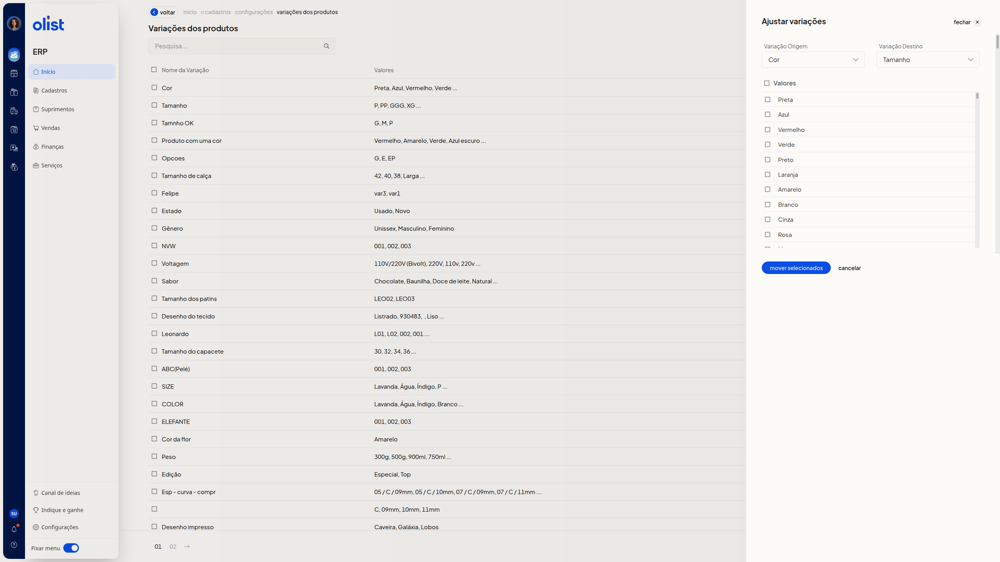

# Como ajustar variações de produtos

## Descrição

No ERP da Olist, você move valores de uma variação de produto para outra. A página **Variações dos produtos** lista as variações cadastradas e oferece essa opção.

Acesse **Início > Cadastros > Configurações > Variações dos produtos**.

## Pré-requisitos

Esteja autenticado no ERP. A página **Variações dos produtos** lista as variações cadastradas.

## Instruções

1. Acesse **Início > Cadastros > Configurações > Variações dos produtos**.
2. Clique em **Ajustar variações**. Os campos **Variação Origem**, **Variação Destino** e **Valores** não são obrigatórios.
3. Escolha, em **Variação Origem**, a variação de onde os valores saem. A lista reúne as variações já cadastradas.
4. Escolha, em **Variação Destino**, a variação que receberá os valores.
5. Marque, em **Valores**, os valores da origem que devem ser movidos.
6. Clique em **mover selecionados** para mover os valores marcados. **cancelar** fecha o painel e volta à lista.

   

## Links relacionados

Se precisar de ajuda, fale com o suporte.
