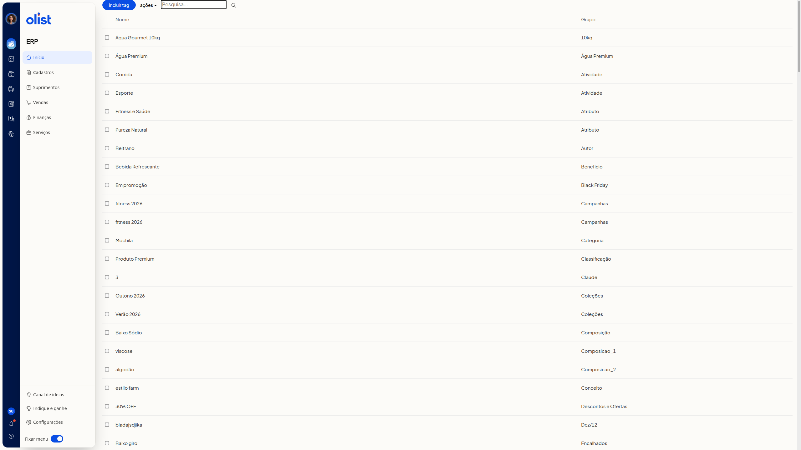
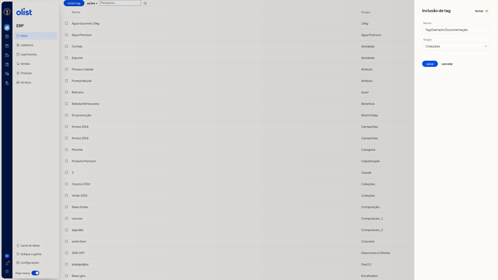

# Tags de produtos

## Descrição

A listagem de tags de produtos no ERP da Olist mostra as tags nas colunas **Nome** e **Grupo**. Por ela, você inclui uma nova tag e escolhe um grupo já cadastrado.

Na listagem, o botão **incluir tag** fica ao lado de **ações** e do campo **Pesquisa...**.

## Pré-requisitos

- Tenha a permissão de Tags para acessar a tela de tags de produtos.
- Tenha grupos de tags já cadastrados para escolher em **Grupo**.

## Importante

Antes de gravar, confira o nome: ele não pode ser igual ao de outra tag já cadastrada no mesmo grupo.

## Instruções

1. Clique em **incluir tag**, ao lado de **ações** e do campo **Pesquisa...**.

   

2. Preencha **Nome** no painel **Inclusão de tag**. O campo não é obrigatório.

3. Selecione um grupo já cadastrado em **Grupo**. O campo não é obrigatório, mas já abre com um grupo selecionado e não tem opção em branco. Só é possível escolher um grupo existente.

   

4. Revise **Nome** e **Grupo**. Para sair do painel, use **cancelar** ou **fechar**. Para gravar a inclusão, clique em **salvar**. Até esse clique, a tag não entra na listagem.

## Perguntas frequentes

### Posso criar um grupo ao incluir a tag?

Não. Em **Grupo**, só é possível escolher um grupo já cadastrado.

### A tag aparece na listagem antes de clicar em salvar?

Não. A tag não entra na listagem enquanto **salvar** não é clicado.

## Links relacionados

Se precisar de ajuda, fale com o suporte.
