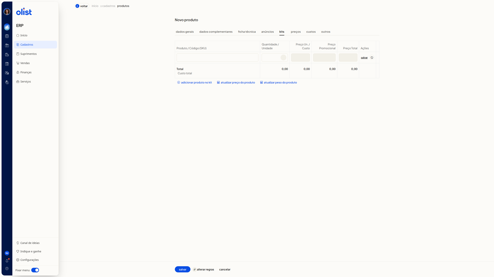

# Como trabalhar com kits que possuem variações?

## Descrição

No ERP da Olist, a ficha **Novo produto** serve para cadastrar um kit ou um produto com variações. O tipo escolhido em **Tipo do Produto** define o que você configura em seguida: a composição do kit ou a primeira variação.

Acesse **ERP > Cadastros > Produtos** e clique em **Incluir produto**. A ficha abre com o título **Novo produto** e a trilha **Início > Cadastros > Produtos**.

**Importante:** as abas **Kits** e **Variações** não aparecem juntas. A aba exibida depende de **Tipo do Produto**.

## Pré-requisitos

- Tenha permissão de produtos para acessar o cadastro de novo produto.
- Acesse a lista de produtos pelo menu **Cadastros**.
- Para usar o tipo **Com variações**, a empresa precisa ter o módulo de variações.
- Para ver e usar a aba **Kits**, deixe **Tipo do Produto** em **Kit**.
- Para ver e usar a aba **Variações**, deixe **Tipo do Produto** em **Com variações**.

## Instruções

**Tipo do Produto** não é obrigatório. As opções incluem **Kit** e **Com variações**. Escolha um dos caminhos abaixo.

### Como abrir a ficha de novo produto

1. Acesse **ERP > Cadastros > Produtos**.
2. Clique em **Incluir produto**. A ficha **Novo produto** abre na aba **Dados Gerais**, pronta para preenchimento. **Salvar** e **Cancelar** ficam no rodapé.

### Como cadastrar a composição de um kit

1. Na aba **Dados Gerais**, selecione **Kit** em **Tipo do Produto**. A aba **Kits** passa a aparecer.
2. Clique na aba **Kits**.
3. Confira as colunas **Produto / Código (SKU)**, **Quantidade / Unidade**, **Preço Un. / Custo**, **Preço Promocional**, **Preço Total** e **Ações**.
4. Clique em **adicionar produto no kit** para incluir componentes. Use **atualizar preço do produto** ou **atualizar peso do produto** para atualizar preço ou peso. O botão **alterar regras** também está na aba. A composição fica visível. Sem componentes, a tabela permanece vazia e os totais ficam em R$ 0,00.

   

### Como definir a primeira variação do produto

1. Na aba **Dados Gerais**, selecione **Com variações** em **Tipo do Produto**. A aba **Kits** sai e a aba **Variações** aparece.
2. Clique na aba **Variações**.
3. No bloco **Variações do produto**, selecione o tipo em **Primeira variação**. A lista mostra tipos já cadastrados, como **Cor**, **Tamanho**, **Gênero**, **Voltagem** e **Sabor**. **Primeira variação** não é obrigatório.
4. Localize o botão com ícone de visto à direita de **Primeira variação**. A ficha mostra a escolha da primeira variação.

   

## Perguntas frequentes

**Posso usar as abas Kits e Variações no mesmo produto?**

Não. A aba que você vê depende de **Tipo do Produto**. Com **Kit**, aparece **Kits**. Com **Com variações**, aparece **Variações** e a aba **Kits** sai.

**Preciso preencher Tipo do Produto e Primeira variação?**

Não. **Tipo do Produto** e **Primeira variação** não são obrigatórios. A aba correspondente só aparece depois que você seleciona **Kit** ou **Com variações**.

## Links relacionados

Se precisar de ajuda para concluir o cadastro, fale com o suporte.
