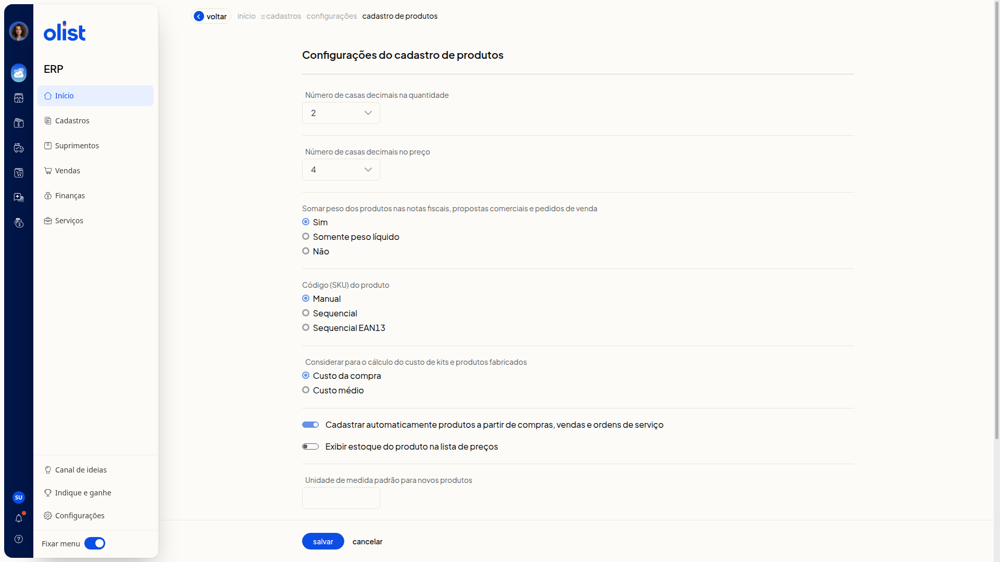
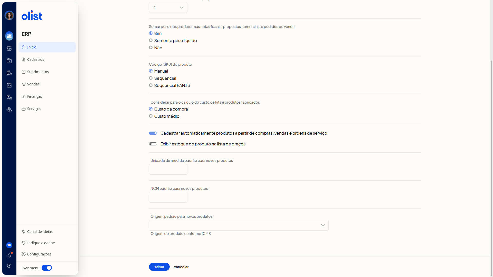

# Configurações do cadastro de produtos

A tela **Configurações do cadastro de produtos** do ERP da Olist reúne, em uma única sequência e sem grupos nomeados, os parâmetros do cadastro de produtos. Nela você ajusta o número de casas decimais da quantidade e do preço, se o peso dos produtos é somado nas notas fiscais, propostas comerciais e pedidos de venda, como o código (SKU) é gerado, o cálculo do custo de kits e produtos fabricados, o cadastro automático a partir de compras, vendas e ordens de serviço, a exibição do estoque na lista de preços e a unidade, o NCM e a origem padrão dos novos produtos.

## Importante

Só quem tem permissão para configurar cadastros de produtos acessa esta tela. A opção **Considerar para o cálculo do custo de kits e produtos fabricados** só aparece para quem possui os módulos de preço de custo de produtos e de DRE.

## Como acessar

Acesse **Configurações > Configurações ERP** no menu lateral e, na aba **Cadastros**, clique em **Configurações do cadastro de produtos**.

## Pré-requisitos

- Autenticação no ERP: é preciso estar autenticado para abrir a tela.
- Permissão para configurar cadastros de produtos: só quem tem essa permissão acessa **Configurações do cadastro de produtos**.
- Item **Configurações** no menu lateral: ele precisa estar visível para você seguir o caminho de acesso.

## Configurações do cadastro de produtos

Nenhum parâmetro exibe marcador de obrigatoriedade. O único texto de ajuda é **Origem do produto conforme ICMS**, abaixo de **Origem padrão para novos produtos**.

- **Número de casas decimais na quantidade**: escolha **0**, **1**, **2**, **3** ou **4**.
- **Número de casas decimais no preço**: escolha de **0** a **10**.
- **Somar peso dos produtos nas notas fiscais, propostas comerciais e pedidos de venda**: escolha **Sim**, **Somente peso líquido** ou **Não**.
- **Código (SKU) do produto**: escolha **Manual**, **Sequencial** ou **Sequencial EAN13**.
- **Considerar para o cálculo do custo de kits e produtos fabricados**: escolha **Custo da compra** ou **Custo médio**.
- **Cadastrar automaticamente produtos a partir de compras, vendas e ordens de serviço**: ligue ou desligue o interruptor.
- **Exibir estoque do produto na lista de preços**: ligue ou desligue o interruptor.
- **Unidade de medida padrão para novos produtos**: informe a unidade no campo.
- **NCM padrão para novos produtos**: informe o NCM no campo.
- **Origem padrão para novos produtos**: selecione a origem. Abaixo do campo, o texto de ajuda é **Origem do produto conforme ICMS**. As opções são:
 - **0 - Nacional, exceto as indicadas nos códigos 3 a 5**
 - **1 - Estrangeira - Importação direta, exceto a indicada no código 6**
 - **2 - Estrangeira - Adquirida no mercado interno, exceto a indicada no código 7**
 - **3 - Nacional, mercadoria ou bem com Conteúdo de Importação superior a 40% e inferior ou igual a 70**
 - **4 - Nacional, cuja produção tenha sido feita em conformidade com os processos produtivos básicos de que tratam as legislações citadas nos Ajustes**
 - **5 - Nacional, mercadoria ou bem com Conteúdo de Importação inferior ou igual a 40**
 - **6 - Estrangeira - Importação direta, sem similar nacional, constante em lista da CAMEX**
 - **7 - Estrangeira - Adquirida no mercado interno, sem similar nacional, constante em lista da CAMEX**
 - **8 - Nacional, mercadoria ou bem com Conteúdo de Importação superior a 70**

No final da página estão os botões **salvar** e **cancelar** e o link **Voltar**. Ao terminar, clique em **salvar**.

## Links relacionados

Se precisar de ajuda com estas configurações, fale com o suporte.
