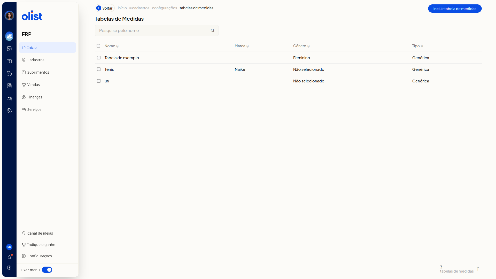
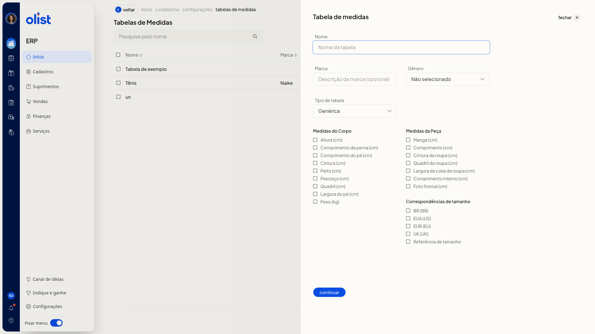
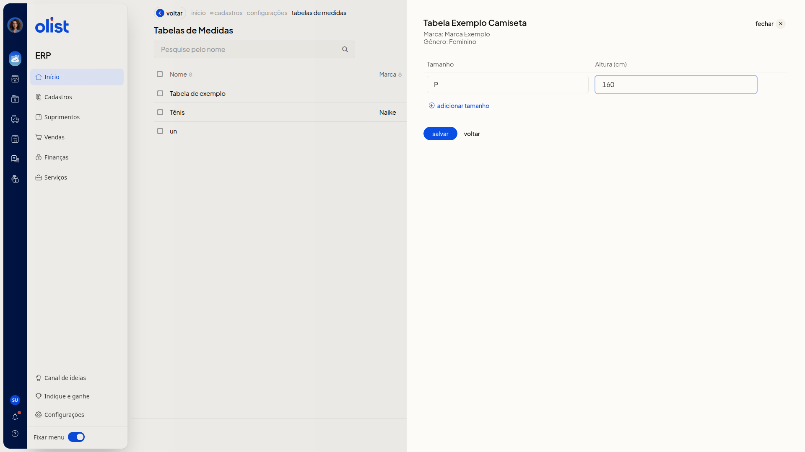

# Tabelas de medidas - Vestuário: Roupas e calçados

## Descrição

No ERP da Olist, a página **Tabelas de Medidas** lista tabelas de vestuário e permite incluir uma nova em duas etapas. Você consulta as colunas **Nome**, **Marca**, **Gênero** e **Tipo**, pesquisa uma tabela no campo **Pesquise pelo nome** e inclui uma tabela pelo botão **Incluir Tabela de Medidas**.

O caminho no menu lateral é **Configurações > Configurações ERP > Cadastros > Tabelas de medidas**. Na inclusão, informe os dados da tabela, marque as medidas e preencha os tamanhos na etapa seguinte.

## Pré-requisitos

- Estar no ERP com o menu **Configurações** disponível.
- Permissão para configurar tabelas de medidas. Só quem tem essa permissão acessa a tela **Tabelas de Medidas**.
- O item **Tabelas de medidas** não aparece no submenu **Cadastros** da barra lateral. O caminho passa por **Configurações ERP**, aba **Cadastros**.

## Importante

- Nenhum campo do formulário é obrigatório.
- Na primeira etapa, a ação para seguir é **Continuar**. **Salvar** só aparece na etapa de tamanhos.
- O **Tipo de tabela** altera quais grupos de medidas são exibidos.

## Instruções

1. Clique em **Configurações** no menu lateral.
2. Clique em **Configurações ERP**.
3. Na aba **Cadastros**, clique em **Tabelas de medidas**.

   

4. Na página **Tabelas de Medidas**, clique em **Incluir Tabela de Medidas**.

   

5. Informe **Nome** e, se quiser, **Marca**. Selecione **Gênero** e **Tipo de tabela** com as opções abaixo.

#### Dados da tabela

- **Nome**
- **Marca**
- **Gênero**: valor inicial **Não selecionado**. Opções: **Não selecionado**, **Masculino**, **Feminino**, **Meninos** e **Meninas**.
- **Tipo de tabela**: valor inicial **Genérica**. Opções: **Genérica**, **Moda - Medidas da peça**, **Moda - Medidas do corpo** e **Moda - Medidas combinadas**.

6. Marque as medidas desejadas em **Medidas do Corpo**, **Medidas da Peça** e **Correspondências de tamanho**, conforme o tipo. A medida marcada vira coluna na etapa de tamanhos.

#### Medidas do Corpo

Visível em **Genérica**, **Moda - Medidas do corpo** e **Moda - Medidas combinadas**.

- **Altura (cm)**
- **Comprimento da perna (cm)**
- **Comprimento do pé (cm)**
- **Cintura (cm)**
- **Peito (cm)**
- **Pescoço (cm)**
- **Quadril (cm)**
- **Largura do pé (cm)**
- **Peso (kg)**

#### Medidas da Peça

Visível em **Genérica**, **Moda - Medidas da peça** e **Moda - Medidas combinadas**.

- **Manga (cm)**
- **Comprimento (cm)**
- **Cintura da roupa (cm)**
- **Quadril da roupa (cm)**
- **Largura da coxa da roupa (cm)**
- **Comprimento interno (cm)**
- **Foto frontal (cm)**

#### Correspondências de tamanho

Visível em **Genérica**, **Moda - Medidas da peça**, **Moda - Medidas do corpo** e **Moda - Medidas combinadas**.

- **BR (BR)**
- **EUA (US)**
- **EUR (EU)**
- **UK (UK)**
- **Referência de tamanho**

7. Clique em **Continuar**.
8. Preencha **Tamanho** e os valores das medidas marcadas. Para incluir outro tamanho, clique em **Adicionar tamanho**. Clique em **Salvar** para concluir o cadastro.

   

## Informações adicionais

### Voltar na etapa de tamanhos abre um aviso

A opção continuar devolve à configuração com os dados ainda preenchidos.

## Links relacionados

Se precisar de ajuda, fale com o suporte.
