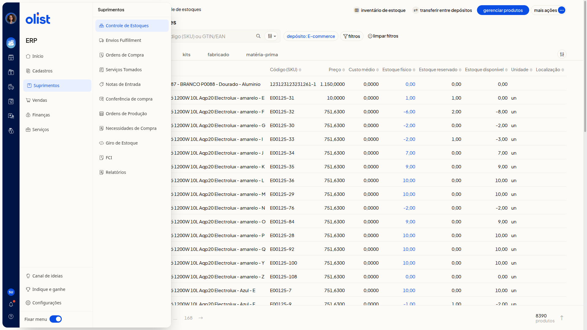

# Controle de lotes e validades de produtos

## Descrição

No ERP da Olist, você consulta as quantidades dos produtos no **Controle de estoques**. A lista não exibe lote nem validade.

Acesse **Suprimentos > Controle de Estoques** no menu lateral do ERP. Ao clicar na quantidade de **Estoque físico**, o painel **Detalhes** lista depósitos e quantidades, não lotes do produto.

## Pré-requisitos

- Acesso ao ERP com o menu **Suprimentos** visível.
- Apenas quem tem permissão para o **Controle de estoques** acessa a tela.
- A aba **Lotes e validades** pode exigir um plano superior para ser desbloqueada.
- A aba **Lotes e validades** pode ser desbloqueada ao contratar a extensão.

## Importante

- **Depósito Lote** e **Entrada** são nomes de depósito, não campos de lote ou de lançamento.

## Instruções

1. Clique em **Suprimentos** no menu lateral do ERP.

   

2. Clique em **Controle de Estoques**. A tela **Controle de estoques** mostra a lista de produtos, a busca por nome, código (SKU) ou GTIN/EAN, o filtro **depósito** e as abas **Todos**, **Simples**, **Kits**, **Fabricado** e **Matéria-prima**.
3. Confira as colunas **Produto**, **Código (SKU)**, **Preço**, **Custo médio**, **Estoque físico**, **Estoque reservado**, **Estoque disponível**, **Unidade** e **Localização**. Não há coluna de lote nem de validade.
4. Clique na quantidade de **Estoque físico** de um produto para abrir o painel **Detalhes**. O painel lista depósitos e quantidades, e não mostra lote nem validade do produto.

## Resultado

Ao fechar o painel **Detalhes**, você volta à lista. A lista permanece sem colunas de lote ou validade.

## Informações adicionais

### Lotes e validades não aparecem nos menus da tela

O menu **Suprimentos**, o menu **Mais ações** e o menu da linha do produto não trazem uma opção nomeada de lotes ou validades.

## Links relacionados

Se precisar de ajuda para desbloquear a aba **Lotes e validades**, fale com o suporte.
