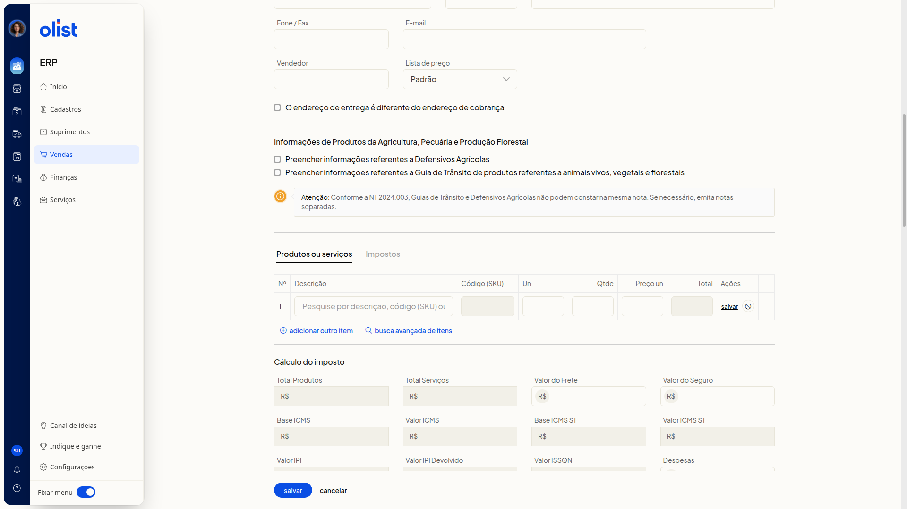
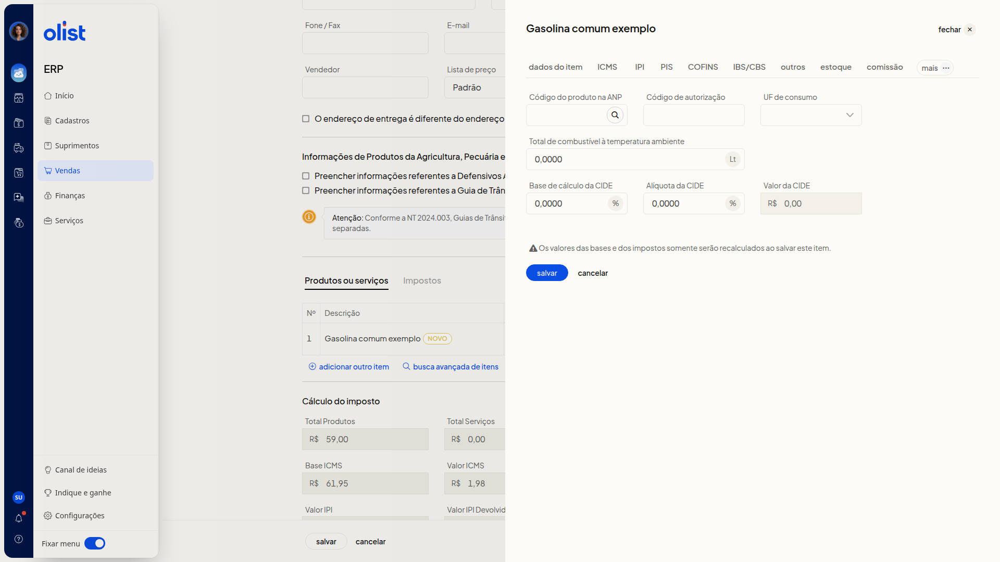
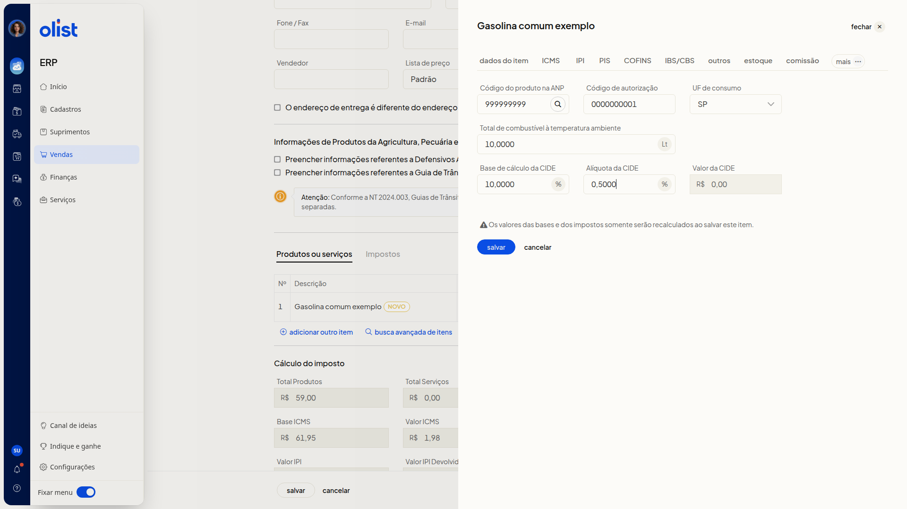
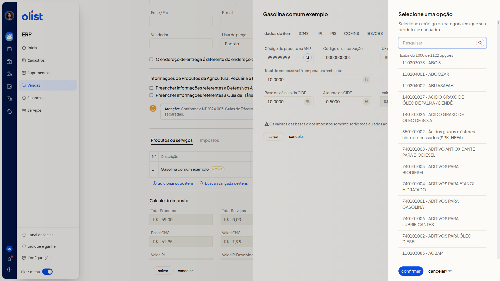
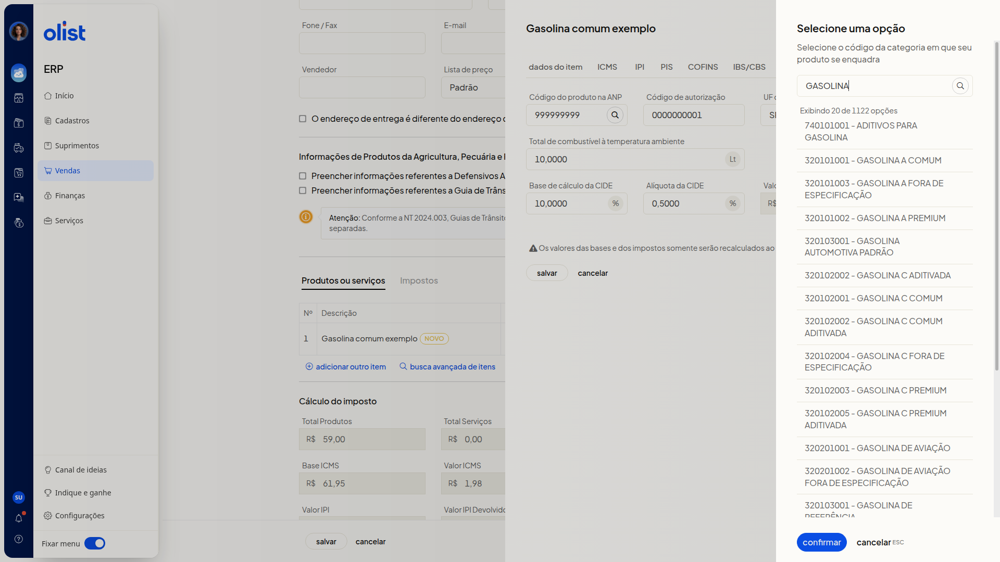

# Como configurar produtos da tabela ANP (Combustíveis) na Nota Fiscal

## Descrição

A aba **Combustível** do item da nota fiscal, no ERP da Olist, reúne o código do produto na tabela ANP, o código de autorização, a UF de consumo e os dados da CIDE. Com ela, você informa o combustível no item de uma nota nova, ainda sem emitir.

Na lista de **Notas Fiscais**, com **Vendas** em destaque no menu lateral, o caminho é o botão **Incluir nota fiscal**. Você pode preencher os dados pela tela da nota ou consultar o código da categoria ANP no painel de busca.

## Pré-requisitos

- A lista de **Notas Fiscais** precisa estar acessível.
- Para abrir a aba **Combustível**, inclua um item na nota e abra o item em **editar**.

## Importante

- **Os valores das bases e dos impostos somente serão recalculados ao salvar este item.**
- Nenhum campo da aba **Combustível** é obrigatório.
- O código digitado em **Código do produto na ANP** permanece no campo até a confirmação no painel **Selecione uma opção**.

## Instruções

### Pela tela da nota fiscal

1. Acesse a lista de **Notas Fiscais** e clique em **Incluir nota fiscal**. O formulário de uma nota nova abre, sem emitir. Alguns dados de cabeçalho já vêm preenchidos, entre eles **Tipo de Saída** **Emissão própria**, **Natureza da operação** **Venda de mercadorias** e **Finalidade** **NF-e normal**.

#### Dados da linha do item

2. Em **Produtos ou serviços**, informe os dados da linha. Nenhum destes campos é obrigatório. O total da linha é calculado na hora.
   - **Descrição**
   - **Un**
   - **Qtde**: quantidade com duas casas decimais, por exemplo 10,00
   - **Preço un**: valor com duas casas decimais, por exemplo R$ 5,90

   

3. Clique no **salvar** da linha do item, não no **Salvar** do rodapé da nota. O item entra na tabela com o selo **Novo**.

4. Clique em **editar** na linha do item, depois em **mais** e em **Combustível**.

   

#### Campos da aba Combustível

5. Preencha os campos abaixo. Nenhum é obrigatório. Para localizar o código na tabela, siga a consulta do código do produto na ANP. A aba traz **Salvar** e **Cancelar** do item. O item permanece na nota não salva e não emitida, com a aba preenchida e o aviso de recálculo ao salvar o item.
   - **Código do produto na ANP**
   - **Código de autorização**
   - **UF de consumo**: lista de siglas de UF, com a opção **Selecione**
   - **Total de combustível à temperatura ambiente**: quantidade com 4 casas decimais e unidade Lt, por exemplo 10,0000
   - **Base de cálculo da CIDE**: valor com 4 casas decimais e sufixo %, por exemplo 10,0000
   - **Alíquota da CIDE**: percentual com 4 casas decimais e sufixo %, por exemplo 0,5000
   - **Valor da CIDE**: valor com prefixo R$

   

### Consulta do código do produto na ANP

Na lista de **Notas Fiscais**, inclua o item e siga **editar > mais > Combustível**. Com a aba aberta, consulte o código sem salvar a nota.

1. Clique no botão de busca ao lado de **Código do produto na ANP**. O painel **Selecione uma opção** lista as categorias e oferece **confirmar** e **cancelar**.

   

2. Leia a orientação **Selecione o código da categoria em que seu produto se enquadra**. Filtre no campo **Pesquisar**. Ao pesquisar GASOLINA, a lista mostra categorias de gasolina. Cada opção aparece como código de 9 dígitos, hífen e descrição, por exemplo **320101001 - GASOLINA A COMUM**. O código já digitado permanece até a confirmação, e a consulta não salva a nota.

   

## Resultado

O item aparece em **Produtos ou serviços** com a descrição informada e o selo **Novo**, e a nota continua não salva e não emitida. No painel **Selecione uma opção**, as categorias ANP filtradas ficam listadas, e o código digitado em **Código do produto na ANP** segue no campo até a confirmação.

## Informações adicionais

### O cálculo do imposto exibe totais depois de incluir o item

Depois que o item entra em **Produtos ou serviços**, **Cálculo do imposto** passa a exibir totais, com **Cálculo automático de imposto** ligado.

## Links relacionados

Se você precisar de ajuda para configurar o combustível na nota, fale com o suporte.
