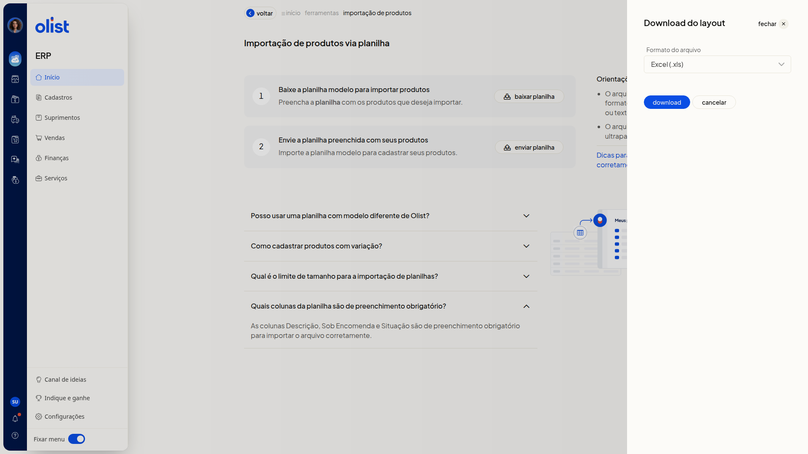

# Validações na importação de produtos

## Descrição

Na importação de produtos por planilha, o ERP da Olist confere o arquivo antes de criar ou atualizar os produtos. A validação aponta a linha e o motivo da falha, para você corrigir a planilha.

Você abre a página **Importação de produtos via planilha** por **Início > Ferramentas**, na aba **Importações**, em **Produtos** no grupo **Cadastros**, ou por **Cadastros > Produtos > Mais ações > Importar produtos de uma planilha**. O link **Dicas para preencher corretamente** abre o artigo Importar planilha de produtos.

## Pré-requisitos

- Esteja no ERP, já autenticado.
- Tenha permissão de Produtos e de importação de registros, com permissão para incluir e editar produtos.
- Use a planilha modelo baixada nesta tela. Um modelo diferente do layout da Olist não deve ser usado.
- Preencha a planilha antes do envio.

## Importante

- Use o layout padrão baixado nesta tela. Não use um modelo diferente do da Olist, não altere os nomes das colunas, não mude a ordem do cabeçalho e não exclua colunas.
- O arquivo enviado deve ser Excel (.xls ou.xlsx) ou texto (.csv), com até 2 Mb e até 500 registros.
- No painel **Download do layout**, as opções são **Excel (.xls)** e **Texto (.csv)**.
- Deixe as células opcionais em branco. Use Sim ou Não e os códigos de **Origem**. Sem esses termos, a importação é bloqueada.
- Para vincular o fornecedor, ele já precisa estar cadastrado com o mesmo nome informado na planilha.

## Instruções

1. Acesse **Início > Ferramentas**.
2. Abra a aba **Importações**.

   

3. No grupo **Cadastros**, clique em **Produtos**.

   

4. Leia as **Orientações** da página.
5. Abra as perguntas da página sobre layout, limite de registros, colunas obrigatórias e variações.
6. Acesse o link **Dicas para preencher corretamente**.
7. No passo **Baixe a planilha modelo para importar produtos**, clique em **baixar planilha**.
8. No painel **Download do layout**, escolha **Excel (.xls)** ou **Texto (.csv)**.

   

9. Preencha a planilha com estas regras:
 - informe as colunas obrigatórias **Descrição**, **Sob Encomenda** e **Situação**
 - em **Situação**, use Ativo ou Inativo
 - em **Sob Encomenda**, use Sim ou Não
 - nos dados fiscais, preencha **Unidade**, **NCM** com 8 dígitos e **Origem** com código de 0 a 8
 - deixe **ID** em branco para produto novo
 - informe o **ID** exato para atualizar um produto
 - no produto pai, use **Tipo de Produto** V
 - no produto filho, use **Tipo de Produto** S, K, F ou M, nunca V
 - preencha **Código do Pai** no produto filho
 - em **Variações**, use o formato Tamanho:GG||Cor:Branco
 - informe até 10 URLs diretas de imagem: as colunas 1 a 6 são armazenadas e as colunas 7 a 10 são externas
 - em categorias, use o formato Nível 1 > Nível 2 > Nível 3
10. No passo **Envie a planilha preenchida com seus produtos**, clique em **enviar planilha**. A validação mostra a linha e o motivo da falha. Se a planilha estiver correta, os produtos são criados ou atualizados.

## Informações adicionais

### O preço promocional depende do módulo

O preço promocional informado na planilha só é importado se a empresa tiver o módulo de preço promocional.

### As imagens dependem do espaço de anexos

As imagens das colunas de URL imagem só são importadas se houver espaço de anexos disponível.

## Links relacionados

O artigo Importar planilha de produtos detalha o preenchimento e a finalização da importação. Se a validação continuar indicando falha, fale com o suporte.
