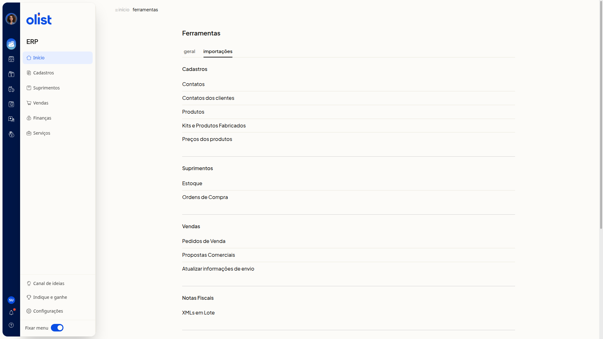
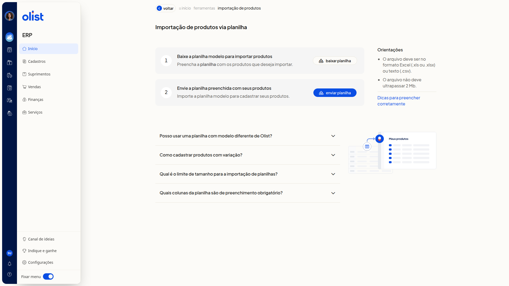

# Importar planilha de produtos

## Descrição

A página **Importação de produtos via planilha**, no ERP da Olist, orienta você a baixar o layout oficial, preencher os produtos e enviar o arquivo.

Você baixa a planilha modelo em **Excel (.xls)** ou **Texto (.csv)**. A página informa o formato aceito no envio, o limite de tamanho, as colunas obrigatórias e o cadastro de variações. Você inicia o envio em **enviar planilha**. A página abre por **Início > Ferramentas**, na aba **Importações**, em **Produtos** no grupo **Cadastros**, ou por **Cadastros > Produtos > Mais ações > Importar produtos de uma planilha**.

## Pré-requisitos

- Você precisa estar no ERP.
- Você precisa de permissão de Produtos e de importação de registros, com permissão para incluir e editar produtos.
- Use a planilha modelo baixada nesta tela. Não use um modelo diferente do da Olist.
- Preencha a planilha antes do envio.

## Importante

- Envie um arquivo Excel (.xls ou.xlsx) ou texto (.csv), com no máximo 2 Mb e até 500 registros.
- Em **Download do layout**, as opções são **Excel (.xls)** e **Texto (.csv)**.
- Não altere os nomes das colunas nem a ordem do cabeçalho e não exclua colunas.
- Deixe as células opcionais em branco.
- Preencha as colunas obrigatórias **Descrição**, **Sob Encomenda** e **Situação**.
- Use termos padronizados, como Sim, Não e os códigos de **Origem**. Se o termo não for o esperado, a importação é bloqueada.
- O preço promocional informado na planilha só é importado se a empresa tiver o módulo de preço promocional.
- Para vincular o fornecedor, ele já precisa estar cadastrado com o mesmo nome informado na planilha.
- As imagens das colunas de URL imagem só são importadas se a empresa tiver espaço de anexos disponível.

## Instruções

Pela lista de produtos, acesse **Cadastros > Produtos**, clique em **Mais ações** e depois em **Importar produtos de uma planilha**. A mesma página abre. Siga a partir de **baixar planilha**.

Por Ferramentas:

1. Acesse **Início > Ferramentas**.
2. Abra a aba **Importações**.

   

3. Clique em **Produtos** no grupo **Cadastros**.

   

4. Clique em **baixar planilha**.
5. Escolha **Excel (.xls)** ou **Texto (.csv)** em **Download do layout** para baixar a planilha modelo.

   

6. Preencha a planilha modelo com os produtos.
 - Em **Situação**, informe Ativo ou Inativo.
 - Em **Sob Encomenda**, informe Sim ou Não.
 - Nos dados fiscais, informe **Unidade**, **NCM** com 8 dígitos e **Origem** com código de 0 a 8.
 - Deixe **ID** em branco para produto novo. Para atualizar, informe o **ID** exato.
 - Em categorias, use o formato Nível 1 > Nível 2 > Nível 3.
 - Informe até 10 URLs diretas de imagem. As colunas 1 a 6 são armazenadas e as colunas 7 a 10 são externas.
 - Para variações, no produto pai informe **Tipo de Produto** com V.
 - No produto filho, informe **Tipo de Produto** com S, K, F ou M, nunca com V, e preencha **Código do Pai**.
 - Em **Variações**, use o formato Tamanho:GG||Cor:Branco.
7. Clique em **enviar planilha**. A validação mostra a linha e o motivo da falha. Se a planilha estiver correta, os produtos são criados ou atualizados.

## Links relacionados

Se precisar de ajuda, fale com o suporte.
