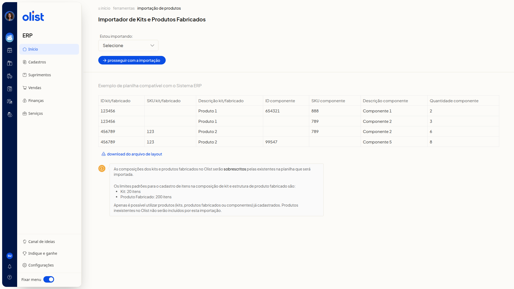

# Importar planilha de composições de kits e estrutura dos produtos fabricados

## Descrição

No ERP da Olist, você importa por planilha a composição dos kits e a estrutura dos produtos fabricados. Na página, você escolhe **Kits** ou **Produtos Fabricados**, consulta o exemplo de planilha ou baixa o layout e segue para carregar o arquivo.

Acesse pelo menu lateral **Início > Ferramentas > Importações > Cadastros > Kits e Produtos Fabricados**.

## Pré-requisitos

- Permissão de Produtos, permissão para importar registros e permissão para incluir e editar produtos. O suporte acessa mesmo sem essas permissões.
- Kits, produtos fabricados e componentes da planilha já cadastrados. Produtos inexistentes não são incluídos por esta importação.
- Planilha no formato do **Exemplo de planilha compatível com o Sistema ERP** ou do arquivo do link **download do arquivo de layout**.

## Importante

- As composições dos kits e dos produtos fabricados no ERP serão sobrescritas pelas da planilha.
- O limite padrão de itens na composição é de 20 para kit e de 200 para produto fabricado.
- O arquivo precisa ser Excel (.xls ou.xlsx) ou CSV e ter no máximo 2Mb.

## Instruções

1. Acesse **Início > Ferramentas**.
2. Abra a aba **Importações**. Na seção **Cadastros**, clique em **Kits e Produtos Fabricados**.
3. Selecione **Kits** ou **Produtos Fabricados** em **Estou importando**, na página **Importador de Kits e Produtos Fabricados**. O campo não é obrigatório e a lista traz **Selecione**, **Kits** e **Produtos Fabricados**. O exemplo de planilha e as regras de sobrescrita e de limite permanecem iguais nas duas opções.

   

4. Monte a planilha com as colunas abaixo, como no **Exemplo de planilha compatível com o Sistema ERP**. O exemplo mostra, entre outras linhas, o kit/fabricado 123456 (Produto 1) com o componente 654321 / SKU 888 (Componente 1), quantidade 2, e o kit/fabricado 456789 / SKU 123 (Produto 2) com componentes de quantidade 6 e 8. Se preferir o modelo, acesse o link **download do arquivo de layout**.
 - **ID kit/fabricado**
 - **SKU kit/fabricado**
 - **Descrição kit/fabricado**
 - **ID componente**
 - **SKU componente**
 - **Descrição componente**
 - **Quantidade componente**
5. Clique em **prosseguir com a importação**. A tela **Carregar arquivo** pede um arquivo Excel (.xls ou.xlsx) ou CSV de no máximo 2Mb. **Cancelar** volta à página do importador sem enviar o arquivo.

   

## Links relacionados

Se você precisar de ajuda com a importação, fale com o suporte.
