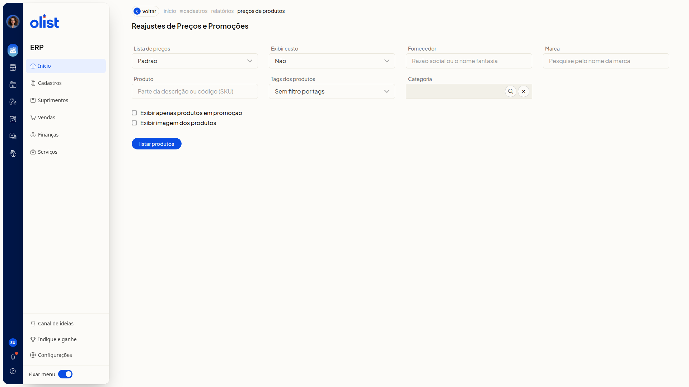

# Reajuste de preços em massa de produtos

## Descrição

A tela **Reajustes de Preços e Promoções** do ERP da Olist filtra os produtos de uma lista de preços e os lista para você informar um reajuste. Você monta essa listagem e segue para **Informar reajuste**.

Acesse **Reajustes de Preços e Promoções** no ERP. Na tela, filtre por lista de preços, exibição de custo, fornecedor, marca, produto, tags dos produtos e categoria. Você também pode restringir a listagem a produtos em promoção e optar por exibir a imagem dos produtos.

## Pré-requisitos

- Tenha uma sessão autenticada no ERP.
- Tenha permissão para o relatório de preços de produtos para acessar **Reajustes de Preços e Promoções**.
- Tenha permissão para editar produtos para a ação **Informar reajuste** aparecer.

## Importante

- **Lista de preços**: só aparece se você tiver permissão de lista de preços.
- **Exibir custo**: só aparece se você tiver permissão de preço de custo dos produtos.
- **Custo da compra** e **Custo médio**: só aparecem em **Exibir custo** se a empresa tiver permissão de DRE.
- **Categoria**: só aparece se a empresa tiver permissão de categorias de produtos.
- **Exibir apenas produtos em promoção** e **Informar promoções**: só aparecem se a empresa tiver permissão de preço promocional.
- Nenhum filtro é obrigatório.

## Instruções

1. Acesse a tela **Reajustes de Preços e Promoções**.
2. Ajuste os filtros, se quiser.

#### Lista de preços e custo

- **Lista de preços** (opcional): na lista suspensa, selecione uma lista cadastrada na conta, como **Padrão**.
- **Exibir custo** (opcional): escolha **Não**, **Custo da compra** ou **Custo médio**.

#### Filtros de produto

- **Fornecedor** (opcional): digite o fornecedor.
- **Marca** (opcional): digite a marca.
- **Produto** (opcional): digite o produto.
- **Tags dos produtos** (opcional): selecione tags já cadastradas. Para não filtrar por tags, use **Sem filtro por tags**.
- **Categoria** (opcional): digite a categoria.

#### Opções de exibição

- **Exibir apenas produtos em promoção** (opcional): marque para restringir a listagem a produtos em promoção.
- **Exibir imagem dos produtos** (opcional): marque para exibir a imagem dos produtos.

3. Clique em **Listar produtos**.
4. Aguarde a mensagem **Os dados do relatório estão sendo carregados. Por favor, aguarde.** A tela mostra um percentual de progresso e, ao concluir, a listagem com as colunas **Descrição**, **Código (SKU)**, **Unidade** e **Preço** e as ações **Exibir filtros**, **Download**, **Informar reajuste** e **Informar promoções**.
5. Na listagem, clique em **Informar reajuste**.

## Resultado

Depois de **Listar produtos**, a listagem da lista de preços mostra **Descrição**, **Código (SKU)**, **Unidade** e **Preço**. A ação **Informar reajuste** fica disponível nessa listagem.

## Links relacionados

Se precisar de ajuda para seguir com o reajuste, fale com o suporte.
