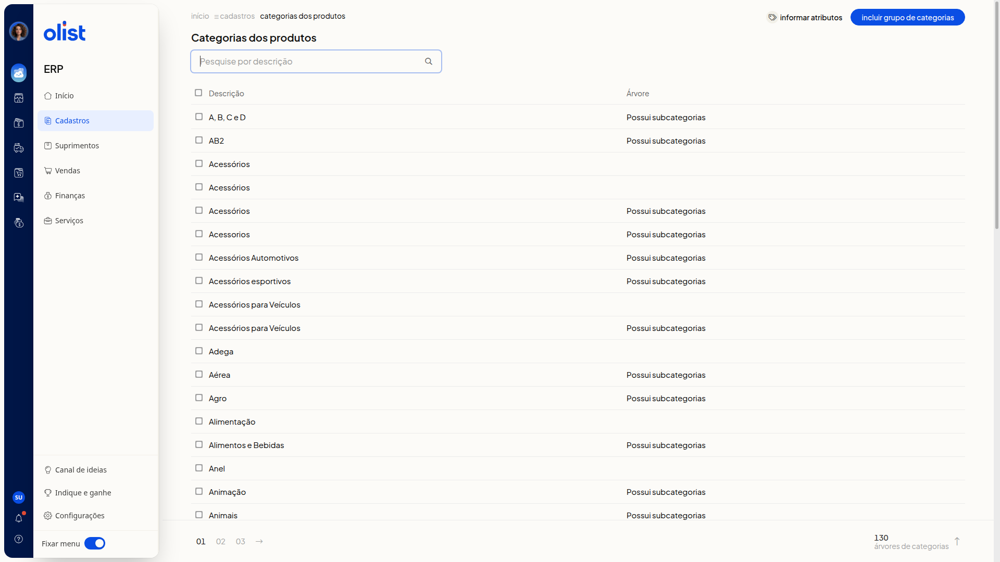
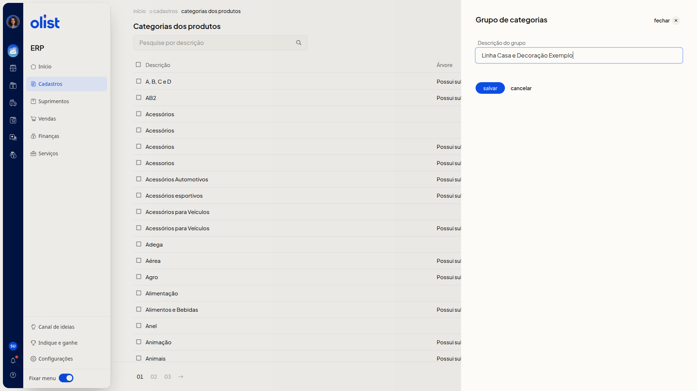
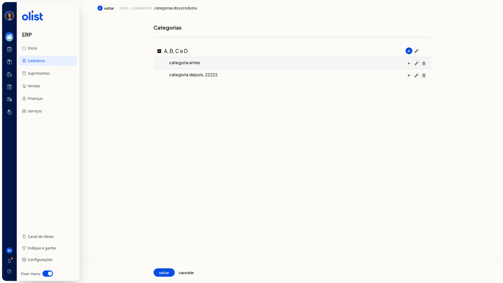
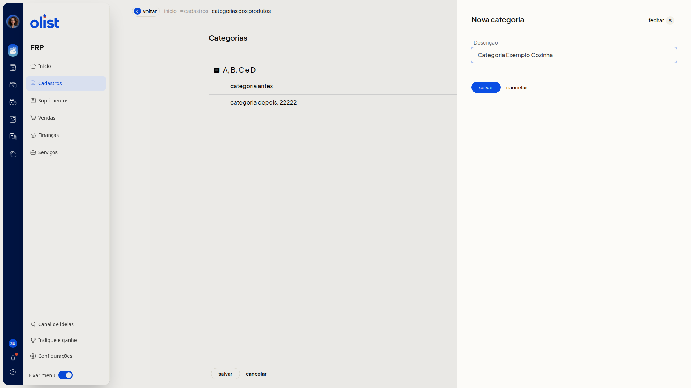
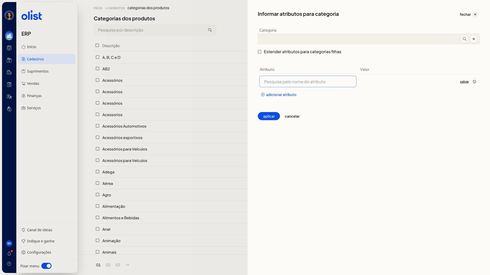

# Categorias dos produtos

## Descrição

No ERP da Olist, você organiza os produtos em grupos de categorias. Na lista, você pesquisa pela descrição, inclui um grupo e abre a árvore para incluir, editar ou excluir categorias. Na mesma lista, você vincula atributos a uma categoria e pode estender esses atributos às categorias filhas.

Para abrir a lista, acesse o menu lateral **Cadastros > Categorias dos Produtos**. As colunas **Descrição** e **Árvore** mostram os grupos de categorias.

## Pré-requisitos

- Você precisa estar no ERP, com o menu **Cadastros** disponível.
- Você precisa da permissão de Categorias dos produtos para acessar a tela.
- Para organizar categorias dentro de um grupo, o grupo já precisa constar na lista.

## Importante

- É necessário informar a descrição do grupo para incluir o grupo de categorias.
- É necessário informar a descrição para incluir ou editar a categoria.
- Não é possível informar o mesmo atributo mais de uma vez.

## Instruções

### Incluir um grupo de categorias

1. Acesse **Cadastros > Categorias dos Produtos** no menu lateral.

   

2. Clique em **Incluir grupo de categorias**.
3. Preencha **Descrição do grupo**. É necessário informar a descrição para incluir o grupo.

   

4. Clique em **salvar** para concluir o cadastro do grupo.

### Incluir uma categoria na árvore

1. Acesse **Cadastros > Categorias dos Produtos** no menu lateral.
2. Clique na descrição do grupo na lista.

   

3. Clique em **Incluir categoria** no nó em que a nova categoria deve ser criada.
4. Preencha **Descrição**. É necessário informar a descrição para incluir a categoria.

   

5. Clique em **salvar** para concluir o cadastro da categoria.

### Editar uma categoria

1. Acesse **Cadastros > Categorias dos Produtos** no menu lateral.
2. Clique na descrição do grupo na lista.
3. Clique em **Editar categoria** no nó desejado.
4. Altere **Descrição**, que abre já preenchida com o texto atual. É necessário informar a descrição para editar a categoria.
5. Clique em **salvar** para concluir a edição.

### Informar atributos para uma categoria

1. Acesse **Cadastros > Categorias dos Produtos** no menu lateral.
2. Clique em **Informar atributos**.

   

3. Busque a categoria no campo **Categoria**.
4. Clique em **Buscar categorias** ou em **Limpar categorias** se precisar ajustar a busca.
5. Marque **Estender atributos para categorias filhas** se quiser replicar os atributos nas categorias filhas.
6. Pesquise o atributo pelo nome na coluna **Atributo**.
7. Informe o valor na coluna **Valor**.
8. Acesse o link **adicionar atributo** se quiser incluir outra linha.
9. Clique em **aplicar** para concluir.

## Informações adicionais

### A coluna Árvore indica subcategorias

Na coluna **Árvore**, o texto **Possui subcategorias** aparece quando o grupo tem categorias filhas.

### A pesquisa localiza o grupo pela descrição

No campo **Pesquise por descrição**, pesquise o grupo pela descrição. Você pode percorrer a lista pela paginação.

### A árvore reúne as categorias do grupo

A árvore mostra o grupo e as categorias filhas recuadas. Em cada nó há **Incluir categoria**, **Editar categoria** e **Excluir categoria**. **Voltar** retorna à lista de categorias.

### Cancelar não grava o preenchimento

No grupo, **cancelar** fecha o painel e a descrição preenchida não entra na lista. Na nova categoria, **cancelar** fecha o painel sem incluir a categoria. Na edição, **cancelar** fecha o painel e a descrição exibida na árvore permanece a anterior.

## Links relacionados

Se precisar de ajuda com categorias dos produtos, fale com o suporte.
