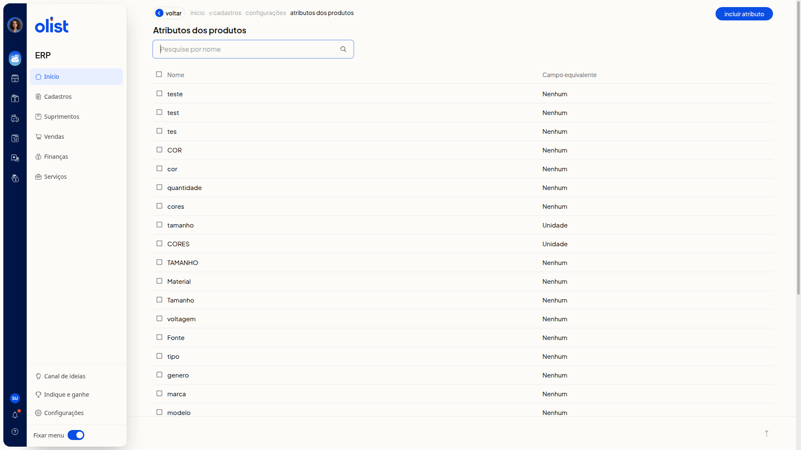
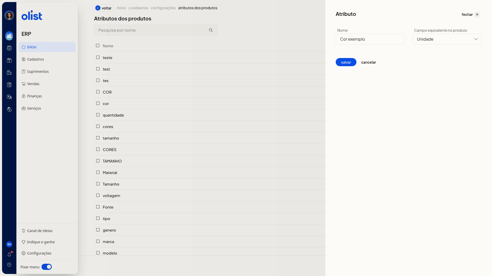

# Atributos dos Produtos - Configurações

A página **Atributos dos produtos** do ERP da Olist serve para você consultar os atributos já cadastrados e incluir um novo atributo, com nome e campo equivalente no produto.

## Como acessar

Acesse **Configurações > Configurações ERP > Configurações de atributos de produtos**, na seção **Cadastros**. A página que abre se chama **Atributos dos produtos**.

## Pré-requisitos

Você precisa do menu **Configurações** disponível no ERP, porque o caminho passa por **Configurações** e **Configurações ERP**.

## Atributos dos produtos

A página reúne a busca e a lista de atributos.

- O campo **Pesquise por nome** busca um atributo pelo nome, com o botão de pesquisa ao lado.
- O botão **Incluir atributo** abre o painel **Atributo**.
- A lista mostra as colunas **Nome** e **Campo equivalente**.

## Atributo

No painel **Atributo**, você preenche **Nome** e **Campo equivalente no produto**. Nenhum dos dois é obrigatório.

**Nome** é o nome do atributo.

**Campo equivalente no produto** aceita somente uma destas opções:

- **Nenhum**
- **GTIN**
- **Código (SKU)**
- **Marca**
- **Unidade**
- **Fornecedor**
- **Peso Bruto**
- **Peso Líquido**
- **Altura Embalagem**
- **Largura Embalagem**
- **Comprimento Embalagem**

Nenhuma dessas opções exibe outro campo.

O painel traz os botões **salvar**, **cancelar** e **fechar**. **cancelar** e **fechar** fecham o painel sem salvar.

## Links relacionados

Se precisar de ajuda com esta configuração, fale com o suporte.
