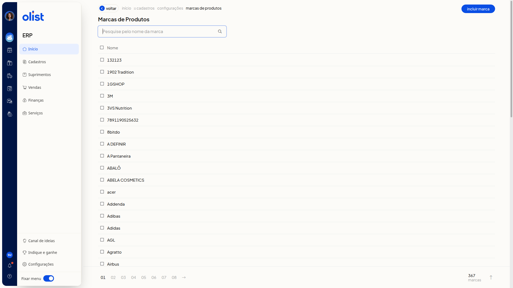
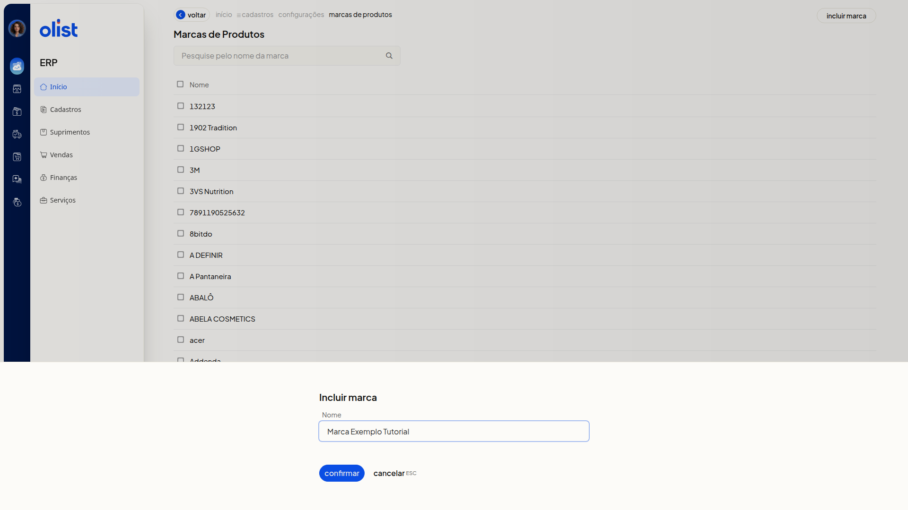
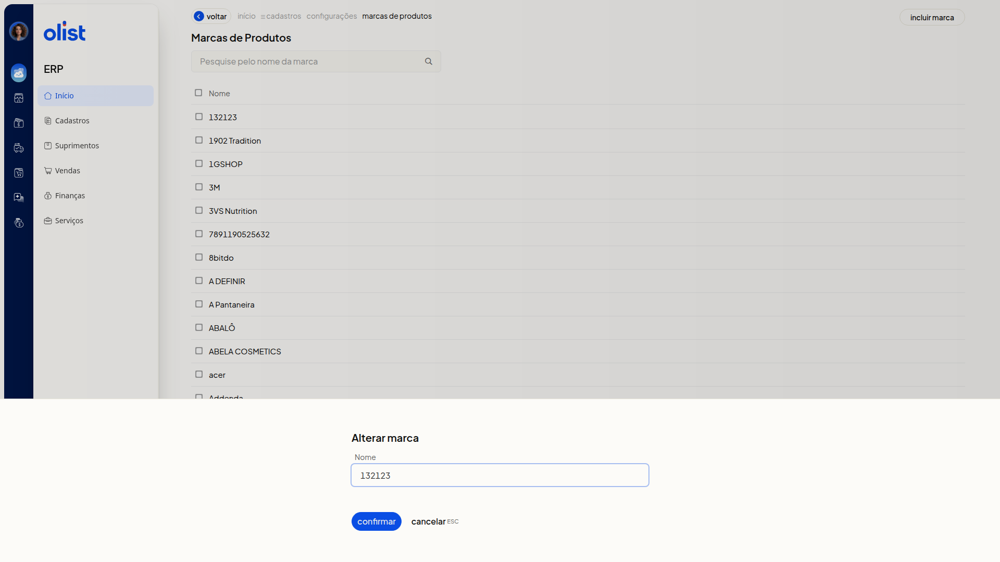

# Marcas dos Produtos - Configurações

No ERP da Olist, a opção **Configurações de marcas de produtos** abre a lista **Marcas de Produtos**. Você pesquisa uma marca pelo nome, inclui uma marca ou altera o nome de uma marca já listada, para manter os nomes atualizados.

## Importante

Apenas quem tem permissão para configurar marcas de produtos acessa esta tela.

Informe o nome para incluir ou alterar uma marca. Não é possível incluir ou alterar uma marca usando um nome já cadastrado.

## Como acessar

No menu lateral, acesse **Configurações > Configurações ERP > Cadastros > Configurações de marcas de produtos**.

## Pré-requisitos

- Você precisa estar autenticado no ERP, com o menu **Configurações** e a opção **Configurações ERP** disponíveis.
- Você precisa de permissão para configurar marcas de produtos.

## Grupos de configuração

### Marcas de Produtos

A lista reúne as marcas na coluna **Nome** e pode ter mais de uma página.

- **Pesquise pelo nome da marca**: localize uma marca pelo nome.
- **Incluir marca**: inicia a inclusão de uma marca.
- **Nome**: mostra o nome de cada marca. Clique no nome para alterar a marca.

### Incluir marca

Clique em **Incluir marca**.

- **Nome**: informe o nome da marca.

- **Confirmar**: conclui a inclusão.
- **Cancelar (ESC)**: fecha a inclusão e volta à lista **Marcas de Produtos**, sem incluir a marca informada.

### Alterar marca

Na lista **Marcas de Produtos**, clique no nome da marca na coluna **Nome**. O campo **Nome** aparece preenchido com o nome atual. Ajuste o texto se necessário.

- **Confirmar**: salva a alteração.
- **Cancelar (ESC)**: fecha sem confirmar a alteração.

## Links relacionados

Se precisar de ajuda com esta configuração, fale com o suporte.
