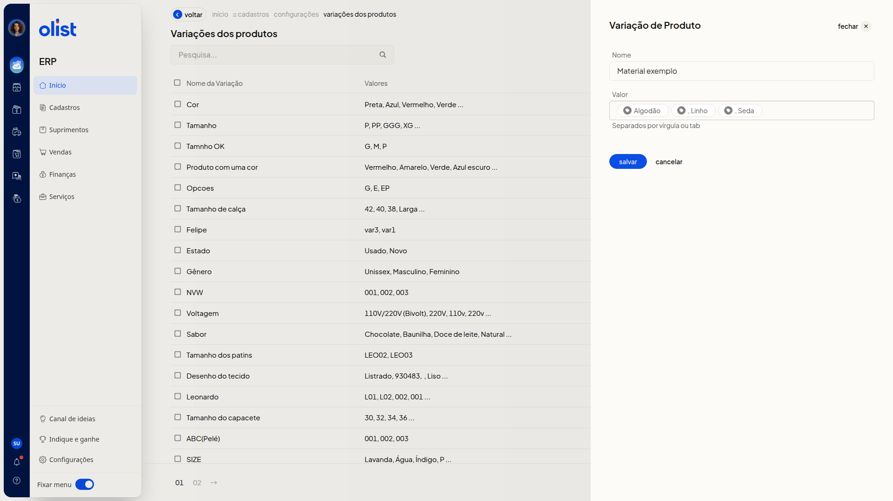
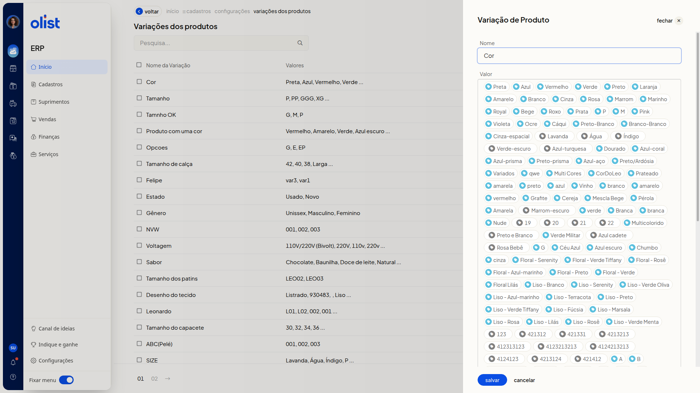
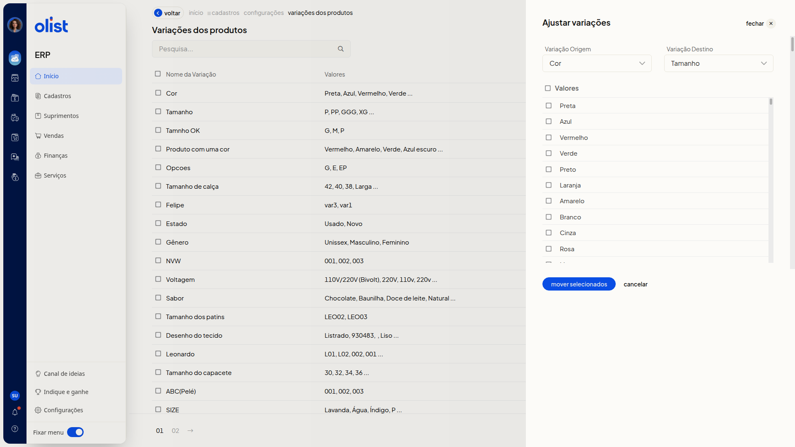

# Variações de Produtos - Configurações

A página **Variações dos produtos** mostra as variações já cadastradas, com o nome e os valores. Nela, você inclui uma variação, revisa ou complementa uma variação existente e ajusta valores entre duas variações.

## Importante

Apenas quem tem permissão para configurar variações de produtos acessa a página **Variações dos produtos**.

## Como acessar

Acesse a página **Variações dos produtos**.

## Pré-requisitos

- Para editar ou ajustar, você precisa de uma variação já cadastrada.
- No ajuste, os valores saem da variação escolhida como origem.

## Grupos de configuração

### Variações dos produtos

A lista reúne as colunas **Nome da Variação** e **Valores**. A página indica o total de variações e oferece paginação.

Use o campo **Pesquisa...** para buscar uma variação.

### Incluir variação de produto

Clique em **Incluir variação de produto**.

Os campos não são obrigatórios.

- **Nome**: nome da variação.
- **Valor**: valores com a orientação **Separados por vírgula ou tab**. Cada valor passa a aparecer como etiqueta.

Use **Salvar** ou **Cancelar**. **Cancelar** fecha o painel e volta à lista, sem gravar.

### Variação de Produto

Clique no nome da variação na coluna **Nome da Variação**.

Os campos não são obrigatórios.

- **Nome**: nome já preenchido, para revisão ou complemento.
- **Valor**: valores já exibidos como etiquetas. Novos valores seguem a orientação **Separados por vírgula ou tab**.

Valores já vinculados a um produto não podem ser alterados.

Use **Salvar** ou **Cancelar**. **Cancelar** volta à lista, sem gravar.

### Ajustar variações

Clique em **Ajustar variações**.

Os campos não são obrigatórios.

- **Variação Origem**: variação de onde os valores saem. A lista mostra as variações já cadastradas.
- **Variação Destino**: variação que receberá os valores. A lista mostra as variações já cadastradas.
- **Valores**: caixas de seleção dos valores da variação de origem. Marque os que devem ser movidos.

A variação selecionada em **Variação Origem** não aparece em **Variação Destino**.

Use **mover selecionados** ou **Cancelar**. **Cancelar** fecha o painel, sem mover valores.

## Links relacionados

Se precisar de ajuda com as variações de produtos, fale com o suporte.
