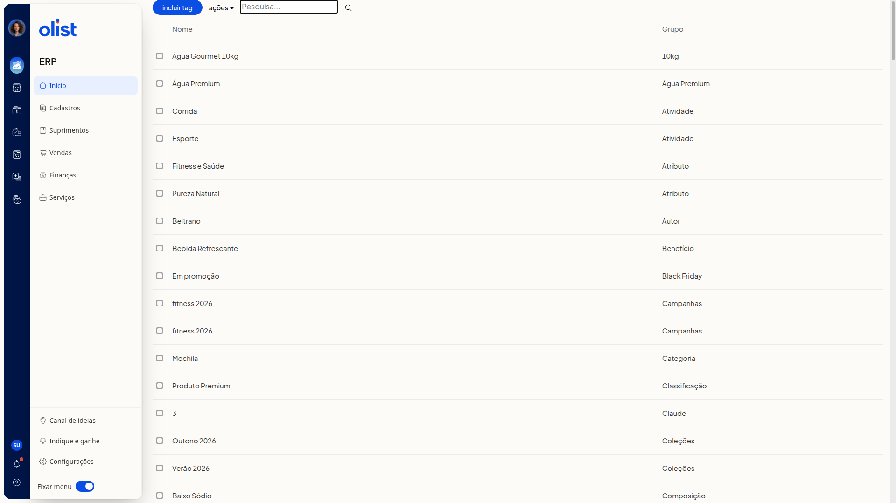
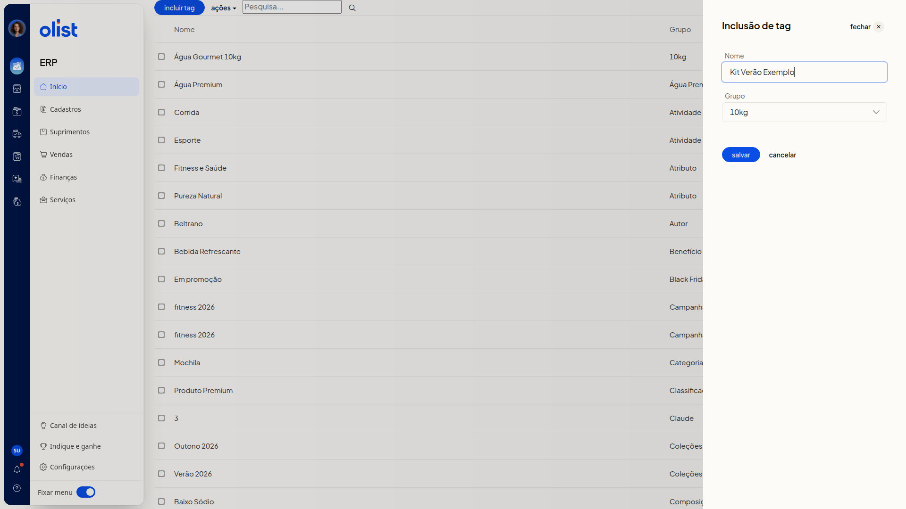

# Tags de produtos

## Descrição

A página de tags de produtos no ERP da Olist lista as tags nas colunas **Nome** e **Grupo**. Você pesquisa pelo campo **Pesquisa...**, inclui uma tag em um grupo já cadastrado e seleciona linhas para usar o menu **Ações**.

Para incluir uma tag, use o botão **Incluir tag** na página de tags de produtos.

## Pré-requisitos

- Estar autenticado no ERP, na página de tags de produtos
- Ter a permissão de Tags para acessar a página
- Ter grupos de tags já cadastrados, pois **Grupo** só oferece grupos existentes

## Importante

- **Grupo** não aceita um nome digitado. Escolha um grupo já cadastrado na lista.
- **Novo grupo de tags** não cadastra um grupo. Escolher essa opção só seleciona um grupo que já tem esse nome e não abre outro campo.
- **Ações** não inclui tag. O único item do menu é **excluir selecionados**.
- Não é possível salvar a tag se já existir outra tag com o mesmo nome no grupo escolhido.

## Instruções

1. Confira, na página de tags de produtos, a listagem com as colunas **Nome** e **Grupo**, o botão **Incluir tag**, o menu **Ações** e o campo **Pesquisa...**.

   

2. Clique em **Incluir tag**. O painel **Inclusão de tag** mostra os campos **Nome** e **Grupo** e os botões **salvar**, **cancelar** e **fechar**. **Grupo** já vem com um grupo selecionado.

   

3. Preencha **Nome** e selecione um grupo já existente em **Grupo**. Os campos **Nome** e **Grupo** não são obrigatórios. A listagem não muda enquanto **salvar** não é acionado.

   

4. Clique em **salvar** quando quiser gravar a tag.

## Links relacionados

Se precisar de ajuda, fale com o suporte.
