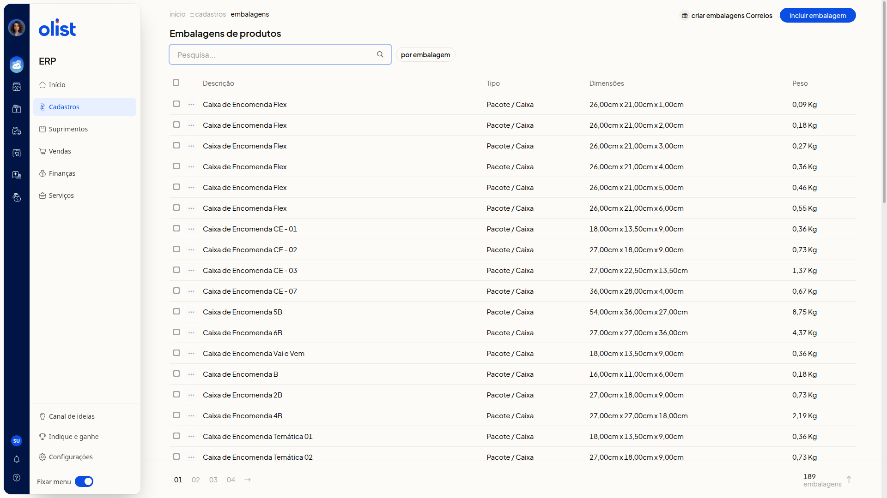
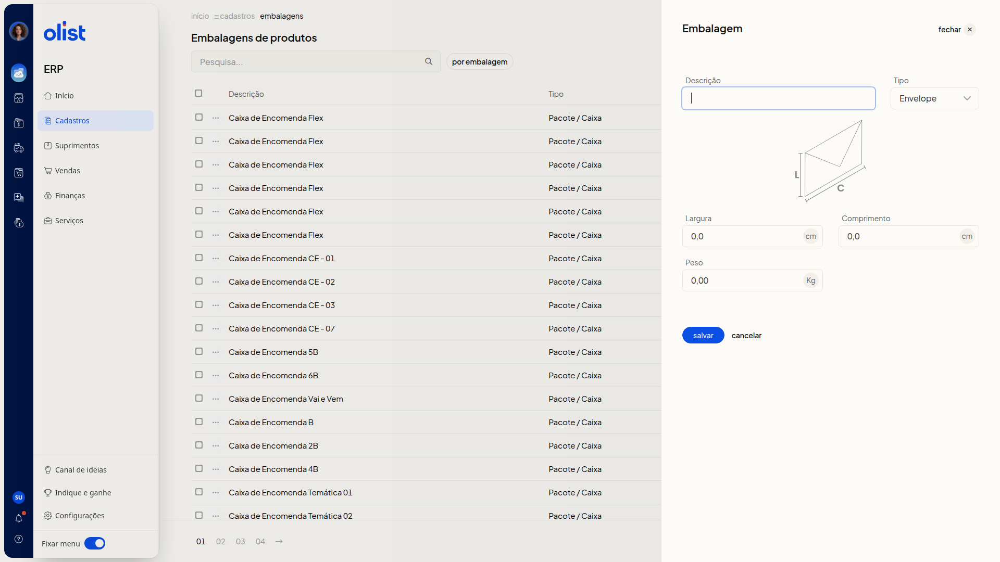
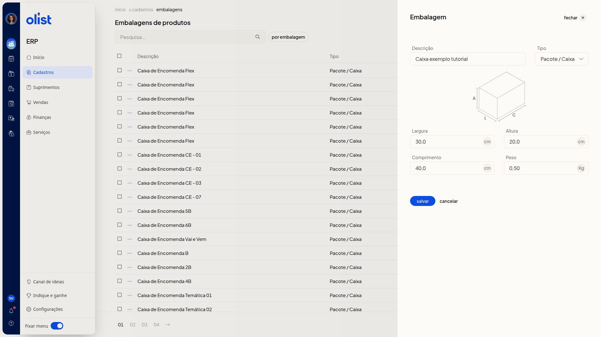
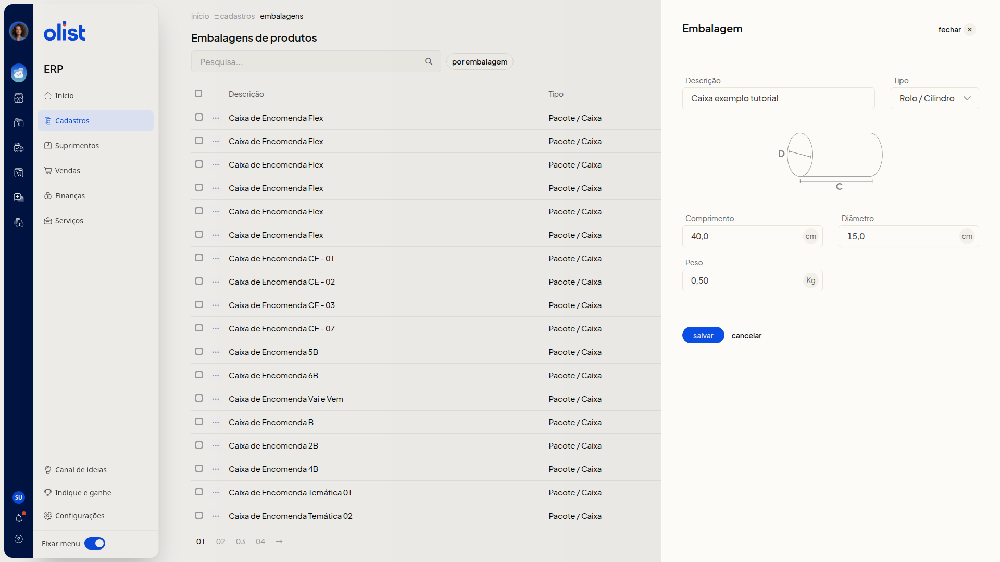
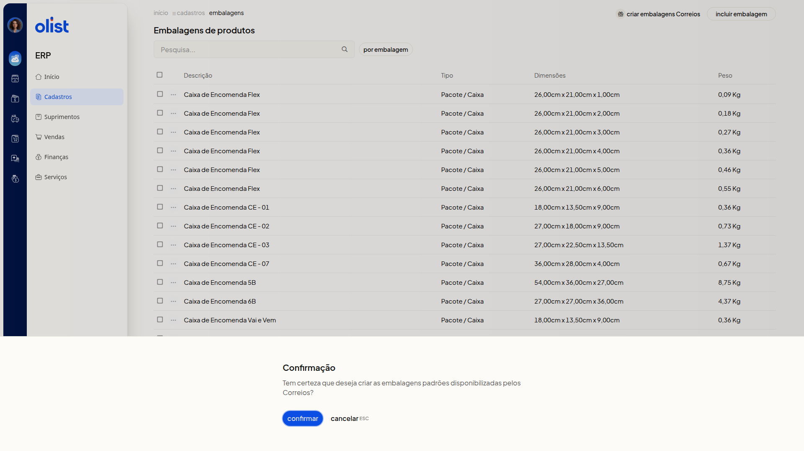

# Embalagens

## Descrição

A página **Embalagens de produtos** no ERP da Olist lista as embalagens com descrição, tipo, dimensões e peso. Você consulta a lista e cadastra uma nova embalagem. O tipo escolhido define as medidas: **Envelope** usa largura e comprimento, **Pacote / Caixa** acrescenta altura e **Rolo / Cilindro** usa comprimento e diâmetro. O peso aparece nos três tipos.

No menu lateral, acesse **Cadastros > Embalagens**. Você cadastra uma embalagem em **Incluir embalagem** ou cria as embalagens padrões dos Correios em **Criar embalagens Correios**.

## Pré-requisitos

- Ter o menu **Cadastros** disponível no ERP.
- Ter a permissão de Embalagens para acessar **Embalagens de produtos**.

## Importante

- **Criar embalagens Correios** não grava na hora. O ERP abre o diálogo **Confirmação** antes de criar as embalagens padrões dos Correios.

## Instruções

### Cadastro pela tela

1. No menu lateral, acesse **Cadastros > Embalagens**.

   

2. Clique em **Incluir embalagem**.

   

3. Informe a **Descrição**. O campo não é obrigatório.

4. Selecione o **Tipo**: **Envelope**, **Pacote / Caixa** ou **Rolo / Cilindro**. O campo não é obrigatório. O tipo inicial é **Envelope**, e a opção muda as medidas.

5. Preencha as medidas do tipo escolhido e o **Peso**. Estes campos não são obrigatórios. Use vírgula decimal. As medidas ficam em cm e o peso em Kg.

#### Envelope

Preencha **Largura**, **Comprimento** e **Peso**.

#### Pacote / Caixa

Preencha **Largura**, **Altura**, **Comprimento** e **Peso**.

#### Rolo / Cilindro

Preencha **Comprimento**, **Diâmetro** e **Peso**. Veja o diagrama de cilindro marcado com D e C.

6. Clique em **Salvar** para gravar a embalagem. Para descartar o preenchimento sem incluir a embalagem, clique em **Cancelar**.

### Criar embalagens padrões dos Correios

1. No menu lateral, acesse **Cadastros > Embalagens**.
2. Clique em **Criar embalagens Correios**.
3. Leia a pergunta do diálogo **Confirmação**: Tem certeza que deseja criar as embalagens padrões disponibilizadas pelos Correios?

   

4. Clique em **Confirmar** para seguir com a criação. Para desistir, clique em **Cancelar** ou pressione **ESC**.

## Informações adicionais

### A lista mostra as dimensões conforme o tipo

As colunas são **Descrição**, **Tipo**, **Dimensões** e **Peso**. **Pacote / Caixa** aparece com três medidas, por exemplo 26,00cm x 21,00cm x 1,00cm. **Envelope** aparece com duas medidas, por exemplo 16,20cm x 11,40cm. O peso aparece em Kg, por exemplo 0,09 Kg.

### A página inclui pesquisa e filtro

A página traz o campo **Pesquisa...** e o filtro por embalagem.

## Links relacionados

Se precisar de ajuda, fale com o suporte.
