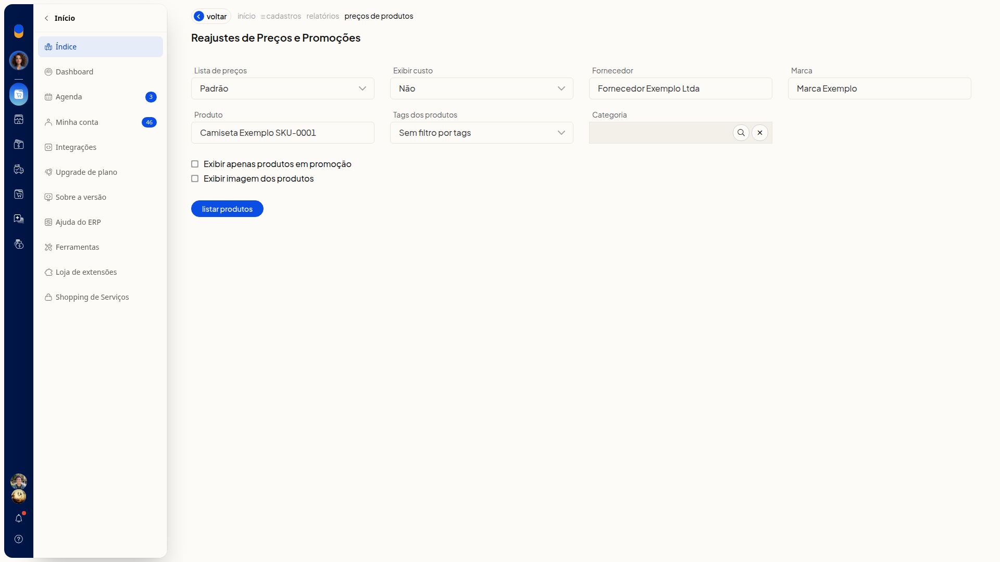
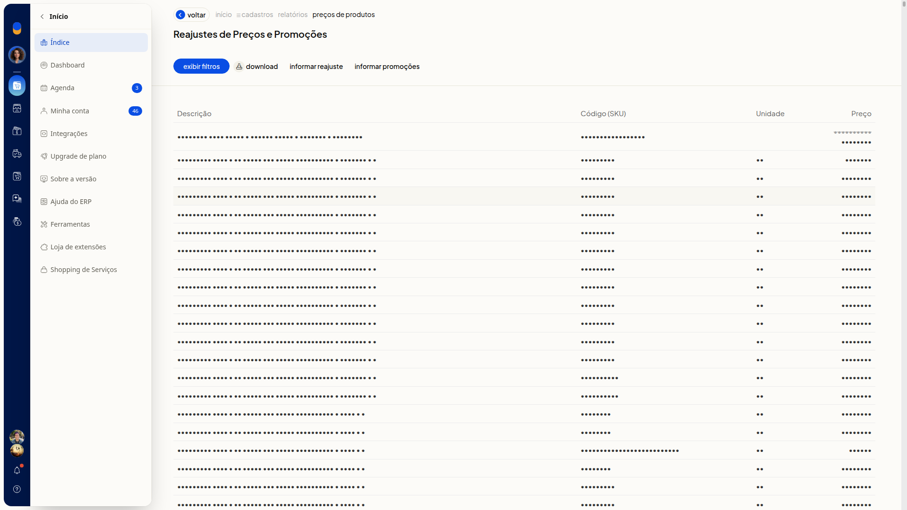

# Ações em lote nos produtos

Na listagem de produtos do ERP da Olist, em **Cadastros > Produtos**, **Mais ações** reúne operações em lote do cadastro. Você reajusta preços, edita o CEST em lote, imprime relatório e trabalha com planilha de produtos.

Em **Reajustes de Preços e Promoções**, você filtra os produtos, lista os preços da lista escolhida e pode informar um reajuste ou promoções.

## Instruções
1. Acesse **Cadastros > Produtos**.

   

2. Clique em **Mais ações**.

   

O menu exibe:

- **Receber produtos do e-commerce**
- **Imprimir relatório**
- **Iniciar histórico de custos**
- **Reajustar preço dos produtos**
- **Editar CEST dos produtos em lote**
- **Produtos com problemas fiscais**
- **Gerenciar preços dos anúncios**
- **Consultar último lote de sugestão de ncm**
- **Exportar produtos para planilha**
- **Exportar composição de kits para planilha**
- **Exportar estrutura de fabricados para planilha**
- **Importar produtos de uma planilha**

3. Clique na ação em lote desejada.

Os passos seguintes valem para **Reajustar preço dos produtos**.

4. Confira os filtros na tela **Reajustes de Preços e Promoções**. **Lista de preços** inicia em **Padrão** e **Exibir custo** inicia em **Não**.

   

5. Ajuste os filtros que precisar. Nenhum filtro é obrigatório.

   

#### Lista de preços e custo

- **Lista de preços**: opcional. Selecione uma lista de preços já cadastrada. A opção inicial é **Padrão**.
- **Exibir custo**: opcional. As opções são **Não**, **Custo da compra** e **Custo médio**.

#### Filtros de cadastro

- **Fornecedor**: opcional. Busque um fornecedor já cadastrado. Se o nome não existir, a tela indica que o cadastro não foi encontrado.
- **Marca**: opcional. Busque uma marca já cadastrada. Se o nome não existir, a tela indica que a marca não foi encontrada.
- **Produto**: opcional. Filtre por um produto do cadastro.
- **Tags dos produtos**: opcional. Selecione tags já cadastradas ou o controle **Sem filtro por tags**.
- **Categoria**: opcional. Busque uma categoria já cadastrada. O texto digitado livremente não permanece no campo.

#### Exibição

- **Exibir apenas produtos em promoção**: opcional. Marque a caixa de seleção para exibir apenas produtos em promoção.
- **Exibir imagem dos produtos**: opcional. Marque a caixa de seleção para exibir a imagem dos produtos.

6. Clique em **Listar produtos** e aguarde a geração da listagem. A tabela mostra **Descrição**, **Código (SKU)**, **Unidade** e **Preço**. Clique em **Exibir filtros** para exibir os filtros novamente, em **Download** para baixar a listagem, em **Informar reajuste** para informar o reajuste ou em **Informar promoções** para informar as promoções.

   

## Resultado
A tabela de **Reajustes de Preços e Promoções** mostra os produtos com o preço da lista selecionada.
