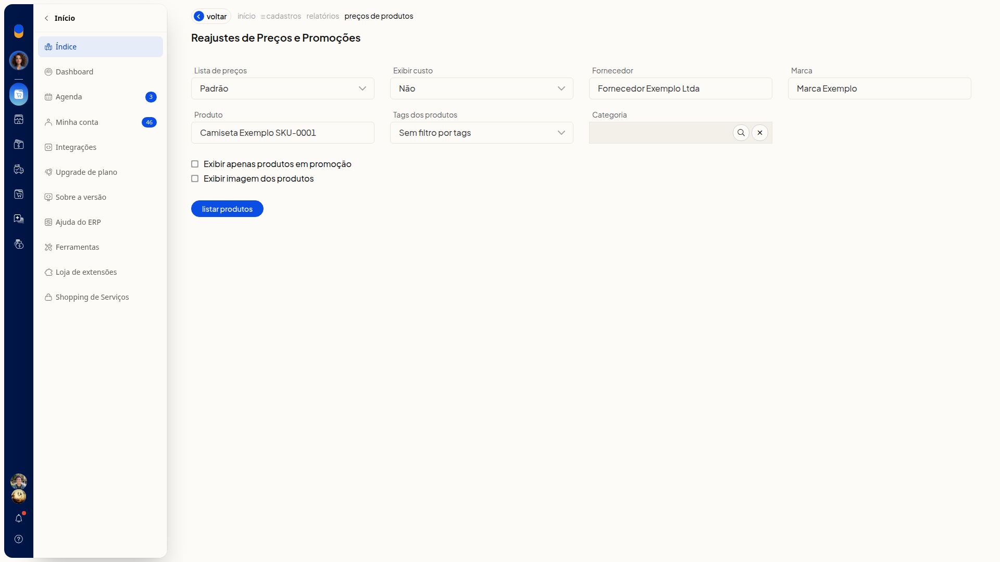
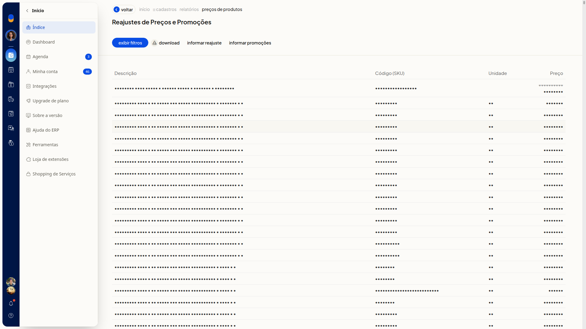

# Baixar a listagem de preços dos produtos

No ERP da Olist, você baixa a listagem de preços dos produtos da lista escolhida, a partir de **Cadastros > Produtos**. Dá para filtrar os produtos e escolher a lista de preços antes de baixar.

## Instruções
1. Acesse **Cadastros > Produtos**.

   

2. Clique em **Mais ações**.

   

3. Clique em **Reajustar preço dos produtos**.

   

4. Ajuste os filtros que precisar.

#### Lista de preços e custo

- **Lista de preços**: não é obrigatório. Selecione uma lista já cadastrada. A opção inicial é **Padrão**. Há outras listas cadastradas na conta.
- **Exibir custo**: não é obrigatório. Escolha **Não**, **Custo da compra** ou **Custo médio**. A opção inicial é **Não**.

#### Filtros do cadastro

- **Fornecedor**: não é obrigatório. Busque um fornecedor já cadastrado. Se o nome não existir, a tela indica que o cadastro não foi encontrado.
- **Marca**: não é obrigatório. Busque uma marca já cadastrada. Se o nome não existir, a tela indica que a marca não foi encontrada.
- **Produto**: não é obrigatório. Preencha se quiser filtrar por um produto.
- **Tags dos produtos**: não é obrigatório. Selecione tags já cadastradas. Para não filtrar por tags, use **Sem filtro por tags**.
- **Categoria**: não é obrigatório. Busque uma categoria já cadastrada e limpe a busca se precisar. O texto livre não permanece no campo.

#### Opções de exibição

- **Exibir apenas produtos em promoção**: não é obrigatório. Marque para listar somente produtos em promoção.
- **Exibir imagem dos produtos**: não é obrigatório. Marque para exibir a imagem dos produtos.

5. Clique em **Listar produtos** e aguarde a geração da listagem. A tabela mostra **Descrição**, **Código (SKU)**, **Unidade** e **Preço**.

   

6. Clique em **Download** para baixar a listagem.

## Informações adicionais
### A listagem pode ser gerada de novo

Clique em **Exibir filtros** para mostrar os filtros outra vez. Ajuste o que precisar, clique em **Listar produtos** e, em seguida, em **Download**.
