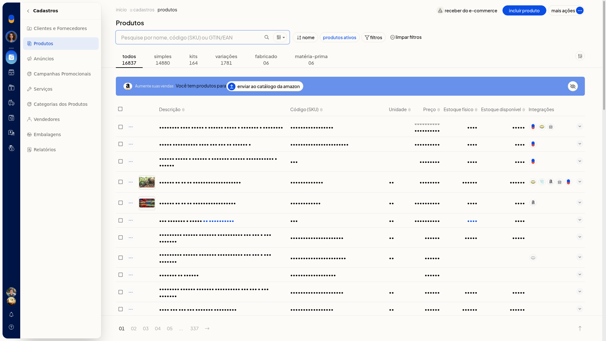
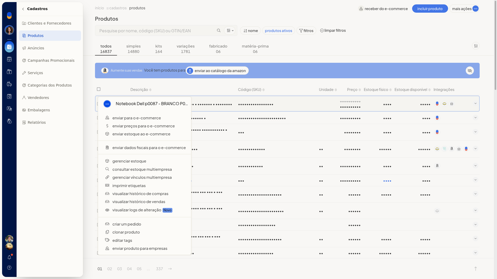
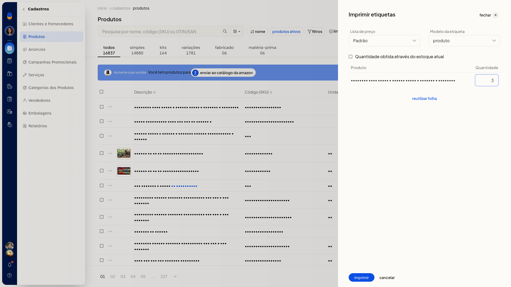
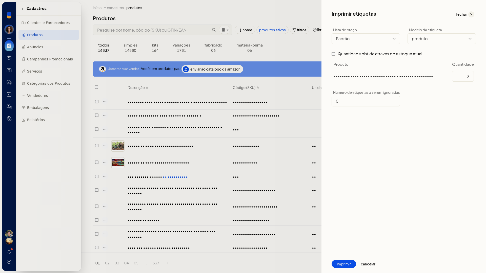
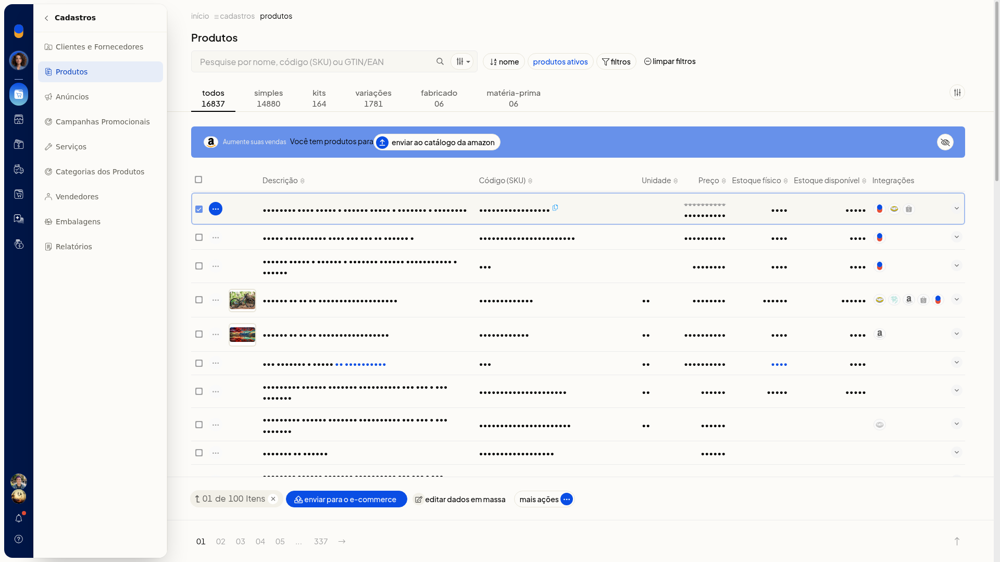
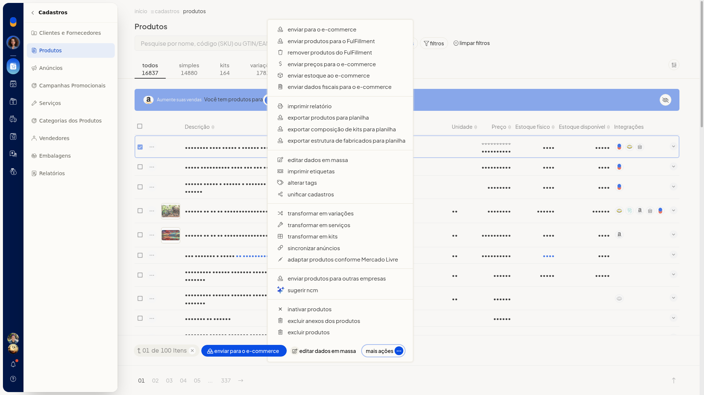

# Imprimir etiquetas de produtos

No ERP da Olist, você imprime etiquetas dos produtos já cadastrados. Dá para escolher a lista de preço, o modelo e a quantidade, e também continuar uma folha já usada.

## Instruções
1. Acesse **Cadastros > Produtos**.

   

2. Abra o menu de ações do produto e clique em **Imprimir etiquetas**.

   

3. Escolha a **Lista de preço**. O campo não é obrigatório. **Padrão** é uma das listas já cadastradas na conta.
4. Escolha o **Modelo da etiqueta**. O campo não é obrigatório. As opções são **produto** e **Produto**.

   

5. Informe a quantidade ou marque **Quantidade obtida através do estoque atual**. A caixa não é obrigatória. Com ela desmarcada, informe a quantidade à parte.

   

6. Para continuar uma folha já usada, use **reutilizar folha** e informe o **Número de etiquetas a serem ignoradas**. O campo não é obrigatório e só aparece depois de usar **reutilizar folha**.

   

7. Clique em **imprimir** para gerar as etiquetas.

## Informações adicionais
### Etiquetas pela seleção da listagem

Você também encontra **Imprimir etiquetas** nos produtos marcados na listagem. Marque um ou mais produtos, abra **Mais ações** na barra inferior e clique em **Imprimir etiquetas**.

