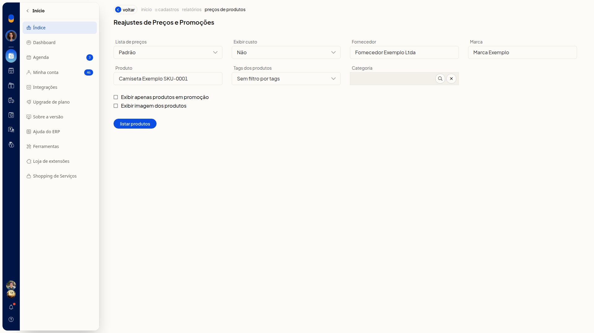
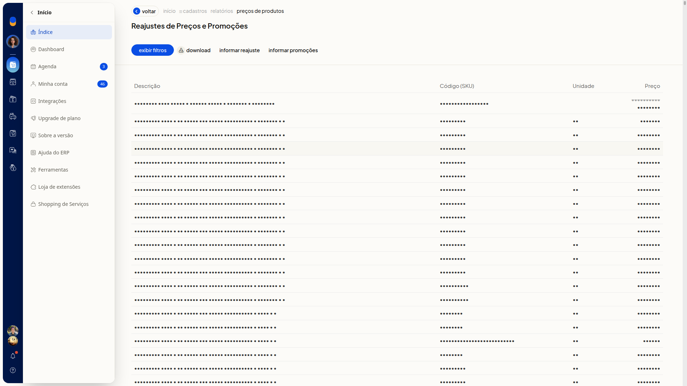

# Informar promoções dos produtos

## Instruções
1. Acesse **Cadastros > Produtos**.

   

2. Clique em **Mais ações**.

   

3. Clique em **Reajustar preço dos produtos**.

   

4. Ajuste os filtros que você precisa. Nenhum filtro é obrigatório.

#### Lista de preços e custo

- **Lista de preços**: selecione uma lista já cadastrada. A opção inicial é **Padrão**.
- **Exibir custo**: selecione **Não**, **Custo da compra** ou **Custo médio**. A opção inicial é **Não**.

#### Produto

- **Fornecedor**: busque um fornecedor já cadastrado. Se o nome não existir, a tela indica que o cadastro não foi encontrado.
- **Marca**: busque uma marca já cadastrada. Se o nome não existir, a tela indica que a marca não foi encontrada.
- **Produto**: informe o produto para restringir a listagem.
- **Tags dos produtos**: selecione tags já cadastradas. Para listar sem filtrar por tags, escolha **Sem filtro por tags**.
- **Categoria**: busque uma categoria já cadastrada. O texto livre não permanece no campo. Esse filtro só aparece se categorias de produto estiverem disponíveis para você.

#### Exibição

- **Exibir apenas produtos em promoção**: marque para listar só produtos em promoção.
- **Exibir imagem dos produtos**: marque para exibir a imagem dos produtos.

5. Clique em **Listar produtos** e aguarde a geração da listagem. A tabela mostra **Descrição**, **Código (SKU)**, **Unidade** e **Preço**, com os botões **Exibir filtros**, **Download**, **Informar reajuste** e **Informar promoções**.

   

6. Clique em **Informar promoções**.
