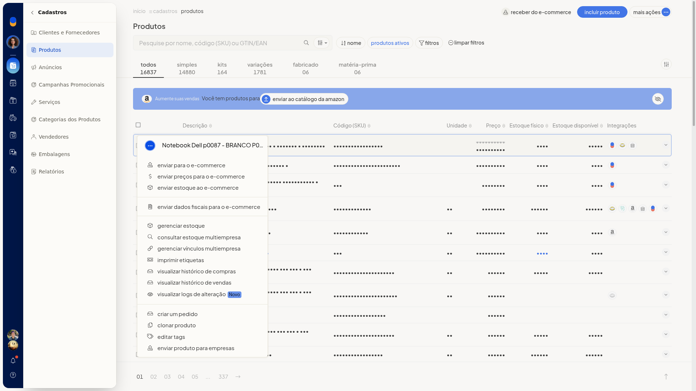
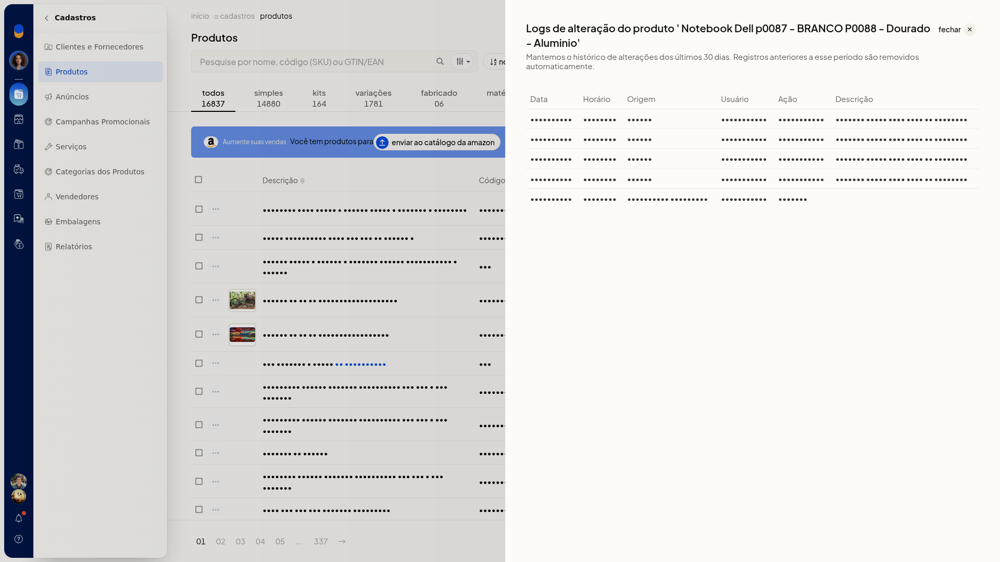

# Logs de produtos

## Pré-requisitos
- Se a opção não aparecer para você, peça acesso ao administrador da conta.

## Importante
- São exibidos os últimos 30 dias. Registros mais antigos são removidos automaticamente.
- O painel é somente leitura: não altera o cadastro do produto.

## Instruções
1. Acesse **Cadastros > Produtos**.
2. Abra o menu de ações do produto e clique em **Visualizar logs de alteração**.

   

3. Confira a tabela pelas colunas **Data**, **Horário**, **Origem**, **Usuário**, **Ação** e **Descrição**.

   

4. Clique em **Fechar** para voltar à listagem de produtos, depois de conferir quem alterou o produto, quando, por qual origem e o que foi feito.

## Informações adicionais
- Uma atualização de origem **Manual** pode trazer a descrição **Produto salvo pela tela de cadastro**.
- Uma criação de origem **Integração ecommerce** pode aparecer com a descrição vazia.
