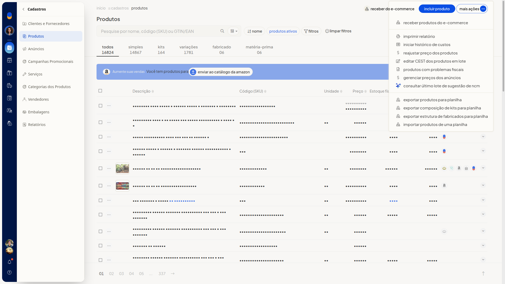
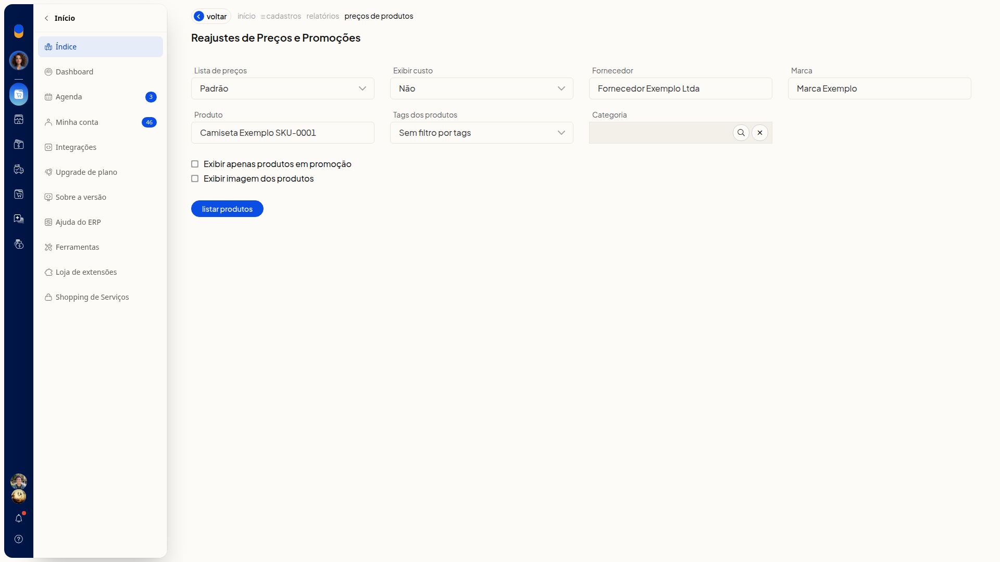
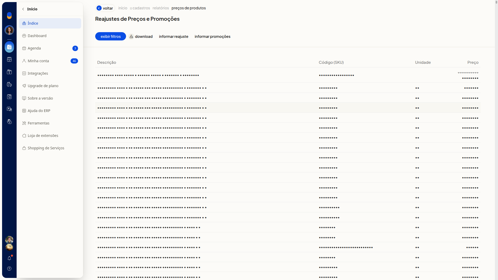

# Reajustar preços em massa

Na listagem de produtos do ERP da Olist, **Reajustar preço dos produtos** abre a tela **Reajustes de Preços e Promoções**. A ação fica em **Mais ações**, no menu **Cadastros > Produtos**.

Você filtra os produtos e lista os preços da lista escolhida. Em seguida, informa um reajuste ou promoções para esses produtos.

## Instruções
1. Acesse **Cadastros > Produtos**.

   

2. Clique em **Mais ações**.

   

3. Clique em **Reajustar preço dos produtos**.
**Lista de preços** já vem em **Padrão** e **Exibir custo** em **Não**.

4. Ajuste os filtros necessários. Nenhum filtro é obrigatório.

#### Lista de preços e custo

- **Lista de preços**: selecione uma lista já cadastrada. A opção inicial é **Padrão**.
- **Exibir custo**: selecione **Não**, **Custo da compra** ou **Custo médio**.

#### Filtros do produto

- **Fornecedor**: busque um fornecedor já cadastrado. Se o nome não existir, a tela indica cadastro não encontrado.
- **Marca**: busque uma marca já cadastrada. Se o nome não existir, a tela indica marca não encontrada.
- **Produto**: preencha apenas se quiser limitar a busca a um produto.
- **Tags dos produtos**: selecione tags já cadastradas. Para não filtrar por tags, use **Sem filtro por tags**.
- **Categoria**: busque uma categoria já cadastrada. O campo não mantém texto livre.

#### Exibição

- **Exibir apenas produtos em promoção**: marque para listar somente produtos em promoção.
- **Exibir imagem dos produtos**: marque para exibir a imagem dos produtos.

5. Clique em **Listar produtos** e aguarde a geração da listagem. A tabela mostra **Descrição**, **Código (SKU)**, **Unidade** e **Preço**.

   

6. Clique em **Informar reajuste** para informar o reajuste dos produtos listados.

## Informações adicionais
### A listagem também oferece outras ações

- **Exibir filtros** mostra os filtros novamente.
- **Download** baixa a listagem.
- **Informar promoções** informa promoções dos produtos listados.
