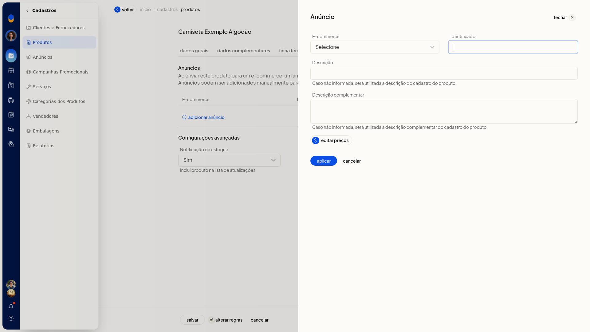
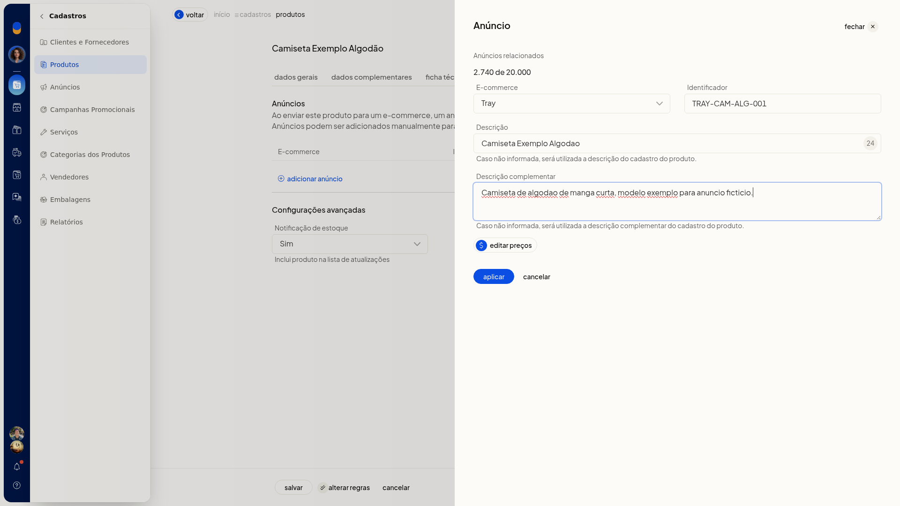
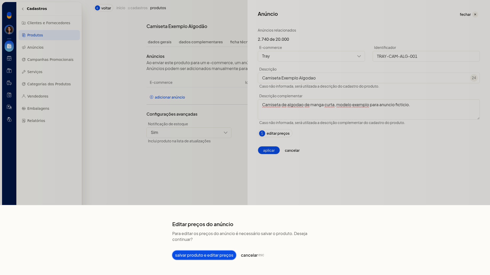

# Adicionar um anúncio de e-commerce no cadastro do produto

Na aba **Anúncios** do cadastro do produto no ERP da Olist, você relaciona o item a um ecommerce já conectado. Você informa o identificador e as descrições do anúncio e define se o produto entra na lista de atualizações de estoque.

## Pré-requisitos
- A conta precisa ter uma integração de ecommerce conectada.

## Importante
- Com o produto ainda não salvo, **Editar preços** não abre a edição. A tela exibe o aviso **Para editar os preços do anúncio é necessário salvar o produto**, com **salvar produto e editar preços** e **cancelar**.
- Se você não informar a descrição complementar do anúncio, o ERP usa a descrição complementar do cadastro do produto.

## Instruções
1. Acesse **Cadastros > Produtos**.
2. Clique em **Incluir produto**.
3. Abra a aba **Anúncios**.
4. Em **Notificação de estoque**, selecione **Sim** ou **Não**. **Sim** inclui o produto na lista de atualizações.
5. Clique em **Adicionar anúncio**.

   

6. Selecione o **E-commerce** já conectado à conta.
7. Preencha **Identificador**, **Descrição** e **Descrição complementar**. O identificador serve para buscar variações no ecommerce.

   

8. Para editar os preços do anúncio com o produto ainda não salvo, clique em **Editar preços**. Salve o produto antes de continuar a edição.

   

9. Clique em **Aplicar**.

## Informações adicionais
- A tabela da aba **Anúncios** mostra **E-commerce**, **Identificador** e **Descrição**.
- **Cancelar** fecha o painel sem incluir a linha na tabela de anúncios.
