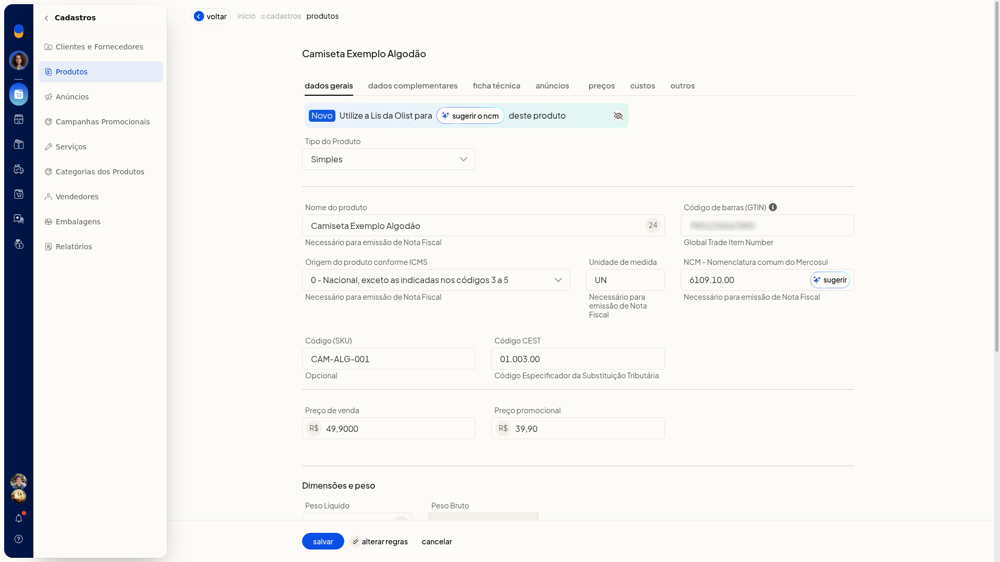
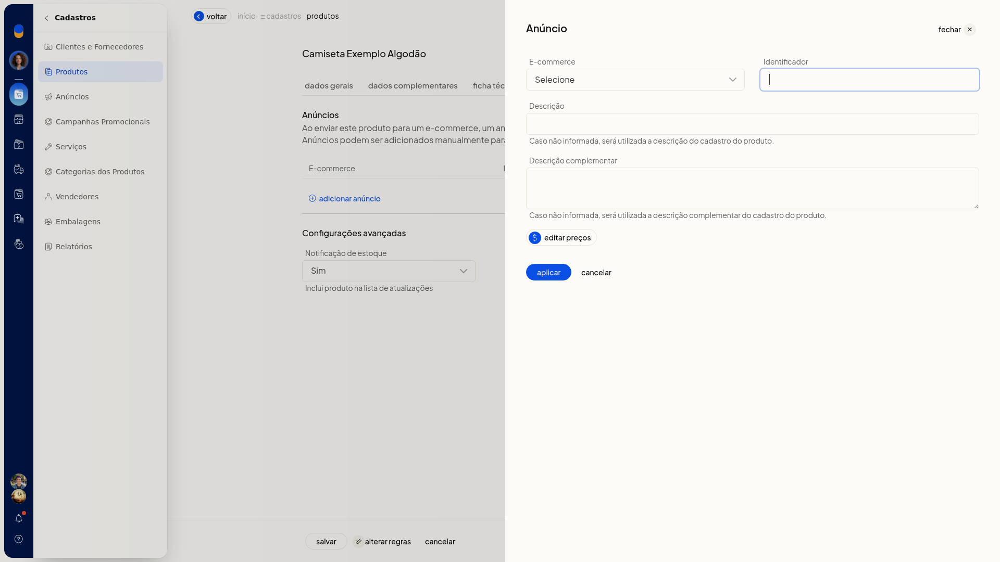
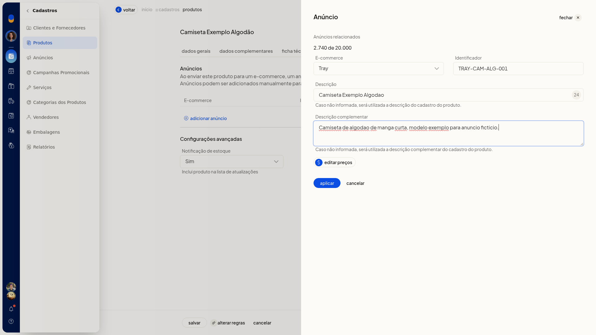
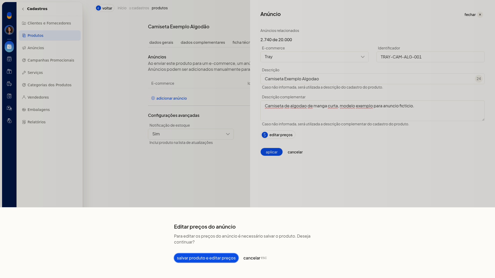
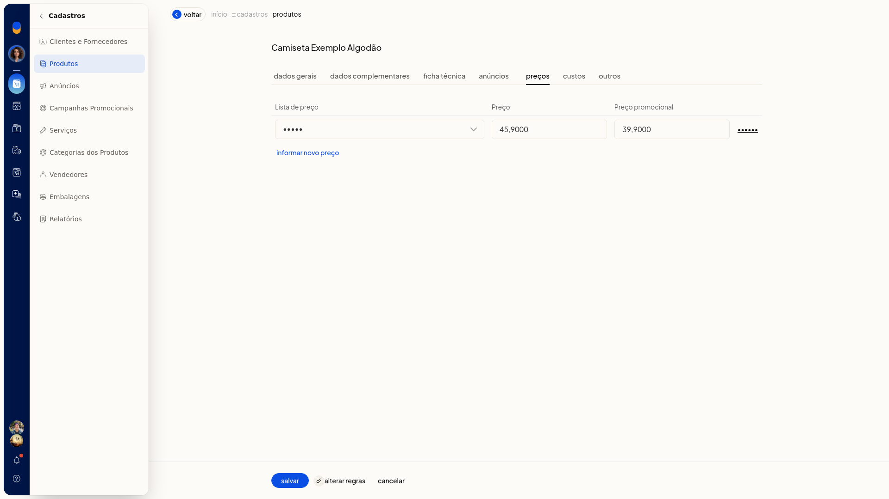

# Cadastrar um produto simples

No ERP da Olist, o cadastro de produto simples reúne numa única ficha os dados para identificar o item, emitir nota fiscal, anunciar, precificar e controlar estoque.

Você inclui um produto do tipo Simples e preenche as abas **Dados Gerais**, **Dados Complementares**, **Ficha técnica**, **Anúncios**, **Preços**, **Custos** e **Outros**. O mesmo cadastro também pode começar por planilha ou pela recepção de anúncios de um ecommerce já conectado.

## Importante
- Para usar o produto em nota fiscal, preencha **Nome do produto**, **Origem do produto conforme ICMS**, **Unidade de medida** e **NCM - Nomenclatura comum do Mercosul**. Na tela, esses campos exibem o texto Necessário para emissão de Nota Fiscal.
- **Código (SKU)** é opcional.
- Para lançar preço na aba **Preços**, a conta precisa ter ao menos uma lista de preço.
- Para vincular anúncio ou receber produtos do ecommerce, a conta precisa ter uma integração conectada.
- Com o produto ainda não salvo, editar os preços do anúncio não abre a edição. A tela pede para salvar o produto antes.
- Na importação, use planilha.xls,.xlsx ou.csv, de até 2 Mb e até 500 registros.

## Instruções
### Pela tela

1. Acesse **Cadastros > Produtos**.
2. Clique em **Incluir produto**.
3. Em **Dados Gerais**, selecione **Simples** em **Tipo do Produto**.
4. Preencha **Nome do produto**.
5. Para nota fiscal, preencha **Origem do produto conforme ICMS** (códigos 0 a 8), **Unidade de medida** e **NCM - Nomenclatura comum do Mercosul**. O NCM segue o formato 1001.10.10. Para pedir uma sugestão de NCM à Lis da Olist, use o aviso da ficha ou clique em **Sugerir**.
6. Preencha, se quiser, os demais campos de **Dados Gerais**:
 - **Código de barras (GTIN)**
 - **Código (SKU)**
 - **Código CEST**, no formato 01.003.00
 - **Preço de venda** e **Preço promocional**, em R$
 - **Peso Líquido** e **Peso da embalagem**, em kg
 - **Tipo da embalagem**: Envelope, Pacote / Caixa ou Rolo / Cilindro
 - **Embalagem**: embalagem customizada ou uma embalagem já cadastrada
 - **Largura**, **Altura** e **Comprimento**, em cm
 - **Controlar estoque**: Sim ou Não
 - **Estoque inicial (E-commerce)**, **Estoque mínimo** e **Estoque máximo**
 - **Sob encomenda**: Sim ou Não
 - **Controlar lotes**: Sim ou Não
 - **Localização**
 - **Dias para preparação**: dias corridos para disponibilizar o produto

   

7. Abra **Dados Complementares**.
8. Atribua a **Categoria** no seletor. O caminho fica em níveis. Para retirar a categoria, clique em **Remover**.
9. Informe, se quiser, **Marca**, **Tabela de medidas**, **Descrição complementar**, **Link do vídeo**, **Slug**, **Palavras-chave**, **Título para SEO** e **Descrição para SEO**.
10. Inclua imagens, se quiser. Para as tags, clique em **Editar tags**.
11. Abra **Ficha técnica**.
12. Informe **Atributo** e **Valor**. Use **sugerir atributos** ou **adicionar atributo** e clique em **Salvar** na linha.
13. Abra **Anúncios**.
14. Clique em **Adicionar anúncio**.

   

15. Selecione o **E-commerce** já conectado e preencha **Identificador**, **Descrição** e **Descrição complementar**. Se a descrição complementar do anúncio ficar em branco, o ERP usa a descrição complementar do cadastro do produto.

   

16. Em **Notificação de estoque**, selecione **Sim** ou **Não**. Sim inclui o produto na lista de atualizações.
17. Clique em **Aplicar**. Se clicar em **editar preços** antes de salvar o produto, a tela exibe o aviso Para editar os preços do anúncio é necessário salvar o produto. Use **salvar produto e editar preços** ou **cancelar**.

   

18. Abra **Preços**.
19. Escolha a **Lista de preço** já cadastrada e informe o preço e o preço promocional. Para lançar outro valor, use **informar novo preço** e clique em **Salvar** na linha.

   

20. Abra **Custos**.
21. Informe **A partir de** no formato DD/MM/AAAA, **Saldo atual**, **Saldo anterior**, **Impostos recuperáveis**, **Preço custo**, **Custo médio** e o preço de venda. Para lançar outro custo, use **informar novo preço de custo** e clique em **Salvar** na linha.
22. Abra **Outros** e preencha, se quiser:
 - **Unidade por caixa**, **Linha de produto**, **Garantia** e **Markup**
 - **Permitir inclusão nas vendas**: Sim ou Não
 - **GTIN/EAN tributável**, **Unidade tributável** e **Fator de conversão**
 - **Código de Enquadramento IPI** e **Valor do IPI fixo**
 - **Código do produto na ANP** e **EX TIPI**
 - **Alíq. específica de Imposto Seletivo**, **Qtd. tributada na monofasia** e **Qtd. tributada sujeita à retenção na monofasia**
 - **Nome do fornecedor** já cadastrado e **Código no Fornecedor**. Para incluir outro, clique em **adicionar fornecedor**
 - **Observações gerais sobre o produto**, de uso interno. Esse texto não é exibido para o cliente
23. Clique em **Salvar**.

### Por planilha

1. Acesse **Cadastros > Produtos**.
2. Abra **Mais ações** e clique em **Importar produtos de uma planilha**.
3. Baixe a planilha modelo. Se a planilha tiver outro layout, associe as colunas aos campos do ERP.
4. Preencha a planilha sem alterar os cabeçalhos e deixe em branco as células não usadas.
5. Preencha os campos obrigatórios **Descrição**, **Situação** (Ativo ou Inativo) e **Sob Encomenda** (Sim ou Não). Para nota fiscal, preencha **Unidade**, **NCM** com 8 dígitos e **Origem** de 0 a 8.
6. Use os termos padronizados, como Sim/Não e os códigos de origem. Em categorias, siga Nível 1 > Nível 2 > Nível 3. Em imagens, informe até 10 URLs diretas.jpg,.png,.webp ou.jpeg. As colunas 1 a 6 são armazenadas e as colunas 7 a 10 ficam externas.
7. Deixe o ID em branco para criar um produto novo. O cruzamento posterior é por SKU ou ID.
8. Envie a planilha em.xls,.xlsx ou.csv, com até 2 Mb e até 500 registros. Em seguida, valide o arquivo e confira a prévia **Todos**, **Novos**, **Atualizados** e **Com erros**. Itens com erro impedem a importação. Só um arquivo 100% correto é processado.

### Receber do e-commerce

1. Acesse **Cadastros > Produtos**.
2. Clique em **Receber do e-commerce**. O mesmo início também aparece em **Mais ações**, em **Receber produtos do e-commerce**.
3. Confira o consumo de anúncios da conta (quantidade usada, limite e restante) e selecione uma integração já conectada.
4. Clique em **Avançar** para seguir para a tela de novos anúncios.

## Resultado
Antes de salvar, os valores digitados permanecem ao trocar entre as sete abas. A categoria atribuída permanece no caminho escolhido, com **Remover**.

## Informações adicionais
Cancelar o painel de anúncio fecha o painel sem incluir a linha na tabela de anúncios.
