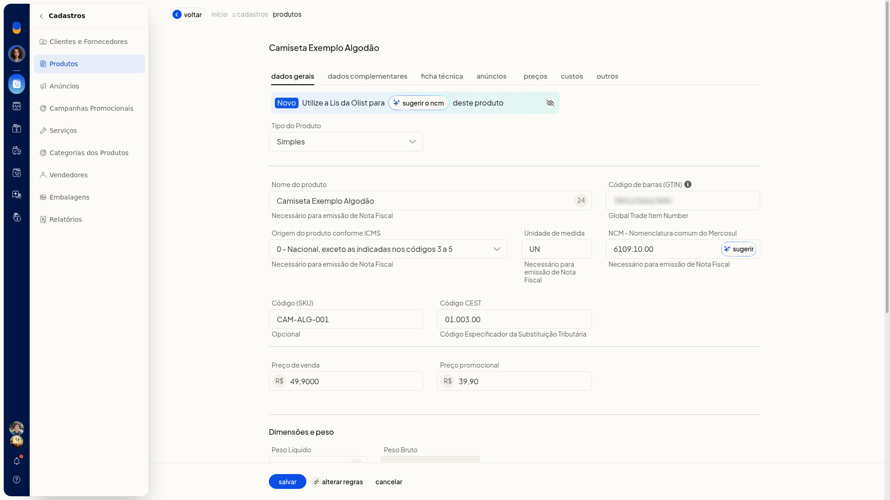
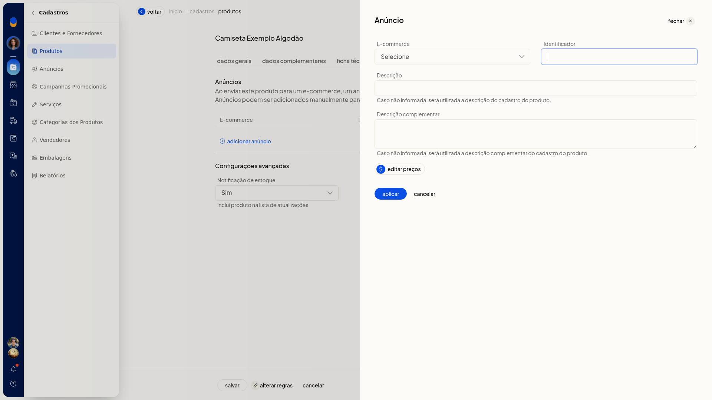
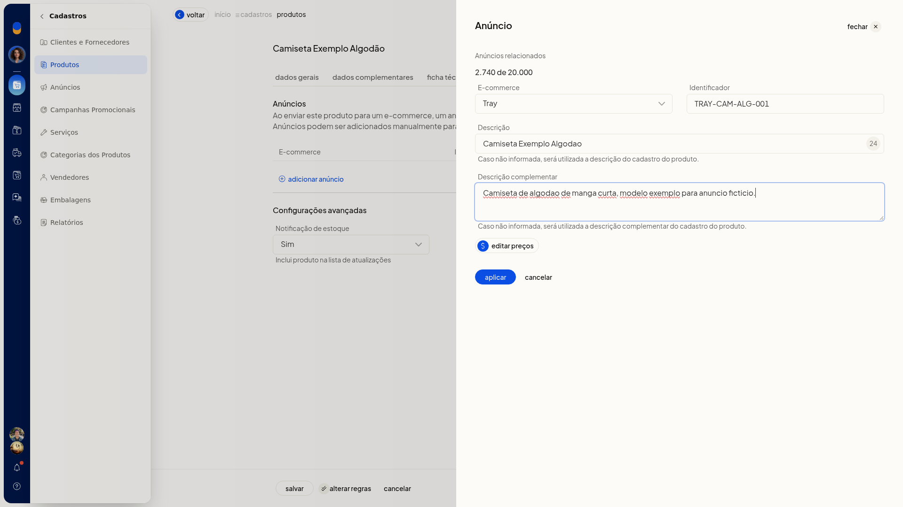
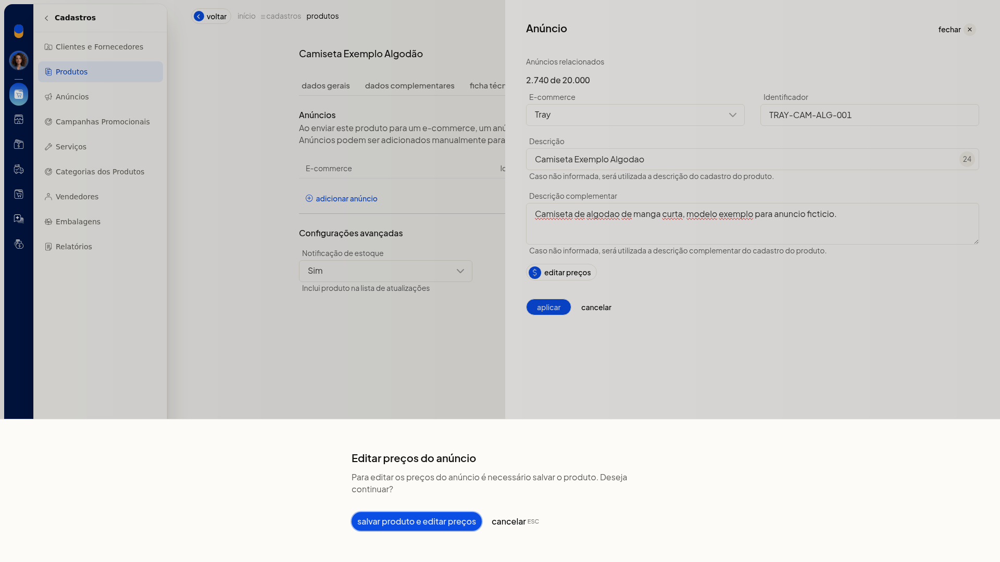
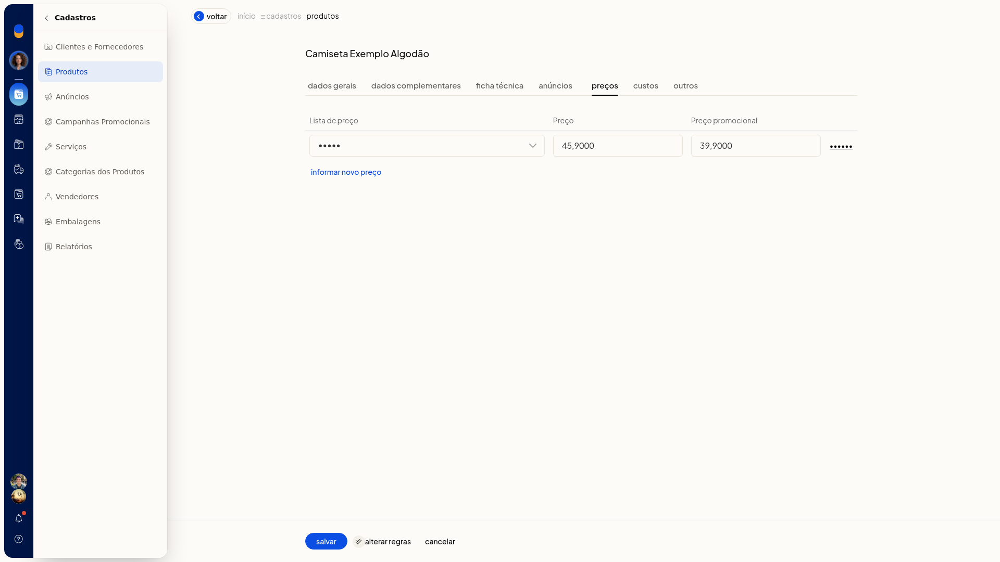

# Formas de cadastrar produtos

No ERP da Olist, o cadastro de produto simples reúne os dados para identificar o item, emitir nota fiscal, anunciar, precificar e controlar estoque. Você inclui o produto pela ficha, envia uma planilha ou recebe anúncios de um ecommerce já conectado.

## Importante
- Se a opção não aparecer para você, peça acesso ao administrador da conta.
- Para usar o produto em nota fiscal, preencha **Nome do produto**, **Origem do produto conforme ICMS**, **Unidade de medida** e **NCM**. Esses campos exibem **Necessário para emissão de Nota Fiscal**. Nenhum campo da ficha mostra asterisco.
- Para lançar preço na aba **Preços**, a conta precisa ter ao menos uma lista de preço.
- Para vincular anúncio ou receber produtos do ecommerce, a conta precisa ter uma integração conectada.
- Para editar os preços do anúncio, salve o produto antes.

## Instruções
### Pela tela

1. No menu lateral, acesse **Cadastros > Produtos**.
2. Clique em **Incluir produto**.
3. Em **Dados Gerais**, selecione **Tipo do Produto** **Simples**.
4. Preencha **Nome do produto**. Para nota fiscal, preencha também **Origem do produto conforme ICMS**, **Unidade de medida** e **NCM**. O **NCM** segue o formato do exemplo 1001.10.10. Use **Sugerir** ou o aviso **Novo** para pedir uma sugestão de NCM à Lis.
5. Preencha, se quiser, **Código de barras (GTIN)**, **Código (SKU)**, **Código CEST**, **Preço de venda**, **Preço promocional**, pesos, embalagem e os dados de estoque.

   

6. Abra **Dados Complementares**. Atribua a categoria, informe marca, descrição, SEO e imagens, se quiser. Clique em **Editar tags** para abrir **Configuração das tags do produto**.
7. Abra **Ficha técnica**. Informe **Atributo** e **Valor**, use sugerir atributos ou adicione outra linha.
8. Abra **Anúncios**. Clique em **Adicionar anúncio**, escolha o ecommerce conectado e informe **Identificador**, **Descrição** e **Descrição complementar**. Defina **Notificação de estoque** como **Sim** ou **Não**.

   

   

9. Para editar os preços do anúncio, salve o produto antes. A tela avisa **Para editar os preços do anúncio é necessário salvar o produto**, com **salvar produto e editar preços** e **cancelar**.

   

10. Abra **Preços**. Escolha uma lista de preço já cadastrada e informe preço e preço promocional.

   

11. Abra **Custos**. Informe a data em **A partir de**, saldos, impostos recuperáveis, preço de custo, custo médio e preço de venda.
12. Abra **Outros**. Informe unidade por caixa, garantia, markup, dados tributários, fornecedor e observações, se quiser.
13. Clique em **Salvar** na base da ficha. Antes de salvar, os valores digitados permanecem ao trocar entre as sete abas.

### Por planilha

1. Acesse **Cadastros > Produtos**.
2. Abra **Mais ações** e clique em **Importar produtos de uma planilha**.
3. Baixe a planilha modelo. Uma planilha de outro layout pode ter as colunas associadas aos campos do ERP.
4. Preencha a planilha sem alterar os cabeçalhos e deixe em branco as células não usadas.
5. Preencha **Descrição**, **Situação** (**Ativo** ou **Inativo**) e **Sob Encomenda** (**Sim** ou **Não**). Para nota fiscal, informe **Unidade**, **NCM** com 8 dígitos e **Origem** de 0 a 8.
6. Use termos padronizados, como **Sim**/**Não** e os códigos de origem. Categorias seguem Nível 1 > Nível 2 > Nível 3.
7. Em imagens, informe até 10 URLs diretas.jpg,.png,.webp ou.jpeg. As colunas 1 a 6 são armazenadas e as colunas 7 a 10 ficam externas.
8. Envie a planilha em.xls,.xlsx ou.csv, com até 2 Mb e até 500 registros. Depois do envio, valide o arquivo na prévia **Todos**, **Novos**, **Atualizados** e **Com erros**. Ícones vermelhos impedem a importação e só um arquivo 100% correto é processado.

### Por integração

1. Acesse **Cadastros > Produtos**.
2. Clique em **Receber do e-commerce**. O mesmo início está em **Mais ações** > **Receber produtos do e-commerce**.
3. Confira o consumo de anúncios da conta: quantidade usada, limite e restante.
4. Selecione uma integração já conectada.
5. Clique em **Avançar** para seguir para a tela de novos anúncios.

## Informações adicionais
- Na ficha, **Código (SKU)** é opcional.
- Na planilha, ID em branco cria produto novo. O cruzamento posterior é por SKU ou ID.
- Para variações pela planilha, o código SKU precisa estar como Manual em **Início > Configurações > Cadastros > Configurações do cadastro de produtos**. Isso não é exigido para o produto simples pela tela.
- Na planilha de variações, o produto pai usa Tipo V, sem estoque próprio. Os filhos usam SKU próprio e Tipo S, K, F ou M, nunca V. **Código do Pai** recebe o SKU do pai e os atributos usam o formato Nome:Valor||Nome:Valor.
- Kit usa Tipo K nesta planilha. A composição vai em uma segunda planilha.
- Se a descrição complementar do anúncio não for informada, o ERP usa a descrição complementar do cadastro do produto.
- **Observações gerais sobre o produto** são de uso interno e não são exibidas para o cliente.
