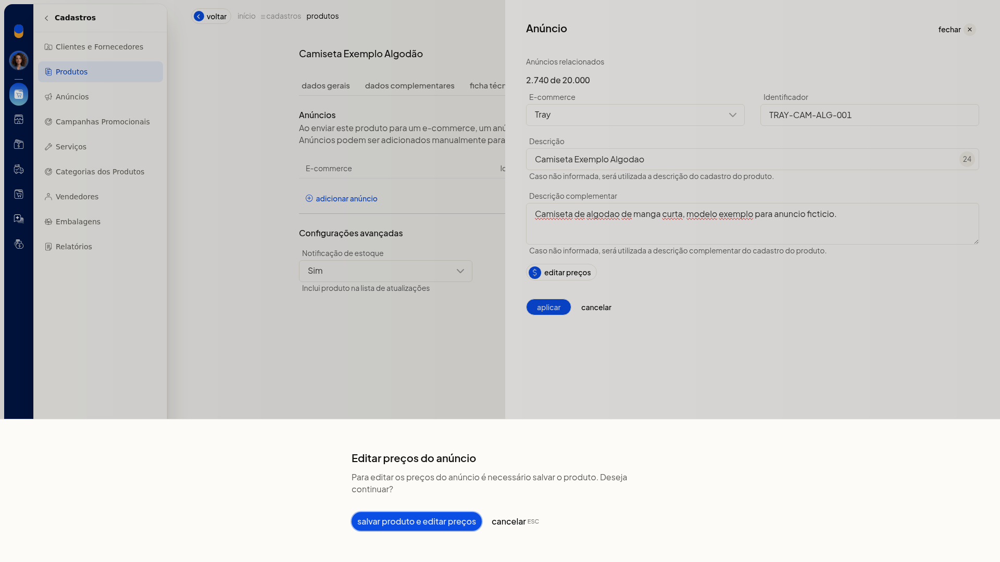
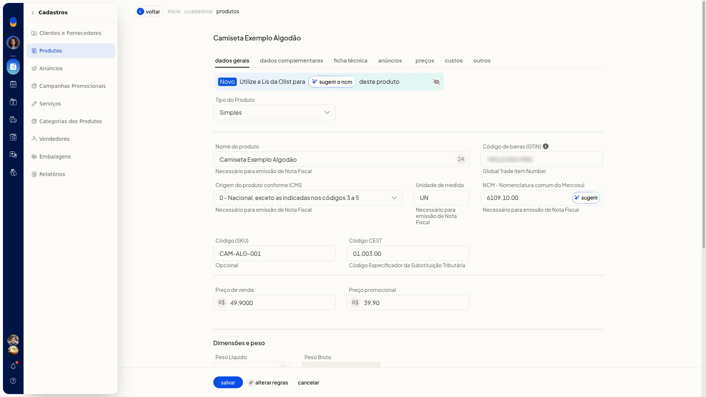
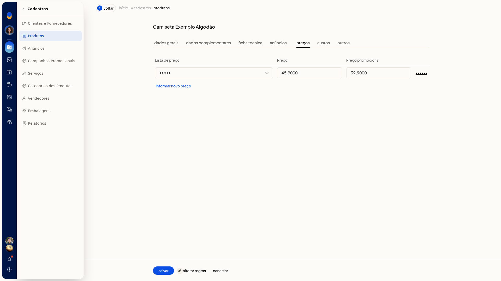

# Produto: preços e custos

Na ficha do produto no ERP da Olist, você informa o preço de venda, o preço promocional, os valores de uma lista de preço e o lançamento de custo. Com isso, o item fica precificado e o custo fica registrado com data, saldos e preço de custo.

Os preços de venda também aparecem na aba **Dados Gerais**. A lista de preço fica na aba **Preços** e o lançamento de custo, na aba **Custos**.

## Pré-requisitos
- Para lançar preço na aba **Preços**, a conta precisa ter ao menos uma lista de preço. O seletor mostra as listas já cadastradas.
- Se a opção não aparecer para você, peça acesso ao administrador da conta.

## Importante
- Nenhum campo da ficha exibe asterisco.
- Com o produto ainda não salvo, **Editar preços** do anúncio não abre a edição. A tela informa que é necessário salvar o produto e oferece **salvar produto e editar preços** e **cancelar**.

## Instruções
1. Acesse **Cadastros > Produtos**.
2. Clique em **Incluir produto**.
3. Em **Dados Gerais**, informe **Preço de venda** e, se quiser, **Preço promocional**. Use valores em R$.

   

4. Abra a aba **Preços**.
5. Selecione uma lista de preço já cadastrada.
6. Informe o preço e o preço promocional da lista. Para outro lançamento, use **Informar novo preço** e salve a linha.

   

7. Abra a aba **Custos**.
8. Informe **A partir de** (data em DD/MM/AAAA), **Saldo atual**, **Saldo anterior**, **Impostos recuperáveis**, **Preço custo**, **Custo médio** e **Preço de venda**. Para outro lançamento, use **Informar novo preço de custo** e salve a linha.
9. Clique em **Salvar**, na base da ficha, para gravar o produto com os preços e os custos informados.

## Resultado
Antes de salvar, os valores digitados permanecem ao trocar de aba.

## Informações adicionais
- Na aba **Outros**, o campo **Markup** recebe o índice de markup do produto.
