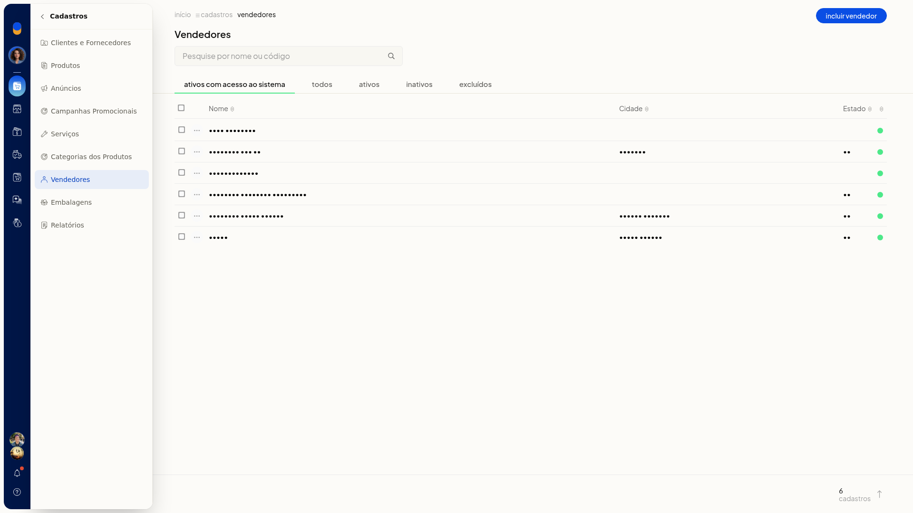
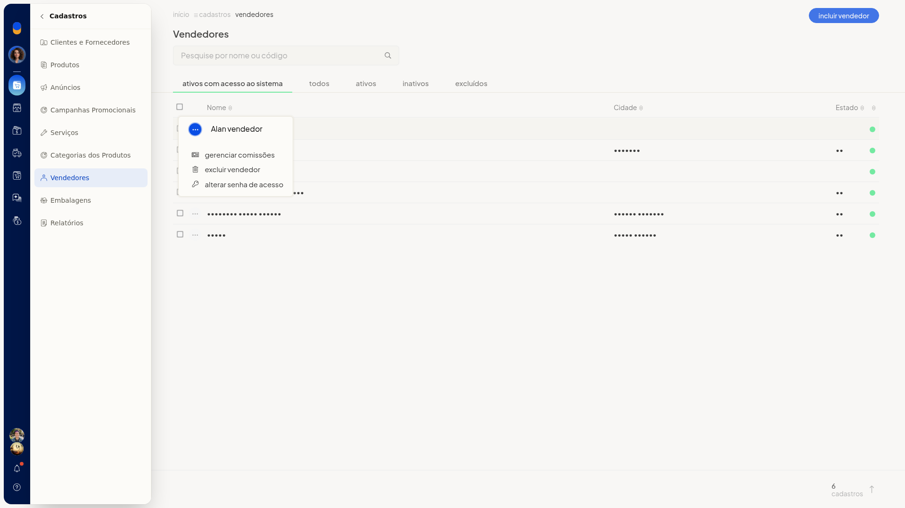

# Alterar a senha de acesso de um vendedor

No ERP da Olist, o vendedor pode ter acesso ao sistema. Você altera a senha desse acesso na lista de vendedores, pela ação **Alterar senha de acesso** da linha do cadastro.

## Instruções
1. Acesse **Cadastros > Vendedores**.
A lista abre na aba **ativos com acesso ao sistema**.

2. Localize o vendedor em **Pesquise por nome ou código** ou nas abas **ativos com acesso ao sistema**, **todos**, **ativos**, **inativos** e **excluídos**.
3. Abra o menu de contexto da linha do vendedor.

   

4. Clique em **Alterar senha de acesso**.
