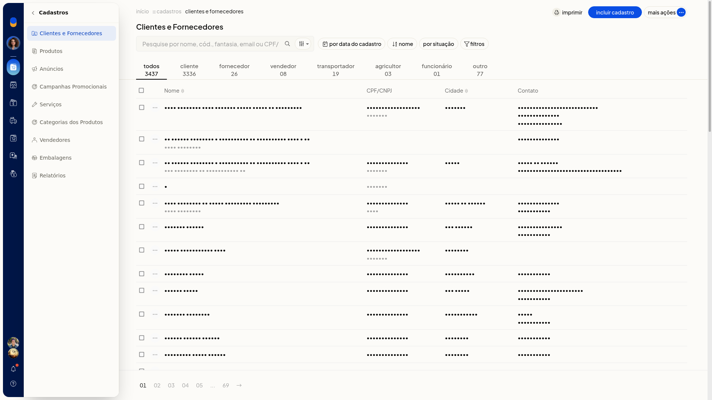
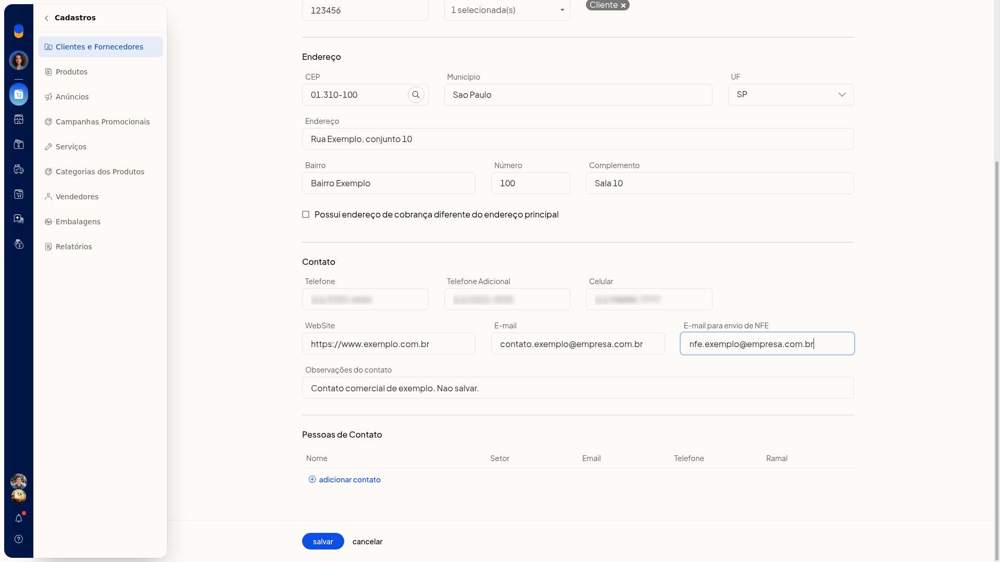
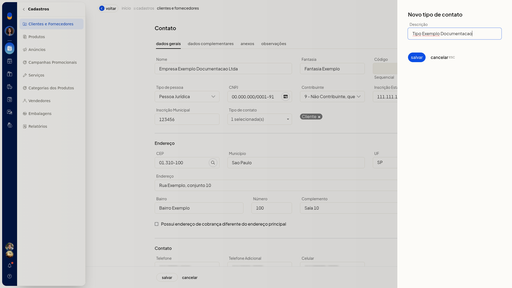
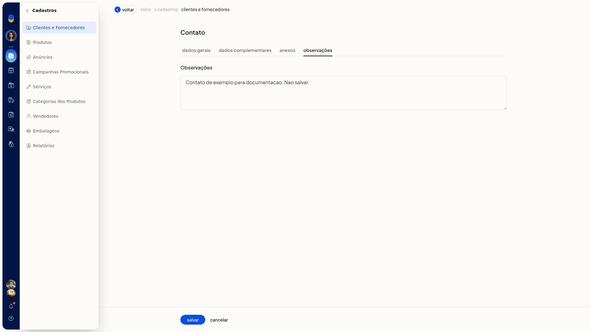
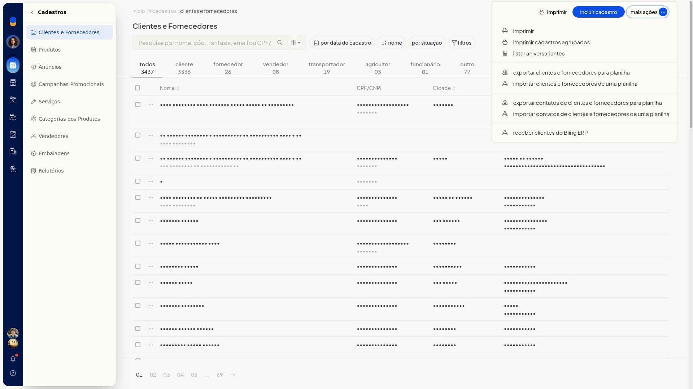
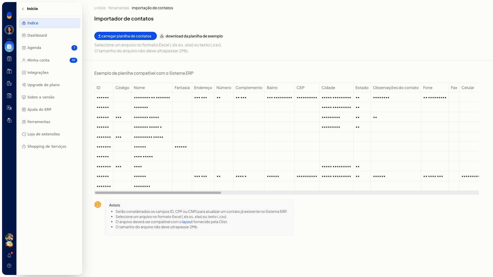
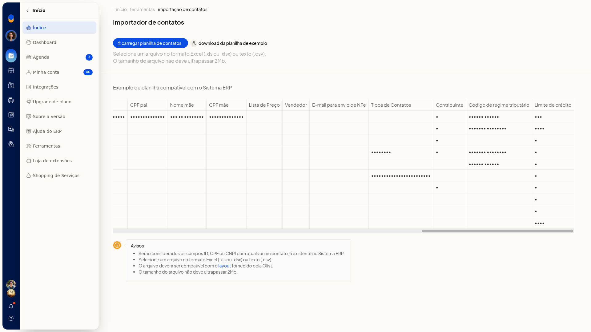
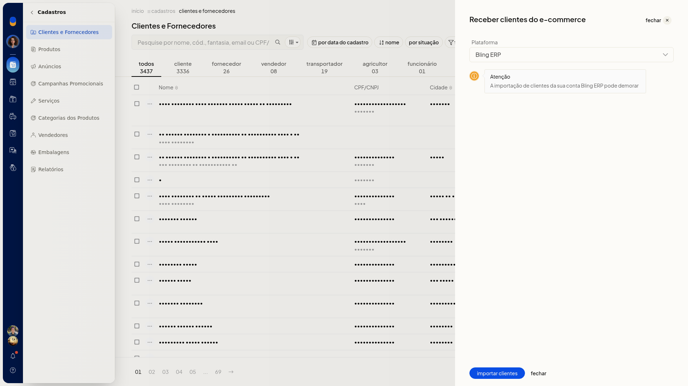

# Clientes, fornecedores e transportadoras

No ERP da Olist, **Clientes e Fornecedores** reúne as pessoas e empresas com as quais a loja se relaciona. Você consulta, inclui e importa contatos nos perfis cliente, fornecedor, transportador e outros.

O cadastro pode ser feito pela tela, por planilha ou recebendo clientes de uma integração Bling ERP.

## Pré-requisitos
- Para importar por planilha, tenha um arquivo Excel ou CSV de até 2 Mb no layout da planilha de exemplo do **Importador de contatos**.
- Para receber clientes do ecommerce, a integração precisa aparecer no seletor **Plataforma**.

## Importante
- Na planilha, **ID** ou **CPF/CNPJ** atualizam um contato já existente.
- A importação de clientes da conta Bling ERP pode demorar.
- Tipos personalizados, criados em **Tipos de contato**, passam a aparecer nas abas da lista.

## Instruções
### Pela tela

1. Acesse **Cadastros > Clientes e Fornecedores**.

   

2. Clique em **incluir cadastro**.
3. Preencha as seções **Dados Gerais**, tipos de contato, **Dados Complementares**, **Anexos** e **Observações**. Em tipos de contato, você pode abrir **Novo tipo de contato**.

   

   

   

4. Clique em **salvar** para gravar o contato. **Cancelar** fecha o formulário e volta à lista sem incluir o contato.

### Por planilha

1. Em **Clientes e Fornecedores**, clique em **Mais ações**.

   

2. Clique em **importar clientes e fornecedores de uma planilha**.

   

3. Baixe a planilha de exemplo e preencha o arquivo no layout Olist.
4. Use as colunas do exemplo:
 - **ID**
 - **Código**
 - **Nome**
 - **Fantasia**
 - **Endereço**
 - **Número**
 - **Complemento**
 - **Bairro**
 - **CEP**
 - **Cidade**
 - **Estado**
 - **Observações do contato**
 - **Fone**
 - **Fax**
 - **Celular**
 - **E-mail**
 - **Web Site**
 - **Tipo pessoa**
 - **CNPJ / CPF**
 - **IE / RG**
 - **IE isento**
 - **Situação**
 - **Observações**
 - **Estado civil**
 - **Profissão**
 - **Sexo**
 - **Data nascimento**
 - **Naturalidade**
 - **Nome pai**
 - **CPF pai**
 - **Nome mãe**
 - **CPF mãe**
 - **Lista de Preço**
 - **Vendedor**
 - **E-mail para envio de NFe**
 - **Tipos de Contatos**
 - **Contribuinte**
 - **Código de regime tributário**
 - **Limite de crédito**

   

5. Em **Tipos de Contatos**, separe os rótulos por barra vertical.
6. Clique em **carregar planilha de contatos** para efetivar a importação. Com **ID** ou **CPF/CNPJ** de um contato já existente, o ERP atualiza esse contato.

### Receber clientes do Bling ERP

1. Em **Clientes e Fornecedores**, clique em **Mais ações**.
2. Clique em **receber clientes do Bling ERP**.
3. Em **Plataforma**, selecione **Bling ERP**. Leia o aviso **Atenção**: a importação de clientes da sua conta Bling ERP pode demorar.

   

4. Clique em **importar clientes** para iniciar a importação. **fechar** dispensa o painel sem importar.

## Resultado
A lista de **Clientes e Fornecedores** exibe a pesquisa, os filtros, as abas com totais e as colunas **Nome**, **CPF/CNPJ** e **Cidade**.

## Informações adicionais
### Consulta na lista

Pesquise por nome, código, fantasia, email ou CPF/CNPJ. Filtre por data do cadastro, nome, situação e filtros. As abas separam **Todos**, **Cliente**, **Fornecedor**, **Vendedor**, **Transportador**, **Agricultor**, **Funcionário** e **Outro**.

### Outras ações em Mais ações

No mesmo menu há **imprimir**, **imprimir cadastros agrupados**, **listar aniversariantes**, **exportar clientes e fornecedores para planilha**, **exportar contatos** e **importar contatos de uma planilha**.
