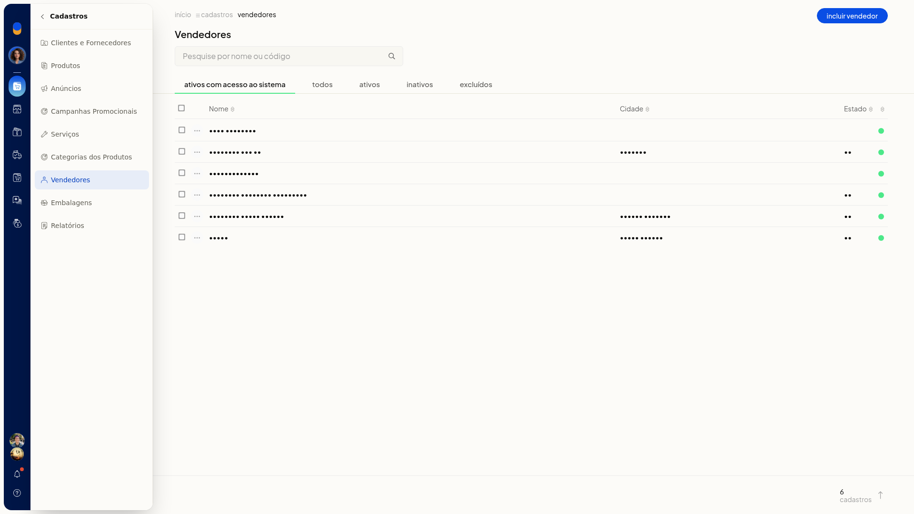
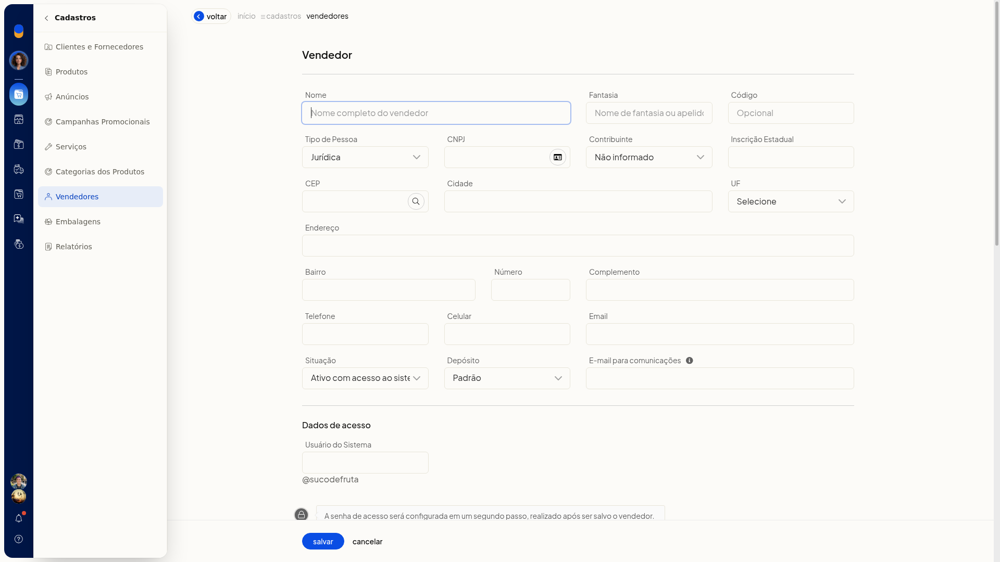
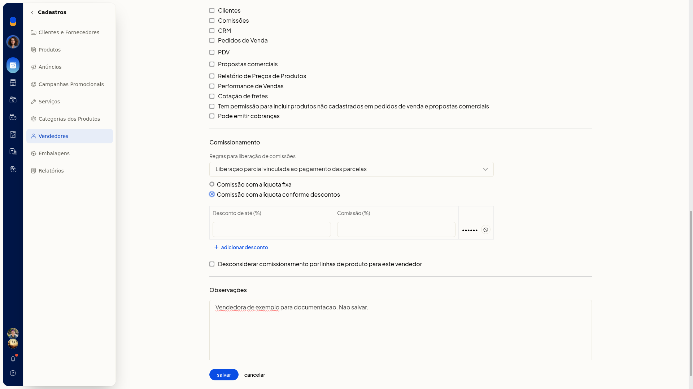

# Definir a comissão do vendedor por faixas de desconto

No ERP da Olist, a comissão do vendedor pode deixar de ser uma alíquota fixa e passar a variar conforme o desconto. Você informa até qual percentual de desconto vale cada comissão e pode adicionar outra faixa.

O ajuste fica no cadastro do vendedor, em **Cadastros > Vendedores**.

## Importante
- O padrão de **Comissionamento** é **Comissão com alíquota fixa**. Para usar faixas, selecione **Comissão com alíquota conforme descontos**.

## Instruções
1. Acesse **Cadastros > Vendedores**.

   

2. Clique em **incluir vendedor**.

   

3. Em **Comissionamento**, selecione **Comissão com alíquota conforme descontos**.

   

4. Preencha **Desconto de até (%)** e **Comissão (%)**. Esses campos não são obrigatórios.

5. Clique em **Adicionar desconto** para incluir outra faixa.

6. Clique em **salvar**. A senha de acesso é uma etapa seguinte ao salvamento.

## Informações adicionais
- A opção **Desconsiderar comissionamento por linhas de produto para este vendedor** só aparece se a empresa usa linhas de produto.
