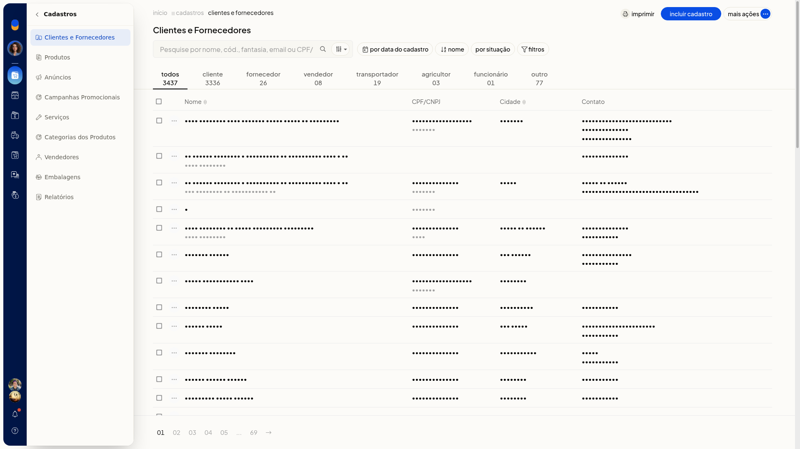
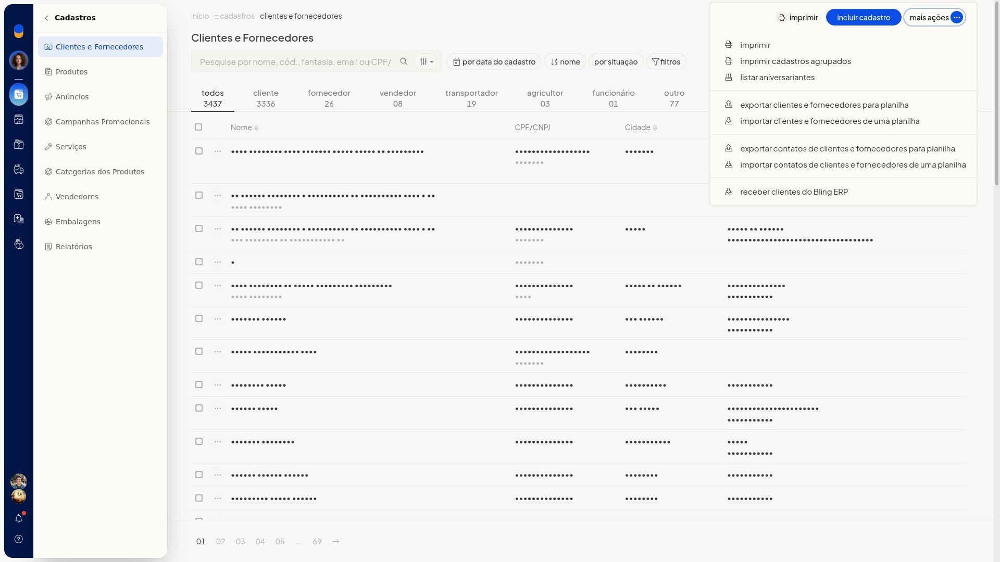

# Exportar clientes e fornecedores para planilha

## Instruções
1. Acesse **Cadastros > Clientes e Fornecedores**.

   

2. Clique em **Mais ações**.

   

3. Clique em **exportar clientes e fornecedores para planilha**.

## Informações adicionais
- No mesmo menu **Mais ações** existe a opção **exportar contatos**, separada de **exportar clientes e fornecedores para planilha**.
